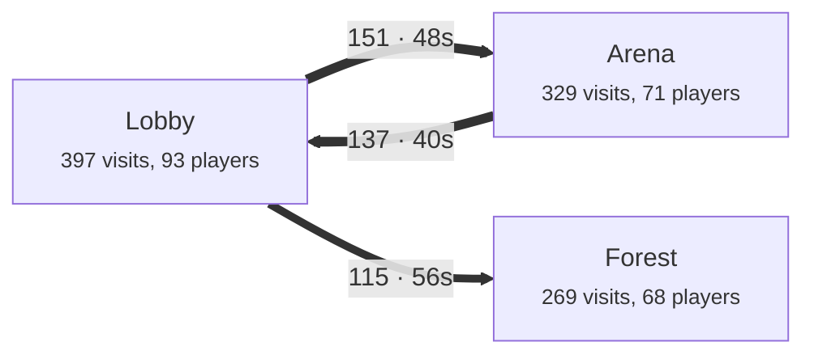

# @typetorch/backend

The TypeTorch backend: one server for everything a game's TypeTorch needs from the outside:

- the **fleet API** (SQLite): live game-server status, deploy reports, alerts;
- **analytics** on **DuckDB** (your own server) or **Cloudflare Basin**: the shared row format, the stores, the logical
  queries, the server for a 1 GB VPS;
- **error logs**: game servers post error kinds (names and ids already replaced), the backend counts them per minute;
- an in-process **event bus** between them, and a live stream of it (`GET /v1/live`);
- the **web explorer** (`web/`), served at `/`, with login (the admin token, or Sign in with Roblox for owners; a read-only **web** role for Roblox viewers);
- a small programmatic API for the CLI: `createStore`, `store.query`, `writeBackendSettings` (through the game's TypeTorch
  CLI), `createFleetClient`, `graph.toMermaid()`.

Two keys, nothing else to remember: game servers write with **`TYPETORCH_API_KEY`**; the CLI and the explorer read and
manage with **`TYPETORCH_ADMIN_TOKEN`**. Runs on Bun and on Node 20+ (the fleet part needs Node 22.5+ for `node:sqlite`,
or Bun). Ships as one Docker image that works as a Coolify app. It is not published to npm (`"private": true`): run it from
a checkout or the image.

CLI commands below are written `typetorch ...`; the CLI (0.11+) also installs the short alias `tt`, so `tt backend setup`
is the same command.

## Contents

- [Quick start (local)](#quick-start-local)
- [Settings](#settings)
- [Runtime settings (the Settings page)](#runtime-settings-the-settings-page)
- [Backend alerts](#backend-alerts) (alerts from the backend's own data: errors, players online, ingest, its health, disk)
- [Security](#security) ([Mobile app](#mobile-app) tokens)
- [Routes and roles](#routes-and-roles) ([API docs for agents](#api-docs-for-agents): OpenAPI, Swagger UI, llms.txt)
- [Deploy on Coolify](#deploy-on-coolify)
- [Audit log](#audit-log)
- [Backups and restore](#backups-and-restore) ([Disk space](#disk-space))
- [Move to another server](#move-to-another-server) (the export API, the migration job, the runbook; [to Basin and back](#move-analytics-to-basin-and-back))
- [Several ingest servers (optional)](#several-ingest-servers-optional) (past one core of ingest: ingest nodes, a queue bucket, one DuckDB)
- [The event bus](#the-event-bus)
- [Error logs](#error-logs)
- [The explorer](#the-explorer)
- [Row format](#row-format)
- [Programmatic API](#programmatic-api)
- [Queries](#queries) (with example output)
- [Cloudflare Basin setup](#cloudflare-basin-setup)
- [The analytics part (DuckDB)](#the-analytics-part-duckdb)
- [The fleet API (SQLite)](#the-fleet-api-sqlite) ([game server addresses and locations](#game-server-addresses-and-locations))
- [Remote debug](#remote-debug) (read a live game server from the explorer; [debug bundles and offline history](#debug-bundles-and-offline-history); [Roblox server logs](#roblox-server-logs))
- [Experience notifications](#experience-notifications) (intents from the game, the planner, the sender, signed launch data)
- [Live events](#live-events) (scheduled live value changes, signed by the CLI; each event's lift report)
- [Maps](#maps) (map geometry exported from the place, no Studio: the 2D minimap and the 3D map, with textures)
  - [Images and animation clips](#images-and-animation-clips) (Roblox images and KeyframeSequences for textured maps and replays)
- [Privacy](#privacy)
- [Run it on a VPS without Docker](#run-it-on-a-vps-without-docker)
- [Load tests](#load-tests)
- [Development](#development)
- [Open issues](#open-issues)

## Quick start (local)

The test place without Coolify: the backend on this PC, a Cloudflare quick tunnel so game servers can reach it, and the
game's settings written for you.

1. In the **game repo's `.env`** (gitignored) set two random values, 32+ characters each and different
   (`openssl rand -hex 32` makes one):

   ```
   TYPETORCH_API_KEY=<random>
   TYPETORCH_ADMIN_TOKEN=<random>
   ```

   For Sign in with Roblox add the OAuth app's `ROBLOX_OAUTH_CLIENT_ID` and `ROBLOX_OAUTH_CLIENT_SECRET` (see
   [Sign in with Roblox](#sign-in-with-roblox)); without them that button is simply off.
2. Build the explorer once: `bun run web:install && bun run web:build`.
3. Run it, pointing at the game repo:

   ```sh
   bun install
   bun run local -- --game ../template
   ```

   It reads the keys from that `.env` (a missing one stops with a red error that says what to add), keeps its data in this
   repo's `data/`, serves the explorer at <http://localhost:8787> (sign in with the admin token), opens the tunnel, and
   writes the game's settings through the game's own CLI (`typetorch backend setup`, which signs with the game's keys:
   `typetorch keys init` first). `--port`, `--public-url`, `--no-settings`, `--cli <entry>`
   and `--cloudflared <path>` exist. Ctrl+C stops the tunnel and the server it started. Without `--game` it still runs but
   says in red that game servers were NOT told about it.

   **The tunnel is public.** Game servers must reach `/v1/ingest` and the fleet routes through it, so the explorer and its
   admin login come along on the `trycloudflare.com` address (hard to guess, a 32+ character token, the 5-failure lockout).
   Fine for a test place; for a tunnel that stays up for days set `TYPETORCH_TOKEN_LOGIN=off` in the game's `.env` and sign
   in with Roblox (the CLI's Bearer token still works), or `TYPETORCH_ADMIN_ALLOW_IPS=<this PC's public address>`.
   (`bun run local` does not switch the token login off by itself.)

From the game repo instead, `typetorch backend run` (CLI) does the same with a checkout of this repo: it starts the
server with the game's two keys, opens a quick tunnel, re-runs `backend setup` whenever the tunnel's address changes, and
restarts either when it drops (`typetorch init` can register it as a login task; `--backend-dir`, `--port`, `--cloudflared`).

Working on the explorer itself: `bun run web:dev` is `vite dev` in `web/`; pass `--game <repo>` (see
[The explorer](#the-explorer)).

## Settings

Everything is an environment variable (a Docker/Coolify env, a systemd `EnvironmentFile`, or `--env-file <file>` /
`TYPETORCH_ENV_FILE` for a local file; real variables win over the file). Values are never printed; the startup line and
`/healthz` only say whether something is set. The server **refuses to start** without the two required values.

A few of them (the alert webhook, the admin allow list, the token login, the rate limits and retention numbers) can also be
changed on the explorer's **Settings page** without a redeploy: the environment gives the defaults, a value saved there wins.
See [Runtime settings](#runtime-settings-the-settings-page).

| Variable | Required | What |
|---|---|---|
| `TYPETORCH_API_KEY` | yes | The game role: game servers write events, heartbeats, deploy reports, alerts and error logs with it. 32+ characters. It reads nothing. |
| `TYPETORCH_ADMIN_TOKEN` | yes | The admin role: the CLI (Bearer) and the explorer's token login read and manage with it. 32+ characters, **different** from the API key. |
| `TYPETORCH_WEB_VIEWERS` | no | Comma-separated Roblox UserIds who may **Sign in with Roblox** as read-only viewers (the **web** role: they see everything, change nothing). Owners (the access list) are admins regardless. Also settable on the Settings page. See [Read-only access](#read-only-access-the-web-role). |
| `TYPETORCH_LOOKUP_TOKEN` | no | A narrow token for scripts and LLM agents: it reaches `GET /v1/identity/resolve` (pid <-> UserId) and nothing else. 32+ characters, different from the API key and the admin token. Unset = that route takes the admin role only. See [The lookup token](#the-lookup-token-for-scripts-and-llm-agents). |
| `TYPETORCH_API_KEY_PREVIOUS` | no | Also accepted as a game key, for a rotation without downtime: put the old key here, update the games, remove it. The server prints a reminder at every start while it is set. |
| `TYPETORCH_DATA_DIR` | no | Where the data lives. `/data` in Docker, `./data` otherwise. |
| `PORT`, `HOST` | no | Listen address (8787; `127.0.0.1`, `0.0.0.0` in Docker). |
| `TYPETORCH_PUBLIC_URL` | no | The public https address, no trailing slash. Used for the Roblox sign-in redirect, `Secure` cookies and origin checks. |
| `TYPETORCH_TRUST_PROXY` | no | `1` when one proxy sits in front (Coolify, Caddy): client addresses come from `X-Forwarded-For`. A number counts the proxies (`2` = two hops). Off by default. **Only the proxy may reach the port** then, or any client can choose its address (see [Security](#security)). |
| `TYPETORCH_TRUSTED_PROXIES` | no | Addresses and CIDR ranges of the proxies. When set, `X-Forwarded-For` is only read when the TCP peer is one of them (a client that reaches port 8787 directly is taken at its own address). E.g. the Docker network's range on Coolify. |
| `TYPETORCH_CLOUDFLARE` | no | `on` when Cloudflare's proxy (orange cloud) sits in front: an address inside Cloudflare's ranges is replaced by the `CF-Connecting-IP` header. `TYPETORCH_CLOUDFLARE_IPS` replaces the built-in list of ranges. See "Behind Cloudflare" under [Security](#security). |
| `TYPETORCH_ADMIN_ALLOW_IPS` | no | Comma-separated addresses and CIDR ranges. When set, admin routes, the explorer and the login answer 404 to every other address. Game routes stay open. |
| `TYPETORCH_TOKEN_LOGIN` | no | `off` hides and refuses the admin-token login in the browser (the CLI's Bearer token still works). Default `on`. |
| `ROBLOX_OAUTH_CLIENT_ID`, `ROBLOX_OAUTH_CLIENT_SECRET` | no | Sign in with Roblox (both, plus `TYPETORCH_PUBLIC_URL`). The secret is never logged. |
| `TYPETORCH_CENTRAL_LOGIN` | no | [Sign in with typetorch.dev](#sign-in-with-typetorchdev). **On by default**; it only turns on with `TYPETORCH_PUBLIC_URL` over https (or http on loopback), otherwise it stays off with a warning and the backend starts as usual (nothing Roblox-specific is needed: the broker publishes TypeTorch's Roblox client id). `off` turns it off: no button, no dashboard link, every route of it answers 404, no instance key is made and no report is sent. |
| `TYPETORCH_CENTRAL_LOGIN_ISSUER` | no | The broker's origin (default `https://dash.typetorch.dev`; plain `http` only on `localhost` / `127.0.0.1`, for a local broker). |
| `TYPETORCH_CENTRAL_LOGIN_UNBLESSED` | no | What an owner gets on a browser that was never trusted: `admin` (full admin, the default), `web` (read-only until the browser is trusted) or `refuse` (no session). See the trade-off under [Sign in with typetorch.dev](#sign-in-with-typetorchdev). |
| `TYPETORCH_CENTRAL_LOGIN_KIDS` | no | Comma-separated broker key ids to pin: an assertion signed by any other key is refused even if the broker publishes it. |
| `TYPETORCH_CENTRAL_LOGIN_LABEL` | no | The name the origin report gives typetorch.dev (64 characters; default the public URL's host). |
| `TYPETORCH_ROBLOX_BROKER_CLIENT_ID` | no | Not needed: the backend reads TypeTorch's Roblox OAuth client id (the audience of the Roblox ID token the broker passes on) from `<issuer>/.well-known/typetorch-login`. Set, this and `TYPETORCH_ROBLOX_BROKER_DISCOVERY` are **pins**: they are used, and a published value that differs refuses every typetorch.dev login (logged once). |
| `TYPETORCH_ROBLOX_BROKER_DISCOVERY` | no | Not needed: Roblox's discovery document is always pinned, by default to Roblox's own (`https://apis.roblox.com/oauth/.well-known/openid-configuration`), so the broker can never choose whose keys sign the Roblox ID token; a broker publishing another URL refuses every typetorch.dev login (logged once). Set it only to trust another discovery URL (a fake Roblox). A local (loopback) issuer may publish its own without a pin. |
| `ROBLOX_WEBHOOK_SECRET` | no | The secret on Roblox's "Right to erasure" webhook. |
| `OPENCLOUD_API_KEY` | no | An Open Cloud key with `universe-datastores.objects:read` (and `:list` for backfill, `:delete` with `TYPETORCH_ERASURE_DELETE_LINK=1`) for erasure and the identity backfill.; with `universe-messaging-service:publish` on the game's universe (and `TYPETORCH_UNIVERSE_ID`) it also sends remote debug's [instant wake](#instant-wake); with `universe:read` (and `TYPETORCH_UNIVERSE_ID`) the explorer shows Roblox's [server logs](#roblox-server-logs) per JobId; with `universe.analytics:read` (and `TYPETORCH_UNIVERSE_ID`) the Roblox page shows Roblox's own [play-through rate and impressions](#roblox-acquisition-numbers); with `universe.place.luau-execution-session:read` and `:write` the Maps page exports maps from the place, and with `asset:read` it says when an export is out of date; with `universe-datastores.objects:read` the Live events page checks what servers have. One table per feature: [Open Cloud key scopes](https://www.typetorch.dev/guides/backend-operations#open-cloud-key-scopes) |
| `TYPETORCH_UNIVERSE_ID` | no | The game's universe id (erasure ignores other games' requests; the instant wake publishes to it). |
| `TYPETORCH_ALERT_WEBHOOK_URL` | no | A Discord, Slack or JSON webhook for critical alerts (https; the server won't start with another scheme). Also settable on the Settings page. |

<details><summary>Advanced (defaults suit a 1 GB machine)</summary>

| Variable | Default | What |
|---|---|---|
| `TYPETORCH_PARTS` | `analytics,fleet` | Which parts run. A game on Basin runs `fleet` only. Error logs are always on. |
| `TYPETORCH_MEMORY_LIMIT`, `TYPETORCH_THREADS` | `400MB`, `2` | DuckDB's memory cap and threads. |
| `TYPETORCH_LOAD_SECONDS` | `5` | Seconds between loader ticks (raw files into DuckDB). |
| `TYPETORCH_KEEP_DAYS`, `TYPETORCH_RAW_KEEP_DAYS` | `400`, `14` | Days of day files and of raw archives kept. |
| `TYPETORCH_COMPACT_MB` | `256` | Rewrite `live.duckdb` after the nightly export when it passes this. |
| `TYPETORCH_QUERY_TIMEOUT`, `TYPETORCH_QUERY_CONCURRENCY` | `60`, `2` | Query timeout (s) and queries at once. |
| `TYPETORCH_SQL`, `TYPETORCH_SQL_MEMORY` | `1`, `256MB` | Ad-hoc SQL on/off and its sandbox's memory. |
| `TYPETORCH_FSYNC_MS` | `1000` | fdatasync interval of the raw files (0 = every write). |
| `TYPETORCH_HANDOVER_SECONDS` | `600` | Rolling deploys: how long a new server waits for the old one to let go of DuckDB before it gives up and exits 1 (see [Deploys on Coolify](#deploys-on-coolify-rolling-updates)). |
| `TYPETORCH_MAX_BODY`, `TYPETORCH_MAX_INFLATE` | 2 MB, 16 MB | Ingest body caps (gzip, inflated). |
| `TYPETORCH_IP_PER_MINUTE`, `TYPETORCH_JOB_PER_MINUTE` | `6000`, `60` | Ingest rate limits per address and per JobId. |
| `TYPETORCH_BUSY_BYTES`, `TYPETORCH_BUSY_REQUESTS` | 512 MB, `256` | [The busy 503](#limits-and-the-busy-503): ingest answers `503` + `Retry-After` while `raw/incoming` holds more than this many bytes, or more than this many ingest requests are in flight (`0` = off). Also on the Settings page. |
| `TYPETORCH_ROLE` | `all` | [Several ingest servers](#several-ingest-servers-optional) (optional): `all` is one server with everything (no bucket); `main` also loads the ingest nodes' files from the queue bucket; `ingest` only takes game batches and writes them to the bucket. |
| `TYPETORCH_QUEUE_BUCKET`, `TYPETORCH_QUEUE_ENDPOINT`, `TYPETORCH_QUEUE_ACCESS_KEY_ID`, `TYPETORCH_QUEUE_SECRET_ACCESS_KEY`, `TYPETORCH_QUEUE_PREFIX`, `TYPETORCH_QUEUE_REGION` | none, `incoming/`, none | The queue bucket (S3 API, e.g. R2: endpoint `https://<account id>.r2.cloudflarestorage.com`) for `main` and `ingest` (the first four required there); ignored with a warning when the role is `all`. The secret is never printed. `REGION` only for an S3 bucket outside `us-east-1` (R2: leave it). |
| `TYPETORCH_MAIN_URL`, `TYPETORCH_INGEST_ROTATE_SECONDS` | none, `5` | Ingest nodes: the main server's address (the erased pids come from it) and the seconds between the Parquet files they upload (also at 64 MB). |
| `TYPETORCH_MIGRATE_ROWS_PER_SECOND` | `20000` | The [migration job](#move-to-another-server)'s default rows per second (a `start` may name its own). |
| `CLOUDFLARE_ACCOUNT_ID`, `BASIN_BUCKET`, `BASIN_SQL_TOKEN`, `BASIN_NAMESPACE` | unset, `typetorch` | Optional Basin SQL read settings (the `TT_BASIN_*` names work too): with them a [move to Basin](#move-analytics-to-basin-and-back) compares each day's row count in Basin. Never logged or returned. |
| `TYPETORCH_NEW_JOBS_PER_MINUTE` | `2000` | Never-seen JobIds per minute the fleet API lets in, and (counted on their own) the error logs. |
| `TYPETORCH_SQLITE` | `<data dir>/fleet.sqlite` | The SQLite file (fleet, identities, error logs). |
| `TYPETORCH_GEOIP`, `TYPETORCH_GEOIP_ASN` | `dbip` in production (`NODE_ENV=production`, as in the image), else `off` | [Game server locations](#game-server-addresses-and-locations): `dbip` downloads DB-IP's free City Lite and ASN Lite databases into `<data dir>/geoip/` and refreshes them monthly; a path uses that City `.mmdb` file as it is (e.g. MaxMind GeoLite2, kept fresh by `geoipupdate`; `TYPETORCH_GEOIP_ASN` names an ASN one); `off` shows no locations. Lookups never leave the server. |
| `TYPETORCH_ALERT_WEBHOOK_FORMAT`, `TYPETORCH_ALERT_WEBHOOK_LEVELS` | detected, `critical` | `discord`, `slack` or `json`; which levels are sent. |
| `TYPETORCH_ERASURE_DELETE_LINK` | `0` | `1` also deletes the DataStore link on erasure. |
| `TYPETORCH_ERROR_KEEP_DAYS`, `TYPETORCH_ERROR_MAX_KINDS` | `30`, `5000` | Error log retention and the most kinds stored. |
| `TYPETORCH_DEPLOY_KEEP_DAYS` | `365` | Days of releases in the [deploy history](#deploy-history) (at most 10,000 rows). |
| `TYPETORCH_ERRORS_IP_PER_MINUTE` | `1200` | `POST /v1/errors` per address per minute (game servers share egress addresses). |
| `TYPETORCH_ERROR_ROWS_PER_DAY` | `2000000` | New error count and player rows per UTC day; past it new rows are dropped and counted. |
| `TYPETORCH_ERROR_DROP_RULES` | none | Error drop rules ([Error logs](#error-logs)): a JSON list of expressions; the Errors page overrides it. |
| `TYPETORCH_SESSION_MAX_DAYS` | `3` | Explorer session lifetime from sign-in (no idle timeout; 0.01 to 90). |
| `TYPETORCH_MOBILE_TOKEN_DAYS` | `60` | [Mobile app](#mobile-app) token lifetime, kept between 30 and 90 (a warning names the value used). |
| `TYPETORCH_MOBILE_TOKEN_MAX_DAYS` | `180` | How long after its sign-in a [mobile app](#mobile-app) token can still be refreshed; no token outlives it (at least `TYPETORCH_MOBILE_TOKEN_DAYS`, at most 730). |
| `TYPETORCH_MOBILE_DEV_REDIRECTS` | `off` | Lets the mobile app's sign-in send its code to Expo Go (`exp://`, `exps://`) during development: `on` = loopback and private-network IP addresses only; else a comma list of `host[:port]` (may include `on`). Such a sign-in gets the read-only role at most; a startup warning while it is set with a public `TYPETORCH_PUBLIC_URL`. |
| `TYPETORCH_LOGIN_MAX_FAILURES`, `TYPETORCH_LOGIN_WINDOW_MINUTES` | `5`, `15` | Failed logins per address before 429. |
| `TYPETORCH_BUS_MAX_QUEUE`, `TYPETORCH_BUS_MAX_BYTES` | `1000`, 8 MB | What a queued bus subscriber holds before it drops. |
| `TYPETORCH_LIVE_MAX_CLIENTS` | `20` | Concurrent `GET /v1/live` streams, and the same number of `GET /v1/fleet/stream` streams. |
| `TYPETORCH_WEB_DIR`, `TYPETORCH_EXPLORER` | `web/dist`, `on` | Where the built explorer is; `off` serves the API only. |
| `TYPETORCH_AUDIT_KEEP_DAYS` | `365` | Days of [audit log](#audit-log) entries kept (also on the Settings page). |
| `TYPETORCH_BACKUP_DIR`, `TYPETORCH_BACKUP_KEEP`, `TYPETORCH_BACKUP_HOURS` | `<data dir>/backups`, `3`, `24` | [Local backups](#backups-and-restore): where, how many are kept, hours between them (`0` = no schedule). |
| `TYPETORCH_DISK_WARN_PERCENT`, `TYPETORCH_DISK_CRITICAL_PERCENT` | `15`, `5` | [Disk space](#disk-space): free percent of the data disk under which the explorer warns and a `disk_low` alert is raised (`0` = never). |
| `TYPETORCH_KEYS_RATE_PER_MINUTE` | `120` | Requests a minute per [named API key](#named-api-keys-and-roles) (`game`-role keys keep the ingest limits). Also on the Settings page. |
| `TYPETORCH_PLAYERS_SUPPORT_EVENTS` | `ac_flag,ac_action,ac_honeypot,join,leave` | Comma-separated event names a `support` key may read per player (at most 64; `join` / `leave` / `device` are session rows, `feedback` the player feedback). Also on the Settings page. |
| `TYPETORCH_NOTIFY_*` | see [Experience notifications](#experience-notifications) | The notification switches' defaults (`ENABLED`, `DRY_RUN`, `RATE`, `CLOCK`, `PRESENCE_STALE_HOURS`, `KINDS_OFF`), `TYPETORCH_NOTIFY_KEY`, and `OPENCLOUD_NOTIFY_KEY`. |
| `TYPETORCH_RUNTIME_SETTINGS` | `on` | `off` ignores what the Settings page saved (the file stays) and makes the page read only: the way back in after locking yourself out. |

</details>

**Old names** (`TT_ANALYTICS_*`, `TT_FLEET_*`, `TT_SERVER_PARTS`, `TYPETORCH_FLEET_TOKEN`,
`TYPETORCH_FLEET_INGEST_TOKEN`) still work for this release: each one read prints a one-line warning that names the new
variable (`TT_ANALYTICS_INGEST_TOKENS` was a list: every entry stays accepted, unless `TYPETORCH_API_KEY` is set, which ignores the whole list). Remove them. The full map of old to new
names is `LEGACY_ENV` in `src/legacy-env.ts`.

## Runtime settings (the Settings page)

Coolify (like Docker) hands environment variables to the container when it is created, so a running server can't re-read
them. Instead, the explorer's **Settings** page (owners and the admin token) changes a short list of settings **while the
server runs**: the environment's value is the default, a value saved on the page wins over it, and **Reset to env** goes back
to the environment's value. A change applies to the next request: every part reads the current value (rate limiters, the
allow list, the login, the error store, the nightly pruning, the alert sender). Nothing restarts and no session ends (except
as noted for the token login).

| Setting (key) | Variable | Values a save accepts |
|---|---|---|
| Alert webhook (`alertWebhookUrl`) | `TYPETORCH_ALERT_WEBHOOK_URL` | an `https://` URL, or `""` for none. **A secret:** never shown or returned again |
| Webhook format (`alertWebhookFormat`) | `TYPETORCH_ALERT_WEBHOOK_FORMAT` | `auto` (from the URL's host), `discord`, `slack`, `json` |
| Alert levels sent (`alertWebhookLevels`) | `TYPETORCH_ALERT_WEBHOOK_LEVELS` | one or more of `critical`, `warning`, `info` |
| Backend alert rules (`backendAlerts`) | `TYPETORCH_BACKEND_ALERTS` and `TYPETORCH_ALERT_<RULE>_*` | the master switch, the repeat window, the hourly cap, and per rule on/off, level and thresholds ([Backend alerts](#backend-alerts)) |
| Admin allow list (`adminAllowIps`) | `TYPETORCH_ADMIN_ALLOW_IPS` | up to 64 addresses / CIDR ranges; empty = any address. **Guarded**, below |
| Admin token login (`tokenLogin`) | `TYPETORCH_TOKEN_LOGIN` | on / off. **Guarded**, below |
| Viewers (`webViewers`) | `TYPETORCH_WEB_VIEWERS` | up to 200 Roblox UserIds who sign in with Roblox as read-only viewers (the web role); a viewer taken off the list is signed out at once |
| Ingest per address (`ipPerMinute`) | `TYPETORCH_IP_PER_MINUTE` | 100 to 1,000,000 a minute |
| Ingest per server (`jobPerMinute`) | `TYPETORCH_JOB_PER_MINUTE` | 10 to 100,000 a minute |
| Busy: raw backlog (`busyBytes`) | `TYPETORCH_BUSY_BYTES` | 1 MB to 1 TB in bytes, or 0 = off ([the busy 503](#limits-and-the-busy-503)) |
| Busy: requests in flight (`busyRequests`) | `TYPETORCH_BUSY_REQUESTS` | 1 to 100,000, or 0 = off |
| Error logs per address (`errorsIpPerMinute`) | `TYPETORCH_ERRORS_IP_PER_MINUTE` | 60 to 1,000,000 a minute |
| New servers per minute (`fleetNewJobsPerMinute`) | `TYPETORCH_NEW_JOBS_PER_MINUTE` | 100 to 1,000,000 a minute |
| Analytics history (`keepDays`) | `TYPETORCH_KEEP_DAYS` | 7 to 36,500 days, or 0 = forever (applied at the nightly export) |
| Raw archives (`rawKeepDays`) | `TYPETORCH_RAW_KEEP_DAYS` | 1 to 3,650 days, or 0 = forever (nightly) |
| Error log history (`errorKeepDays`) | `TYPETORCH_ERROR_KEEP_DAYS` | 1 to 3,650 days (pruned hourly; reads are clamped at once) |
| Error kinds stored (`errorMaxKinds`) | `TYPETORCH_ERROR_MAX_KINDS` | 100 to 1,000,000 |
| Error rows per day (`errorRowsPerDay`) | `TYPETORCH_ERROR_ROWS_PER_DAY` | 10,000 to 1,000,000,000 |
| Audit log history (`auditKeepDays`) | `TYPETORCH_AUDIT_KEEP_DAYS` | 7 to 3,650 days (pruned hourly) |
| Deploy history (`deployKeepDays`) | `TYPETORCH_DEPLOY_KEEP_DAYS` | 7 to 3,650 days (pruned hourly; at most 10,000 releases either way) |
| Error drop rules (`errorDropRules`) | `TYPETORCH_ERROR_DROP_RULES` | the [Error logs](#error-logs) drop rules (the Errors page edits them) |
| Notifications (`notify.enabled`, `notify.dryRun`, `notify.rate`, `notify.clock`, `notify.presenceStaleHours`, `notify.kinds`) | `TYPETORCH_NOTIFY_ENABLED`, `_DRY_RUN`, `_RATE`, `_CLOCK`, `_PRESENCE_STALE_HOURS`, `_KINDS_OFF` | see [Experience notifications](#experience-notifications) |
| Requests per key (`keys.ratePerMinute`) | `TYPETORCH_KEYS_RATE_PER_MINUTE` | 1 to 100,000 a minute |
| Support events (`players.supportEvents`) | `TYPETORCH_PLAYERS_SUPPORT_EVENTS` | up to 64 event names |

The bounds apply to values saved on the page (the environment keeps its own, wider checks). A save is all or nothing: one
wrong value and nothing changes. **Not editable** (change them on Coolify and redeploy): `TYPETORCH_API_KEY`,
`TYPETORCH_API_KEY_PREVIOUS`, `TYPETORCH_ADMIN_TOKEN`, `ROBLOX_OAUTH_CLIENT_ID` / `ROBLOX_OAUTH_CLIENT_SECRET`,
`OPENCLOUD_API_KEY`, `TYPETORCH_PUBLIC_URL`, `TYPETORCH_TRUST_PROXY` / `TYPETORCH_TRUSTED_PROXIES` / `TYPETORCH_CLOUDFLARE`, the data dir,
`PORT` / `HOST`, and everything else in the tables above.

**Where it is kept.** `<data dir>/runtime-settings.json` (`/data` on Coolify, so it survives redeploys): the saved values and
the last 50 audit entries, written atomically (a fresh temp file, fsync, rename) with file mode `0600`. It holds the webhook URL,
so treat the volume backup as secret. On start, a stored value that no longer passes the checks (or an unknown key) is ignored
with a log line that names the key, never the value; an unreadable file means the environment applies until the next save.
The startup line ends with the names of the saved settings that win over the environment.

**The webhook is a secret.** No route returns it: the API says only `set: true/false`, where it comes from, and whether the
environment has one. It is never logged, never put in an error (a wrong value is refused without repeating it), never in the
audit list. On the page it is typed into a password field that empties after the save. **Send test alert** posts one `info`
alert (`test_alert`) through the saved webhook, at most 3 a minute, and answers only the receiver's HTTP status or the error
code (never the URL or the receiver's body).

**Lockout guards.**
- **Admin allow list:** a list (or a reset to the environment's list) that would not include *your own address as the server
  sees it* (after `TYPETORCH_TRUST_PROXY` / `TYPETORCH_TRUSTED_PROXIES` / `TYPETORCH_CLOUDFLARE`) is refused (409). The page
  shows that address. Only addresses in the list reach the admin side from the next request on; game routes stay open.
- **Token login:** turning it off is refused (409) unless Sign in with Roblox is configured **and** you are signed in with Roblox
  right now (the admin token, the CLI or a token session can't do it). Turning it off also signs out the browser sessions made
  with the token. Turning it on needs nothing (the CLI's `PATCH` with the admin token works even with the token login off).
- **Locked out anyway** (say your address changed): set `TYPETORCH_RUNTIME_SETTINGS=off` on Coolify and redeploy. The file is
  kept but ignored, the environment applies, the page is read only. Fix the value, remove the variable, redeploy.

**Who changed what.** Every save is a log line and an audit entry with the time, who (`admin token`, or `roblox user <id>
(<name>)`), how (`bearer` = the CLI token, `session` = the explorer) and which keys were set or reset, never the values. Test
alerts are listed too. The page shows the list under "Recent changes".

**The API** (admin role; a cookie request also needs `X-TypeTorch: 1` and a same-site `Origin`, like every other write):

```sh
# Values, sources ("env" | "dashboard" | "default"), bounds, the env-only names, the audit list
curl -H "Authorization: Bearer $TYPETORCH_ADMIN_TOKEN" https://backend.example.com/v1/admin/settings
# A partial change; null = back to the environment
curl -X PATCH -H "Authorization: Bearer $TYPETORCH_ADMIN_TOKEN" -H 'content-type: application/json' \
  -d '{"ipPerMinute":8000,"keepDays":null}' https://backend.example.com/v1/admin/settings
curl -X POST -H "Authorization: Bearer $TYPETORCH_ADMIN_TOKEN" https://backend.example.com/v1/admin/settings/test-alert
```

`PATCH` answers the new view plus `changed` (the keys whose saved value changed) and `sessionsEnded` when the token login was
turned off; `400` names the key and the rule, `409` carries `guard: "allow-list" | "token-login"`. Unknown keys are refused.

## Backend alerts

Most alerts come from the game servers (the kernel). The backend also watches its own data and raises alerts through the
same pipeline: they are stored in the fleet's alert list (source `server`), so they show on the Fleet page's alerts and its
stream, go on the bus' `alert` topic and to the webhook with the same levels filter. Code: `src/alerts/` (`rules.ts` the
definitions and the setting, `checks.ts` each rule as a pure function, `evaluator.ts` the timer, the data and the raising).
It needs the fleet part (the alert store lives there).

**The rules** (code, default level, default thresholds; every value is editable):

| Rule (code) | Fires when | Defaults |
|---|---|---|
| Error spike (`backend_error_spike`) | one error kind's count in the last N minutes is at least F times its usual rate per N minutes over the hours before, and at least a minimum | warning; 10 min, 5x, 50 errors, usual rate over 24 h |
| New error after a deploy (`backend_error_new`) | an error kind first seen within X minutes after the latest deploy (the fleet's `deploys` table) reaches a count; the alert carries the deploy's seq, branch and artifact | warning; 30 min, 20 errors |
| Players online drop (`backend_ccu_drop`) | players online (fleet heartbeats) fall by X% from the window's peak within N minutes while servers still send heartbeats | critical; 50%, 10 min, peak of 20+ players |
| Fleet silent (`backend_fleet_silent`) | no heartbeat (and no analytics ingest, when analytics run) for N minutes, after players were online in the hour before | critical; 10 min, 10+ players before |
| Ingest stopped (`backend_ingest_stopped`) | analytics ingest accepted no rows for N minutes after steady traffic (rows in 75%+ of the 30 minutes before) while players are online | warning; 10 min, 100+ rows / min before |
| Slow requests (`backend_latency`) | request p99 above the threshold in every minute of the window (minutes with few requests don't count) | warning; 2000 ms, 5 min, 30 requests / min |
| Memory (`backend_memory`) | the process's RSS above the threshold for the whole window | warning; 800 MB, 5 min |
| Event loop lag (`backend_loop_lag`) | the loop came late by more than the threshold in every minute of the window | warning; 500 ms, 3 min |
| Server errors (`backend_5xx`) | the share of 5xx answers over the window, with a minimum of requests | warning; 5%, 5 min, 100 requests |
| Disk space low (`backend_disk_low`) | free space on the data folder's disk below X% or below X GB (0 turns one off) | critical; 10%, 2 GB |
| Disk filling up (`backend_disk_growth`) | at the growth since the oldest hourly sample of the last 7 days (at least one day of them), the disk is full within N days | warning; 7 days |

**Quiet on a small test place.** Every rule that compares against "before" needs volume first (a minimum count, peak or rows
a minute), and a rule without enough data yet says "waiting" instead of firing. Samples are kept from the server's start, so
after a deploy the players and ingest rules need their window of samples again (the disk history is in SQLite and survives).
**Analytics:** the ingest rule switches off while analytics aren't running (the analytics part off, or a handover), and fleet
silent then looks at heartbeats alone. Basin is not involved.

**Dedup and throttle.** A finding has a subject (an error kind, a deploy and kind, the moment a silence began; the whole fleet
for the rest): the same rule and subject is raised once per repeat window (default 180 min), checked against the stored
alerts too, so a restart or a deploy's second server doesn't raise it again. At most `perHour` backend alerts (default 12) go
out per hour; the rest are counted. The webhook's own dedup (10 minutes per code) and rate limit apply on top.

**Cost.** One tick a minute, never two at once: two indexed reads of the `servers` table, the error tables only while the
error rules are on (the window grouped by kind, at most 20 kinds, then one primary-key range per kind), the newest deploy, the
in-memory metrics rings, one `statfs`, and one row an hour in `backend_disk_samples` (30 days kept). Samples in memory: one a
minute for 6 hours.

**Settings.** One runtime setting, `backendAlerts`, edited in the Settings page's "Backend alerts" section (each rule with
On / Off, a level and its thresholds, and what it saw on the last run). The environment gives the defaults, one variable per
value; an invalid one stops the start like every other setting:

| Variable | Meaning |
|---|---|
| `TYPETORCH_BACKEND_ALERTS` | on (default) / off: every rule |
| `TYPETORCH_BACKEND_ALERTS_REPEAT_MINUTES` | the repeat window, 5 to 10,080 (default 180) |
| `TYPETORCH_BACKEND_ALERTS_PER_HOUR` | the hourly cap, 1 to 120 (default 12) |
| `TYPETORCH_ALERT_<RULE>` | on / off for one rule; `<RULE>` is `ERROR_SPIKE`, `ERROR_NEW`, `CCU_DROP`, `CCU_MILESTONE`, `FLEET_SILENT`, `INGEST_STOPPED`, `LATENCY`, `MEMORY`, `LOOP_LAG`, `5XX`, `DISK_LOW`, `DISK_GROWTH` |
| `TYPETORCH_ALERT_<RULE>_LEVEL` | `critical`, `warning` or `info` |
| `TYPETORCH_ALERT_<RULE>_<THRESHOLD>` | e.g. `TYPETORCH_ALERT_CCU_DROP_PERCENT=40`, `TYPETORCH_ALERT_DISK_LOW_GB=5`; the names and bounds are in `src/alerts/rules.ts` and on the Settings page (hover a field) |

**Players online milestone** (`ccuMilestone`, level info): milestones from `START` (10), twice as many each step (10, 20,
40, 80, ...); one fires when the fleet's players online first reach it, re-arms once they drop below `REARM_PERCENT` (70)
% of it, and fires at most once per `COOLDOWN_MINUTES` (30) per milestone (that cooldown is its repeat window, in place of
the general one). A jump past several fires only the highest; the first sample after a start only learns the level (a
restart never announces it). Besides where alerts go, it is a push to every [mobile app](#mobile-app) registration with
milestones on.

A `PATCH /v1/admin/settings` may send part of the value (`{"backendAlerts":{"rules":{"ccuDrop":{"on":false}}}}`): the rest
stays as it is. `GET /v1/admin/alert-rules` (admin) answers each rule's state (`ok`, `waiting`, `firing`, `off`,
`unavailable`) with a short note, when it last raised, and the raised / deduped / throttled counts since the start.

## Security

The model in plain words. The backend is meant to sit on a public https address (Coolify's proxy, or Caddy).

**Two keys, two roles.** A game server holds the **API key**. It lets a server *write* (events, heartbeats, deploy reports,
alerts, error logs) and nothing else: no read route accepts it, so a leaked game key can't read your data. The **admin
token** lives on your PC (the game repo's `.env`) and in the explorer's login; it reads and manages. The two must differ
and be 32+ random characters, or the server won't start. Tokens are compared in constant time and are only accepted in
the `Authorization: Bearer` header, never in a URL. `GET /v1/auth/check` tells a caller which role its token has (no side
effects; the CLI checks before it signs settings). A third role, **web**, has no token at all: it is a Roblox viewer's
session and only reads; see [Read-only access](#read-only-access-the-web-role).

**The explorer's login.** You paste the admin token once (or sign in with Roblox, below); the backend answers with a
session cookie and forgets the token. The session is a signed JWT (HS256) that lasts 3 days from sign-in
(`TYPETORCH_SESSION_MAX_DAYS`). Its key comes from a secret in `<data dir>/sessions.json` (mode 0600) and the admin token,
so a restart or a deploy keeps everyone signed in, while changing `TYPETORCH_ADMIN_TOKEN` ends every session (so does
deleting `sessions.json`). Removing an owner or viewer, revoking a blessed device or turning the token login off ends the
sessions they affect on their next request. The cookie is `HttpOnly`, `SameSite=Strict`, `Path=/` and `Secure` whenever the request
came over https (also behind a trusted proxy that says so, or with an https `TYPETORCH_PUBLIC_URL`). Sign out ends it on the
server: the token's id goes on a short list in `sessions.json` until it would have expired, so a copy of the cookie
stops working too. A request that changes something and is authenticated by the cookie must also carry the header `X-TypeTorch: 1`
(a web page on another site can't send it) and, when the browser sends an `Origin`, that must be this site. Bearer requests
(the CLI) need neither: a browser can't attach them by itself.

**Guessing.** Failed logins and bad Bearer tokens on admin routes, `GET /v1/auth/check` and `GET /healthz` are counted per
client address: after 5 in 15 minutes the address gets `429` with `Retry-After` (even for the right token; `/healthz` answers
a blocked address its plain `{ ok: true }` without looking at the token) until the oldest failure ages out. Each failure is
logged with the address only, never what was typed. Wrong API keys on the game routes are counted per address on their own:
after 30 in 15 minutes *wrong* keys get `429` (the right key from the same address still works, so a real game server behind a
shared Roblox egress address is never blocked); the first one and the block are logged. `GET /v1/auth/check` and the Roblox
start/callback are rate limited too, and each address may hold 5 Roblox sign-ins in progress (more push out its own oldest).

**Who may reach the admin side.** `TYPETORCH_ADMIN_ALLOW_IPS` (addresses and CIDR ranges) makes admin routes, the explorer
and the login answer `404` to every other address. Game routes stay open to any address (Roblox servers' addresses vary)
but need the API key. Client addresses come from the TCP peer, or from `X-Forwarded-For` only when the proxy is trusted
(`TYPETORCH_TRUST_PROXY`; set it to `1` on Coolify, leave it off when nothing sits in front). The allow list only works when
the address is real. The allow list and the token login can also be changed on the Settings page, behind lockout guards
(see [Runtime settings](#runtime-settings-the-settings-page)).

**Let the proxy be the only way in.** With `TYPETORCH_TRUST_PROXY` on, whoever reaches port 8787 *directly* can send their
own `X-Forwarded-For` and pick the address the allow list and the lockout see. So: on Coolify use **Ports Exposes** `8787`
only and **never a "Ports Mappings"** entry (that publishes the port on the host); never `docker run -p 0.0.0.0:8787:8787`
(the examples bind `127.0.0.1`); on a VPS keep `HOST=127.0.0.1` behind Caddy with the firewall closed. Traefik (Coolify's
proxy) must be the only route in. To enforce it in the backend too, set `TYPETORCH_TRUSTED_PROXIES` to the proxy's addresses
(e.g. `10.0.0.0/8,172.16.0.0/12,192.168.0.0/16` for a Docker network: an internet client never has those): `X-Forwarded-For`
from any other peer is then ignored. The server warns at startup when the proxy is trusted on a non-loopback `HOST` without
that list.

**Behind Cloudflare.** If the backend's domain is proxied by Cloudflare (orange cloud) in front of Coolify, Traefik sees a
Cloudflare edge as the client and does not trust Cloudflare's `X-Forwarded-For` unless its `forwardedHeaders.trustedIPs`
lists Cloudflare's ranges. Then every visitor behind that edge shares one address: the allow list can't match you, and
anyone can trip the 5-failure lockout for everyone on that edge (including you) for 15 minutes. Pick one:
- **DNS only** (grey cloud) for the backend's hostname: simplest, addresses are real.
- `TYPETORCH_CLOUDFLARE=on`: when the address the proxy rules give is inside Cloudflare's published ranges, the backend uses
  the `CF-Connecting-IP` header instead (a client that reaches Traefik directly can't use it: its own address isn't
  Cloudflare's). Cloudflare's edge is shared by every Cloudflare customer, so this trusts Cloudflare to set that header; for a
  stronger origin lock use Cloudflare's Authenticated Origin Pulls or a Cloudflare Tunnel. The built-in ranges come from
  <https://www.cloudflare.com/ips/>; `TYPETORCH_CLOUDFLARE_IPS` replaces them if they change (a missing range only means that
  edge is taken as the client, as without the setting).
- Or configure Traefik's `trustedIPs` with Cloudflare's ranges and set `TYPETORCH_TRUST_PROXY=2`.

**Browser hardening.** Every answer carries `Content-Security-Policy` (the explorer: its own scripts, styles and fonts only,
no inline scripts, connections to itself, avatars from Roblox's CDN; the API: nothing), `X-Frame-Options: DENY` with
`frame-ancestors 'none'`, `X-Content-Type-Options: nosniff`, `Referrer-Policy: no-referrer`, and `Strict-Transport-Security` on
https (with `includeSubDomains`: give the backend its own hostname such as `backend.example.com`; on an apex domain it would
force https on every subdomain for a year). There is **no CORS**: a preflight is refused and no `Access-Control-*` header is
ever sent.

**What is public.** `GET /healthz` answers only `{ ok: true }` without the admin role (the server's state, memory, loader lag
and the bus counters need it), also while a deploy hands over. The explorer's files are public (they hold no data); its data
needs the admin or the web role. `GET /v1/auth/check` and the login routes only say yes or no.

### Read-only access (the web role)

To let someone look at the explorer without letting them change anything, give them the **web** role. It sees the game's
data (the queries, the SQL page, the rollups, error logs, the live stream, the fleet lists and streams, a server's page with
its heartbeats and its location) and nothing about the server itself. Game servers' IP addresses are for owners: the web
role gets every server's location but no `ip` / `firstIp` (lists, a server's view, deploy reports, the fleet stream).
Two rules, both enforced in the backend before any handler runs:

- **Reads only, by method.** A web session may send `GET` / `HEAD`, plus the two read-only query routes that take their
  filters in a `POST` body (`POST /v1/query/<name>`, `POST /v1/sql`: one SELECT over the two analytics views, in a
  separate DuckDB with file access off). Every other `POST` / `PUT` / `PATCH` / `DELETE` answers `403 read-only access`
  whatever the route: the identity backfill, the alert acknowledgement, remote debug watches and commands (they run on a
  live game server), the settings, the owner list, erasure.
- **Never the server's configuration.** The settings file's live dials (`GET /v1/settings`), the data folder and disk
  (`GET /v1/storage`), the runtime settings (`GET /v1/admin/settings`, the Settings page), the owner list (`GET /v1/access`),
  the remote debug audit with its addresses and a command's answer, and `/healthz`'s admin view are owners only. No route
  reads `.env` or the environment for anyone; secrets are never returned to the admin either.

It is **Sign in with Roblox only**: there is no token for it to leak. List the viewers' Roblox UserIds in `TYPETORCH_WEB_VIEWERS`, or on the Settings
page under **Viewers (read-only)** (saved while the server runs; see
[Runtime settings](#runtime-settings-the-settings-page)). They sign in like owners do and get the web role; an owner on
both lists is an admin. Taking a viewer off the list ends their session on the next request.

A web session shows **read-only** next to the name in the sidebar, hides the Settings page, and sends no watches or commands
from a server's page. The backend enforces all of it regardless of what the page hides: `GET /v1/auth/check` answers
`role: "web"` for these credentials.

### Named API keys and roles

Plans/31 (`plans/31-api-keys-rbac.md`; code `src/server/keys.ts`). `typetorch keys create --name <name> --role <role>
[--expires 365d]` (`POST /v1/admin/keys { name, role, expiresDays? }`) makes a key `ttk_<id>_<secret>`: the id is public,
the secret is shown once and never stored (the `api_keys` table in `fleet.sqlite` holds the SHA-256 of the whole key) or
logged or audited. `GET /v1/admin/keys` lists them (and the env tokens as built-in `env:api`, `env:api-previous`,
`env:admin`, `env:lookup`, which the API can't revoke: rotate them on Coolify); `DELETE /v1/admin/keys/<id>` revokes.
Revoked and expired keys answer 401 like unknown ones; `last_used_at` is written at most once a minute.

| Scope | Routes |
|---|---|
| `ingest:write` | `POST /v1/ingest`, `/v1/errors`, `/v1/identity`, `/v1/fleet/heartbeat\|report\|alert\|closing\|deploy\|mark\|bundle\|results`, `GET /v1/fleet/commands`, `POST /v1/notify/intents\|opened\|played` |
| `identity:resolve` | `GET /v1/identity/resolve` |
| `players:read` | `GET /v1/players/by-uid/<uid>/events`, `/summary` |
| `analytics:query` | `POST /v1/query/<name>`, `GET /v1/queries` |
| `analytics:sql` | `POST /v1/sql` |
| `settings:write` | `PATCH /v1/admin/settings` |
| `admin` | every other route |

| Role | Scopes |
|---|---|
| `game` | ingest:write |
| `lookup` | identity:resolve |
| `support` | identity:resolve, players:read |
| `analyst` | analytics:sql, analytics:query, identity:resolve |
| `admin` | all |

- A key is a Bearer only; it never opens an explorer session. Admin keys act like the admin token, except the owner list
  (`PUT /v1/access`), the trust-link signing keys (`PUT /v1/access/keys`), the export API (`/v1/admin/export/*`) and
  starting or steering a migration (`POST /v1/admin/migrate`): those take the env admin token only (403 for a named key). Analyst keys read like the web role within their scopes.
- The CLI's `typetorch keys create | list | revoke` ship in the next CLI release (after 0.18.1); the routes work today.
- Rate limit: runtime setting `keys.ratePerMinute` (`TYPETORCH_KEYS_RATE_PER_MINUTE`, default 120) per key, `429 { error: "rate_limited" }` + Retry-After;
  game keys keep the ingest limits; the env tokens keep theirs.
- `GET /v1/players/by-uid/<uid>/events?names=&since=&before=&limit=` (1..100, default 50; `since` / `before` unix ms,
  default the last 30 days): `{ uid, known, pids, rows: [{ t, name, kind, pid, job, props }], more }`, every pid of the
  UserId from `identities`, newest first, `props` an object. Names must be in the runtime setting `players.supportEvents`
  (default `ac_flag,ac_action,ac_honeypot,join,leave`; `join` / `leave` / `device` are the `session` rows; `feedback` is the
  player feedback, the `feedback` kind's rows (named `feedback` in the answer) and the older `custom/feedback` rows, and
  no other name reaches the `feedback` kind) unless the caller is an
  admin: else `403 { error: "event_not_allowed", name }`. `GET .../summary?since=`: `{ uid, known, pids, since, byName,
  byCategory, sessions, lastSeen, playtimeSecs, robuxSpent, purchases }`. An unknown UserId: `known: false`. Named queries `player-events` / `player-summary`
  (DuckDB and Basin). Every call writes a `players.read` audit row (key id and name, role, route template, status, IP, a
  pid count; never the UserId). The admin allow list doesn't apply to these two routes (the key is the gate).

### The lookup token (for scripts and LLM agents)

An agent that only needs to turn a pid from a query into a Roblox UserId (or back) should not hold the admin token, which
reads everything and manages the server. Set `TYPETORCH_LOOKUP_TOKEN` (`openssl rand -hex 32`) and give the agent that
instead. It is accepted as a Bearer header on **one** route:

```sh
curl -H "Authorization: Bearer $TYPETORCH_LOOKUP_TOKEN" "https://backend.example.com/v1/identity/resolve?pid=k3J9x,Qa81z&uid=1001"
# { "byPid": [{ "pid": "k3J9x", "uid": 1001 }, { "pid": "Qa81z", "uid": null }],
#   "byUid": [{ "uid": 1001, "pids": ["k3J9x"] }] }
```

- `pid` and `uid` take comma-separated lists (or repeat the parameter), at most 100 ids in all; either or both. An unknown
  or erased pid comes back as `uid: null`, an unknown UserId as `pids: []`, in the order asked.
- The answer holds ids only: no names, avatars or play history.
- Every other route answers the lookup token `403` before any handler runs, without counting it as a failed login. It
  can't read the explorer's data, run SQL, open a server's debug view or erase anyone. `GET /v1/auth/check` answers
  `role: "lookup"` for it.
- The admin role (token or an owner's session) can call the route too; the **web** role can't.
- `TYPETORCH_ADMIN_ALLOW_IPS` and the 5-failure lockout apply as on admin routes; 60 requests a minute per address.
- Each call is logged as `identity resolve: <n> pid(s), <m> UserId(s) by <lookup token | admin token | owner <UserId>> from <address>`,
  with counts only, never the ids.
- To rotate or revoke it, change or remove the variable and restart.

**Privacy.** The token hands out the pid <-> UserId link, which joins a player's whole pid-keyed history to their Roblox
account (see [Privacy](#privacy)). Keep the agent inside the game's own team tooling: don't paste resolved UserIds next to
play history into chat or social platforms, a ticket another company reads, or a model provider that trains on inputs.

### Sign in with Roblox

The game's **owners** get in this way as admins: the owner list is the access list in the game's signed settings record,
which the CLI sends to the backend with the admin token whenever it writes the settings (`PUT /v1/access`, below). Roblox
users on the **viewer** list (`TYPETORCH_WEB_VIEWERS`, or the Settings page) get in too, with the read-only web role; anyone
else is refused. The admin-token login stays as the way in before any owner list has reached the backend, and for the
CLI; `TYPETORCH_TOKEN_LOGIN=off` hides it in the browser.

1. On <https://create.roblox.com/dashboard/credentials> create an **OAuth 2.0 app** (a confidential client). Scopes:
   **`openid`** and **`profile`** only. Redirect URL: `<your public URL>/v1/auth/roblox/callback`, e.g.
   `https://backend.example.com/v1/auth/roblox/callback` (add `http://localhost:8787/v1/auth/roblox/callback` for
   `bun run local`). Copy the client id and generate a client secret.
2. Set `ROBLOX_OAUTH_CLIENT_ID`, `ROBLOX_OAUTH_CLIENT_SECRET` and `TYPETORCH_PUBLIC_URL` (Coolify: environment variables of
   the app; the secret as a secret). The login page shows **Sign in with Roblox** only when all three are set.
3. Send the owners: the CLI does it on every settings write; by hand, `curl -X PUT -H "Authorization: Bearer
   $TYPETORCH_ADMIN_TOKEN" -H 'content-type: application/json' -d '{"seq":1,"owners":[1234567]}' https://<host>/v1/access`.

The flow is the standard authorization code with PKCE (S256), `state` (bound to a short-lived `HttpOnly`, `SameSite=Lax`
cookie: `Lax` is what lets the cookie come back with Roblox's redirect) and `nonce`, using the endpoints from Roblox's
OpenID discovery document (cached with its signing keys). The callback checks the state and the cookie, exchanges the code
with the client secret and the PKCE verifier, verifies the ID token (signature against Roblox's keys, issuer, audience = your
client id, expiry, nonce), takes `sub` as the Roblox user id, checks it is an owner, and starts the same kind of session as the
token login (with the user's name and avatar for the explorer's header). Roblox's own access and refresh tokens are dropped
unread. A failure goes back to the login page with a plain sentence, never a stack. Removing an owner (a higher-`seq`
`PUT /v1/access` without them) ends their sessions at once.

### Sign in with typetorch.dev

One Roblox sign-in at typetorch.dev for every backend a person owns or views, without a Roblox OAuth app per game
(TypeTorch plans `typetorch-dev-login.md`). typetorch.dev is only an identity broker: it confirms who someone is and
hands this backend a signed statement; the role comes from this backend's own lists, exactly as with Sign in with Roblox.
On by default whenever `TYPETORCH_PUBLIC_URL` is https (http on loopback); `TYPETORCH_CENTRAL_LOGIN=off` turns it off.
Without such a public URL it stays off with a warning on the startup line. The admin token and the per-game Sign in with
Roblox are untouched by it. While it is on, the explorer shows a **TypeTorch Dashboard** link (the issuer, default
`https://dash.typetorch.dev`) as the last sidebar item, below Settings, and on the sign-in page; `GET /v1/auth/check` names that origin as `dashboard`.

- **Identity.** On the first start with the login on, the backend makes an Ed25519 **instance key** in
  `<data dir>/instance.key` (mode 0600, backed up with the data folder). Its fingerprint
  `tt1-<base32 of the first 20 bytes of sha256(public key)>` is printed on the startup line, shown to admins in `/healthz`
  and on the Settings page; paste it into **Add project** on dash.typetorch.dev. Losing the key means a new fingerprint.
- **The origin report.** On start, then daily (10 minutes after a failure), and on `POST /v1/central/report`, the backend
  posts `{ fingerprint, public_key, origin, label, iat, signature }` to `<issuer>/report`, signed over the canonical JSON
  `{"fingerprint","origin","label","iat"}`. A new origin gets a `202 { challenge }`: the token is served at
  `/api/typetorch/challenge/<token>` for 60 seconds while the backend polls; once the broker fetched it the answer is
  `200 { ok, origin, access_token, expires_in }`. The hour-long access token stays in memory and replaces the signature on
  reports within that hour. Failures are logged at most once an hour and never stop the server; startup never waits on
  typetorch.dev.
- **The login.** `GET /auth/typetorch/start` makes `state`, `nonce` and a PKCE verifier (state in a 10-minute `HttpOnly`,
  `SameSite=Lax` cookie on `/auth/typetorch`) and redirects to `<issuer>/authorize?project=<fingerprint>&redirect_uri=
  <public url>/auth/typetorch/callback&...`. The callback checks the state, redeems the single-use code at `<issuer>/token`
  (server to server, no client secret), then verifies **two** signatures: the broker's assertion (EdDSA, keys from
  `<issuer>/.well-known/jwks.json` cached by `kid`, optional pinning; `iss` = the issuer, `aud` = this backend's
  fingerprint, never a URL; `nonce`; `exp`; `iat` at most two minutes old; `jti` never seen before) and **Roblox's own ID
  token** passed through (Roblox's keys, `aud` = TypeTorch's Roblox client id, the same `nonce`, the same `sub`). So
  typetorch.dev alone can never produce a login. Any failure, including a failed `/token` answer, is "not signed in"; the
  broker's answers are never shown or logged.
- **The broker's login metadata.** Before redeeming a code the backend reads `<issuer>/.well-known/typetorch-login`
  (`{ issuer, jwks_uri, roblox_client_id, roblox_discovery }`; 10-second timeout, 16 KB cap, cached an hour). Its `issuer`
  must equal the configured issuer exactly; the client id must look like one; the discovery URL must be https (plain http on
  loopback only when the issuer is local too; Roblox's endpoints follow the same rule). The Roblox ID token is checked against those two values. The discovery URL must also equal Roblox's own (`https://apis.roblox.com/oauth/.well-known/openid-configuration`) unless `TYPETORCH_ROBLOX_BROKER_DISCOVERY` pins another, so the broker never picks the keys that sign the Roblox token (a loopback issuer, a local broker with a fake Roblox, is exempt). A failed
  fetch backs off (2 seconds, doubling up to 5 minutes) and every typetorch.dev login fails closed until one succeeds;
  the admin token and the per-game sign-in are unaffected. `TYPETORCH_ROBLOX_BROKER_CLIENT_ID` and
  `TYPETORCH_ROBLOX_BROKER_DISCOVERY` optionally pin the values: a published value that differs from a pin refuses
  logins and is logged once.
- **The role.** A viewer gets `web`; anyone not on the lists is refused like a wrong token. An owner gets admin on a
  trusted ("blessed") browser; anywhere else `TYPETORCH_CENTRAL_LOGIN_UNBLESSED` decides: `admin` (the default), `web`
  (read-only) or `refuse`. **Trade-off:** with `admin`, anyone who controls an owner's Roblox account (and passes the admin
  allow list, if set) can administer the backend; set `web` or `refuse` to require trusted browsers for admin.
  Every login makes a fresh session (a session id from before is ended), is counted toward the five-failure lockout when it
  fails, and logs `login: typetorch.dev user <id> role <role>`.
- **Trusting a browser** (once per browser; the broker never sees it): the admin token in the Settings page's form
  (`POST /auth/device`, only while the token login is on), or a link signed by the game's signing key, which
  `typetorch backend bless` makes and opens in the game repo (`GET /auth/bless/challenge`, then `GET /auth/bless?challenge=&sig=` with an Ed25519 signature over
  `typetorch-bless-v1\n<fingerprint>\n<challenge>`; the public keys come from `PUT /v1/access/keys` with the admin token).
  The device cookie `tt_device` (`HttpOnly`, `SameSite=Lax`, `Secure` over https, 180 days) holds a random secret whose hash
  is in `<data dir>/devices.json`; it rotates on every login. The Settings page lists trusted browsers; revoking one ends
  the admin sessions it opened. A browser trusted with the admin token stops counting when the token changes.
  Trusting a browser where a listed owner is signed in read-only through typetorch.dev (that browser's own session
  cookie) upgrades that session to admin in place, with a new session id, as a fresh login would; viewers and sessions
  in other browsers are never upgraded. The explorer re-checks on focus, so an open page picks it up.

To try it locally against a broker on `http://127.0.0.1:8788` (typetorch/dash, `bun run dev` and `bun run fake-roblox`):
`TYPETORCH_CENTRAL_LOGIN_ISSUER=http://127.0.0.1:8788 bun run local -- --game ../template`
(the public URL is then `http://localhost:8787`, which the broker accepts as a loopback origin; the fake Roblox's client
id and discovery URL come from the broker's `/.well-known/typetorch-login`, nothing to copy).

### Mobile app

The TypeTorch app (an Expo app) signs in to each backend once and keeps a **mobile app token** in the phone's secure store,
then calls the same `/v1/...` routes as the explorer with `Authorization: Bearer <token>`.

- **The token.** `ttm_<id>_<secret>` (`id`: 10 characters `[0-9a-z]`; `secret`: base64url of 32 random bytes). The server
  keeps only its SHA-256 (SQLite `mobile_tokens`, compared in constant time), never logs it and shows it once. It lasts
  `TYPETORCH_MOBILE_TOKEN_DAYS` (60; 30 to 90). It has the role its sign-in gave: **admin** or **web** (read-only), the
  same gates as a session (it never reaches the admin-token-only routes, `PUT /v1/access`, `PUT /v1/access/keys` and the
  export API `/v1/admin/export/*`). It is re-checked on every request like an explorer session and revoked for good when
  a check fails: a Roblox user's token needs its role still held (admin: still an owner; web: a viewer or an owner); one
  made with the admin token dies when the admin token changes or the token login is turned off; one an owner made
  through typetorch.dev on a trusted browser dies when that browser is revoked. Changing the admin token does **not** end a
  Roblox user's token: use **Revoke all** (below). 20 active tokens per user (the one used longest ago goes), 2,000 in
  all; revoked and expired rows are kept 30 days for the list. Wrong tokens count toward the 5-failure lockout like any
  Bearer; the admin allow list applies.
- **Sign in (browser, PKCE).** The app opens `GET /auth/mobile/start?redirect_uri=typetorch://...&state=&code_challenge=
  <S256 of the verifier>&code_challenge_method=S256&device=<name>` in the phone's browser. The backend keeps the request
  for 10 minutes under an `HttpOnly`, `SameSite=Lax` cookie (`tt_mobile`) and sends the browser through its own login:
  typetorch.dev when that is on, else Sign in with Roblox. The role is exactly what that browser login would give (an
  owner on a browser that was never trusted gets web, as in the explorer). Instead of an explorer session the browser
  then shows a consent page ("Sign in to <game> on the TypeTorch app as <name>, role <role>?", where the code goes, and
  the device name only as the app's own claim: `The app calls itself "<device>"`); Continue
  redirects to `redirect_uri?code=<one-time, 60 s>&state=`, Cancel to `redirect_uri?error=access_denied&state=` (a
  refused or failed login: `?error=not_owner | not_blessed | state | failed ...&state=`). The app trades the code:
  `POST /v1/auth/mobile/token { code, code_verifier }` -> `{ token, id, expiresAt, role, user }`. A code works once; a
  wrong verifier burns it. The start and consent routes are rate limited per address and honour the login lockout (a
  wrong consent form token counts toward it). The consent page is served with `Referrer-Policy: same-origin`, and its form
  POST accepts `Origin: null` (some browsers send it; the form's token and the `SameSite=Lax` cookie stop cross-site
  posts, and a foreign `Origin` or `Sec-Fetch-Site: cross-site` is still refused).
- **`redirect_uri`.** `typetorch://...` only (no fragment, no user or password); Expo Go's `exp://` and `exps://` only on a
  host `TYPETORCH_MOBILE_DEV_REDIRECTS` allows: `on` = loopback and private-network IP addresses (127/8, 10/8, 172.16/12,
  192.168/16, `localhost`, `::1`, `fc00::/7`: a first group of exactly four hex digits `fcXX` or `fdXX`), anything else (an Expo tunnel such as `abc-anon-8081.exp.direct`) must be
  listed as `host[:port]`. An Expo Go address can name anyone's development server, so it is off in production (a
  startup warning while it is set with a public `TYPETORCH_PUBLIC_URL`), a sign-in through one never gets the admin role
  (an owner gets web), and the consent page names the Expo Go host. A bad `redirect_uri` gets an error page, never a
  redirect.
- **With the admin token.** `POST /v1/auth/mobile/token` with the admin token as Bearer and `{ device }` makes an admin
  token, so the app's "paste the admin token" path never keeps the admin token itself. It follows the token login: `403`
  while that is off. A named API key (`ttk_...`) never makes one (`403`).
- **Renew, sign out, revoke.** `POST /v1/auth/mobile/refresh` (with the token) gives a new token with a fresh expiry and
  revokes the old one (the app calls it when fewer than 15 days remain). The old token is claimed before anything else
  runs, in memory and then in the table (a conditional `UPDATE` only one caller can win, so the two processes of a
  rolling-deploy handover sharing the SQLite file can't both refresh it): a parallel refresh of it gets
  `409 { code: "mobile_refresh_in_progress" }`, so one sign-in never has two live tokens. The new token keeps the sign-in's time: none outlives `TYPETORCH_MOBILE_TOKEN_MAX_DAYS` (180) after the
  sign-in, and past that a refresh answers `403 { code: "mobile_signin_too_old" }` (sign in again). Refreshes are limited
  per sign-in (6 a minute). **Reuse detection:** a refreshed token presented again more than 10 s after its refresh (any
  route) revokes every live token of its sign-in (one of the two holders is not the app; audited). `POST
  /v1/auth/mobile/logout` revokes the caller's token. `GET /v1/auth/mobile/tokens` lists them (owners: all; a viewer:
  their own; `?all=1` adds revoked and expired ones), `DELETE /v1/auth/mobile/tokens/<id>` revokes one (owners: any; a
  viewer: their own), `POST /v1/auth/mobile/tokens/revoke-all` (owners) revokes every one (every phone signs out) and
  drops every sign-in on its way (unredeemed codes, browsers not yet past the consent page; a token whose row was still
  being written is revoked, never handed out); the
  Settings page's **Mobile app sessions** card does all three (Revoke all after a confirmation). Minting, refreshing,
  revoking and the consent are in the [audit log](#audit-log) (`mobile.*`), with the token's id, never the token.
- **Which game.** `GET /v1/auth/check` carries `game: { universeId, label }` (`TYPETORCH_UNIVERSE_ID`, the
  typetorch.dev label or the public URL's host), signed in or not, so the app can match a backend to a Roblox universe;
  signed out it also says `mobileLogin` (the browser sign-in is on). With a mobile token it adds `mobile: { id, expiresAt }`.
  The game's name and icon are `GET /v1/place`.
- **Live numbers.** `GET /v1/mobile/live?minutes=30` (a mobile app token only; 20 a minute per token) is what the app's
  live watch (every 30 s) and widgets (every 30 min) poll: `{ at, game: { name, universeId, iconUrl }, ccu, servers, delta,
  peakToday, series: [{ t, ccu }], lastHour: { at, avgSessionSeconds, medianSessionSeconds, sessionsEnded, playtimeHours }
  | null, releases, health }` (`releases`: the release garden, see Widget stats below; `health`: the health card below). Aggregates only, never a player. `ccu` and `servers` are the live fleet (the count of `GET /v1/fleet/servers`,
  cached 5 s). The history is one point a minute in memory for 24 hours, taken by the alert evaluator's sample; after a
  restart the 5-minute metrics rollups (since 00:00 UTC, 6 hours at least) fill in before the first sample, coarser and a
  little high (each server's peak in the bucket; kernels 0.4.2+). `delta`: now minus the point nearest 5 minutes ago (null
  without one); `peakToday`: since 00:00 UTC; `series`: the last `minutes` (1 to 360). `lastHour`: the Session time
  query over the last 60 minutes (sessions that ended in it: mean, median, count; `playtimeHours`: time all players spent
  in the game in it, running sessions included), cached 5 minutes; null without analytics. `game.iconUrl` is the
  game's 256x256 icon (thumbnails.roblox.com through the place card's client, an https URL on `*.rbxcdn.com`), kept 6
  hours; a failed lookup keeps the last good URL (retried after 10 minutes), null when there is none.
- **Widget stats.** `GET /v1/mobile/live?metrics=dau,d1,revenue:72h` adds `metrics: { <id>: { value, prev, unit,
  label } | null }` in the order asked (without `metrics=` the answer and its cost are as above). `prev` is the same
  number for the window right before (null when unknown); `unit` is `count`, `ratio` (0..1), `robux`, `seconds` or
  `hours`. Windows `<w>` are `<n>h` (1 to 72) or `<n>d` (1 to 90). Unknown or invalid ids, and ids past the 12th,
  answer null, never a 400 (an older backend keeps working with a newer app); only a parameter over 1,000 characters
  or sent twice is refused. Every number comes from a named query with the dashboard's default filters:

  | id | value (prev: the window before) | query |
  |---|---|---|
  | `ccu`, `servers`, `peakToday` | the fields above (`ccu`'s prev: 5 minutes ago; the others none) | the fleet |
  | `dau`, `wau`, `mau` | unique players in the last 24 h, 7 days, 30 days | `overview` |
  | `new:<w>` | new players (a first-ever session) in the window | `overview` |
  | `d1` | retention so far of the cohort whose day 1 is today (joined yesterday UTC; it grows through the day, the Retention page's partial cell); prev: the latest complete cohort's D1 (joined two UTC days ago) | `retention` |
  | `d7` | retention of the latest complete join-day cohort (joined eight UTC days ago, back on day 7); prev: the cohort a day older | `retention` |
  | `session:<w>` | mean length of the sessions that ended in the window, seconds | `session-time` (by end, no merge) |
  | `playtime:<w>` | time played in the window, running sessions included, hours | `session-time` |
  | `sessions:<w>` | sessions that ended in the window | `session-time` |
  | `revenue:<w>` | Robux players paid (server-sent purchases) | `monetization` |
  | `payers:<w>` | unique paying players | `monetization` |
  | `releases` | prod-channel releases in the last 182 UTC days (26 weeks; prev null), with the per-day grid below | the fleet's deploy history |

  Metrics that read the same query and window share one computation (`session:1h`, `playtime:1h`). Each is cached 5
  minutes (`mau` and `d7` 15), one computation at a time per source and two at once; a failure keeps the last good
  numbers (retried after a minute). A request waits up to 8 s for a computation and otherwise answers the last good
  numbers (or null) while it finishes for the next poll; at most 64 sources are kept. Without analytics those metrics
  answer `{ value: null, prev: null, unit, label }`. Aggregates only, never a player.

  `releases` (the mobile app's release garden widget) counts the rows the explorer's **Deploys** page lists (the
  fleet's `deploys` table, every branch, releases known only from server reports too) on the UTC day each started (the
  CLI's time, else when the backend first heard of it). A release is prod when its channel is `prod` (the channel the
  deploy page shows), anything else, no channel included, is dev. Next to `value`, `prev`, `unit`, `label` it carries
  `prod`, `dev` (the 182 days), `prod30`, `dev30` (the last 30), `lastProd` (`"today"`, `"1 d ago"`, `"12 d ago"`;
  null without a prod release in the 182 days), `lastProdLabel` (`"#142 · <artifact>"`, the Deploy and Artifact
  columns; `"#142"` without an artifact; null likewise) and `days`: exactly 182 `{ date, p, d, bg, tri }` (26 weeks, the
  widget draws columns of 7), oldest first, the last today. `bg` / `tri` are the widget's colour tokens, with level 0
  for 0, 1 for 1, 2 for 2-3, 3 for 4+: a day with prod releases is `rg<level p>` with `rb<level d>` in the corner
  (`rnone` without dev ones), a dev-only day `rb<level d>` / `rnone`, an empty one `r0` / `rnone`. Days before the
  history's first kept release (its UTC day) are "no data", `rnone` / `rnone` (drawn as nothing); a game with no deploy
  history at all has all 182 so. It reads the whole kept history (one SQLite read of at most 10,000 small rows, no
  reports) to find that first release, cached 5 minutes in its own entry (one computation at a time, a failure keeps
  the last good value); it counts toward the 12 ids like any other. Without the fleet part it answers `{ value: null,
  prev: null, unit, label }`. Every answer also carries the same object as a top-level `releases` (null without the
  fleet part), asked or not: the widget build in the field keeps only `value`, `prev`, `unit` and `label` of a metric,
  and a live watch's poll asks for no metrics.
- **Health card.** Every answer carries `health: { errors1h, errorsPrev1h, servers, serversOk, alertsOpen, alerts:
  [{ level, title, at }] }` (null without the fleet part), aggregates from the services behind the explorer's pages:
  `errors1h` / `errorsPrev1h` are the **Errors** page's count with no filter (the error store keeps errors only, no
  warnings) over the last 60 whole minutes, the current one included, and the 60 before; `servers` is the **Fleet**
  page's live servers and `serversOk` those whose Health badge has no reasons (kernel health ok, a heartbeat within 75
  s, TPS 50 or more, memory 3,000 MB or less: `src/fleet/health.ts`); `alertsOpen` counts the fleet alerts raised in
  the last 24 hours that nobody acknowledged (the Alerts table's Acked column; 1,000 at most); `alerts` lists the
  newest 3 of the last 24 hours, acknowledged or not, with the Message column as `title` (whitespace folded, cut to
  80 characters with "..."). Cached 60 s, one computation at a time; a failure keeps the last good card (retried after
  a minute), null before a first one (`src/server/mobile-health.ts`).
- **Push.** `POST /v1/mobile/push { token: "ExponentPushToken[...]", milestones }` registers the phone (one registration
  per mobile app token, a second call replaces it; the same push token under another token is dropped there; SQLite
  `mobile_push`, 2,000 at most) and answers `{ ok, milestones }`; `DELETE /v1/mobile/push` removes it. Logout, revoke,
  revoke all and expiry remove it, a refresh moves it to the new token. `POST /v1/mobile/push/test` sends one push to the
  caller's registration (`{ ok, ticket: { status, error? } }`, `409 { error: "not_registered" }`, 1 per 10 s). Pushes go
  through Expo's push service (`https://exp.host/--/api/v2/push/send`, 100 a request, 10 s timeout): a
  `DeviceNotRegistered` ticket or receipt (read 15 minutes later) removes the registration. The message's
  `data.backendUrl` (the app opens that backend's Fleet page) is `TYPETORCH_PUBLIC_URL` (null without it). Push tokens are never
  answered, logged or audited (the audit log has `mobile.push.register` / `mobile.push.remove` with the token's id).
- **Streams.** The Server-Sent Events routes (`GET /v1/live`, `GET /v1/fleet/stream`) take the token as a Bearer header
  like every route; tokens are never read from the URL. Every keep-alive ping (15 s) checks the caller again: a revoked
  token or session, a role no longer held or an address off the allow list closes the stream (an explorer session's
  stream too). React Native has no `EventSource`: the app reads them with a streaming `fetch` (`expo/fetch`) or an
  `XMLHttpRequest` reading `responseText` as it grows, sending
  `Authorization: Bearer ttm_...` and `Accept: text/event-stream`. The live map (`POST /v1/fleet/live-map/watch`, then
  polled `GET /v1/fleet/live-map`) and a server's streams (polled `GET /v1/fleet/servers/<JobId>/streams?since=`) are
  plain requests (owners, as in the explorer). There are no WebSocket routes.

### On Coolify: the short list

1. https on (a domain on the app; Coolify's proxy gets the certificate).
2. `TYPETORCH_API_KEY` and `TYPETORCH_ADMIN_TOKEN`: two different random values of 32+ characters.
3. `TYPETORCH_TRUST_PROXY=1` (the compose file already defaults to it) and `TYPETORCH_PUBLIC_URL=https://<your domain>`.
   Port 8787 only under **Ports Exposes**, never **Ports Mappings**: Traefik must be the only way in. Optional
   `TYPETORCH_TRUSTED_PROXIES` enforces it.
4. Optional: `TYPETORCH_ADMIN_ALLOW_IPS=<your IP or range>` to hide the admin side from everyone else (needs real addresses:
   no Cloudflare orange cloud, or see "Behind Cloudflare" under [Security](#security)).
5. Optional: the Roblox OAuth variables above.
6. Optional: `OPENCLOUD_API_KEY` with `universe-messaging-service:publish` on the game (for the instant wake) and
   `TYPETORCH_UNIVERSE_ID`: the server page connects to a game server within seconds ([instant wake](#instant-wake)).

The full steps are in [Deploy on Coolify](#deploy-on-coolify).

## Routes and roles

**game** = the API key (or the previous key). **admin** = the admin token as a Bearer header, or an owner's explorer session
cookie. **web** = the read-only role: a Roblox viewer's session cookie (no token); it gets every route marked `admin, web`
below, `403` on the rest of the admin routes, and `403` on any `POST` / `PUT` / `PATCH` other than the two query routes.
A [mobile app token](#mobile-app) (`ttm_...`) as a Bearer header is admin or web, as its sign-in was.
**lookup** = `TYPETORCH_LOOKUP_TOKEN` as a Bearer header: the routes marked `lookup` only, `403` everywhere else.
**Named keys** (`ttk_<id>_<secret>`, [API keys](#named-api-keys-and-roles)): a Bearer with a role; each route needs one
scope, and a key outside its role's scopes gets `403 { error: "forbidden", need }`.
**open** = no credentials.

| Route | Role | What |
|---|---|---|
| `POST /v1/ingest` | game | gzip JSON `{ events, recordings, identities? }`. Appended to a raw file, then `202 { accepted, rejected }`; `503 { busy: true }` + `Retry-After` while the backend is behind ([the busy 503](#limits-and-the-busy-503)) |
| `POST /v1/errors` | game | error logs (see [Error logs](#error-logs)) |
| `POST /v1/identity` | game | pid <-> UserId rows from Basin games |
| `POST /v1/fleet/heartbeat`, `report`, `alert`, `closing`, `bundle`, `deploy`, `mark` | game | the kernel's fleet posts (`bundle`: a [debug bundle](#debug-bundles-and-offline-history)) and the CLI's release start, chart marks (`mark`: `j = "cli"` only) and alerts |
| `POST /v1/notify/intents`, `opened`, `played` | game | [experience notifications](#experience-notifications): intents (want / drop / presence / prefs), a verified open (`first` / `repeat` / `unknown`), the session length after it |
| `GET /v1/fleet/commands`, `POST /v1/fleet/results` | game | [remote debug](#remote-debug): a watched server's long-poll for read-only commands, and its answers |
| `POST /v1/fleet/streams` | game | [streams](#game-defined-debug-streams-and-the-live-map): a watched server's samples (positions, the game's streams), in memory only |
| `POST /v1/query/<name>`, `GET /v1/queries` | admin, web | the logical queries |
| `GET /v1/rollups/<daily\|players\|player_days\|edges>` | admin, web | the nightly rollup tables; `from` / `to` are dates or exact instants (widened to the days they touch) |
| `POST /v1/sql` | admin, web | one read-only SELECT |
| `GET /v1/storage` | admin | what the data folder holds |
| `GET /v1/settings` | admin | live dials from `data/settings.json` |
| `GET /v1/identity` | admin, web | pid <-> UserId lookups |
| `GET /v1/live-events` | admin, web | [live events](#live-events): the events with their status and sync state, the schedule servers should hold, the CLI commands that sign it (`refresh=1`: read the signed record again) |
| `POST /v1/live-events`, `POST /v1/live-events/<id>/cancel` | admin | schedule or cancel a live event (audited); the answer carries the new signing commands |
| `GET /v1/live-events/<id>/lift` | admin, web | an event's lift report (`weeks` 1-8, `afterDays` 0-7) |
| `POST /v1/identity/backfill` | admin | the identity backfill from the DataStore |
| `GET /v1/roblox/servers/<job>/logs` | admin, web | Roblox's [server logs](#roblox-server-logs) for one JobId (Open Cloud) |
| `GET /v1/roblox/demographics?from&to&dev&players` | admin, web | Creator Hub's Demographics from Roblox: daily active users per age group, gender, locale, country, platform and OS over the range's full UTC days; device / players as Roblox's Platform / IsNewUser (matched on the values Roblox reports; `applied`, `notApplied` say what happened) |
| `GET /v1/roblox/analytics/acquisition?days=7` | admin, web | Roblox's own play-through rate, impressions and qualified plays ([Roblox acquisition numbers](#roblox-acquisition-numbers), Open Cloud) |
| `GET /v1/players/by-uid/<uid>/events`, `GET /v1/players/by-uid/<uid>/summary` | admin, `players:read` key | one player's support rows / summary ([API keys](#named-api-keys-and-roles)); audited |
| `GET /v1/admin/keys`, `POST /v1/admin/keys`, `DELETE /v1/admin/keys/<id>` | admin | [named API keys](#named-api-keys-and-roles): list (built-ins too, `?all=1` with revoked), create (the key once), revoke |
| `GET /v1/identity/resolve` | admin, lookup | `?pid=a,b&uid=1,2` (<= 100): `{ byPid: [{ pid, uid \| null }], byUid: [{ uid, pids }] }`; the [lookup token](#the-lookup-token-for-scripts-and-llm-agents)'s only route |
| `GET /v1/identity/<pid>/profile` | admin, web | the pid's UserId and its Roblox username, display name and headshot, looked up by the server (see [Player profiles](#player-profiles)) |
| `GET /v1/errors`, `GET /v1/errors/<fp>`, `GET /v1/errors/<fp>/players` | admin, web | error kinds with counts; one kind; the players who hit it |
| `GET /v1/errors/drop-rules`, `POST /v1/errors/drop-rules/preview` | admin, web / admin | the [drop rules](#error-logs) with drops per rule; a preview of what one expression would drop (owners) |
| `GET /v1/players/<pid>/errors` | admin, web | the error kinds one player hit |
| `GET /v1/servers/<job>/errors` | admin, web | the error kinds one game server reported |
| `GET /v1/saved-queries`, `GET /v1/saved-queries/<id>` | admin, web | the Query page's saved queries (see [Saved queries](#saved-queries)) |
| `POST /v1/saved-queries`, `PATCH /v1/saved-queries/<id>`, `DELETE /v1/saved-queries/<id>` | admin | save, change (name, SQL, chart, pinned), delete one |
| `GET /v1/experiments/<key>/players` | admin, web | the players in one experiment: variant, random or forced, assigned / first / last seen |
| `POST /v1/experiments/<key>/change` | admin | prepare a start / stop / split / settle / clear: checked, audited (`experiment.prepare`), answered with the signed `typetorch experiment ...` command and its `--dry-run`; applies nothing (the signing keys never reach this server) |
| `GET /v1/experiments` | admin, web | the experiment overrides from `data/settings.json` (`active`, `weights`, `variant` per experiment; nothing else from the file): `{ source: "settings-file" \| "none" \| "unreadable", experiments }` |
| `GET /v1/place` | admin, web | the game's name, live players and icon for the explorer's sidebar card, looked up by the server |
| `GET /v1/maps`, `GET /v1/maps/<name>/geometry` | admin, web | the exported [maps](#maps) (bounds, part counts, place version, out of date, alignment) and one map's geometry (binary, with an ETag) |
| `POST /v1/maps/export`, `PUT` / `DELETE /v1/maps/<name>/override` | admin | export the maps (a read-only Luau Execution task, audited `maps.export`; its end `maps.export.done`; then the animation pass), a map's manual model path / offset (audited `maps.override.*`) |
| `GET /v1/images`, `GET /v1/images/<assetId>` | admin, web | [images](#images-and-animation-clips) for textured maps and replays: the store's numbers; one image (200 PNG / WebP, cached a year; 202 `{ state: "pending" }` while resolving; 404 `{ state: "blocked" \| "error" \| "unknown" }`) |
| `GET /v1/anims`, `GET /v1/anims/<animationId>` | admin, web | [animation clips](#images-and-animation-clips): the store's numbers and the last pass; one clip (200 JSON; 404 `{ state: "pending" \| "failed" }` until exported); the id as digits or a url-encoded `rbxassetid://` |
| `POST /v1/anims/export` | admin | runs just the animation pass (a read-only Luau Execution task, audited `anims.export`; its end `anims.export.done`) |
| `GET /v1/roblox/products` | admin, web | game pass and developer product names, Robux prices and icons for the explorer's product tooltips, looked up by the server |
| `GET /v1/live` | admin, web | Server-Sent Events of the event bus |
| `GET /v1/fleet/servers`, `servers/<jobId>/metrics`, `reports`, `alerts`, `marks`, `stream` | admin, web | fleet reads (a server's TPS / memory history too; `marks`: releases, kernel publishes and backup refreshes for the charts) |
| `GET /v1/fleet/deploys`, `GET /v1/fleet/deploys/<seq>` | admin, web | the [deploy history](#deploy-history): releases newest first, paged; one release with its report, alerts and neighbors |
| `POST /v1/fleet/alerts/<id>/ack` | admin | alert acknowledgement |
| `GET /v1/fleet/servers/<jobId>` | admin, web | one server's view (its heartbeats, its debug state, its [offline history](#debug-bundles-and-offline-history)); the web role gets its location but not its [addresses](#game-server-addresses-and-locations) |
| `GET /v1/fleet/servers/<jobId>/bundles`, `GET /v1/fleet/bundles/<id>` | admin, web | [debug bundles](#debug-bundles-and-offline-history); the web role gets a bundle's body without `playerLogs` |
| `POST .../watch`, `POST .../commands`, `GET .../commands/<id>`, `GET /v1/fleet/debug/audit` | admin | [remote debug](#remote-debug) of one server: read-only ops only, each command audited, answers in memory only |
| `GET /v1/fleet/servers/<jobId>/streams`, `POST /v1/fleet/live-map/watch`, `GET /v1/fleet/live-map` | admin | [streams and the live map](#game-defined-debug-streams-and-the-live-map) (player names and positions, memory only) |
| `GET /v1/fleet/columns` | admin, web | the game's [custom fleet columns](#game-defined-debug-streams-and-the-live-map) (the live servers' declarations) |
| `GET /v1/access` | admin | the owner list |
| `PUT /v1/access` | admin token only (not a session) | `{ seq, owners: [UserId, ...] }` |
| `GET /v1/admin/settings` | admin | runtime settings: values, sources, bounds, audit list; the webhook only as `{ set, source }` |
| `PATCH /v1/admin/settings` | admin | `{ key: value \| null }`, applied at once; lockout guards (see [Runtime settings](#runtime-settings-the-settings-page)) |
| `POST /v1/admin/settings/test-alert` | admin | one test alert through the saved webhook (3 a minute) |
| `GET /v1/admin/alert-rules` | admin | the [backend alert rules](#backend-alerts)' state on the last run (404 without the fleet part) |
| `GET /v1/admin/audit` | admin | the [audit log](#audit-log), newest first: `?actor=&action=&outcome=&since=&until=&before=&limit=&facets=1` |
| `GET /v1/admin/backups`, `POST /v1/admin/backups` | admin | [backups](#backups-and-restore): the schedule, the local backups and the [disk](#disk-space); `POST` makes one now (2 a minute with the download) |
| `POST /v1/admin/backups/download` | admin | a tar of a fresh backup, streamed (without the webhook URL and `instance.key`) |
| `GET /v1/admin/stats?window=1m\|5m\|15m\|1h` | admin | the server's own metrics for the explorer's **Backend stats** page: requests, DuckDB statements, rows in and loaded, SQLite reads and writes per second (the last 10 s), request latency p50 / p90 / p99, memory, CPU and event loop lag, per second for 2 minutes and per minute for an hour, and per route group over `window` (default `5m`); `ingest: { busy, inflight, lastBusyAt }` (busy 503s since the start, ingest requests in flight) |
| `GET /v1/admin/export/manifest`, `rows`, `hash` (`GET` or `POST`), `fleet`, `erased` | admin token only (a Bearer: not a session, not the web role) | the [export API](#the-export-api-every-backend): what a new server pulls when it [moves](#move-to-another-server); read-only, one at a time, 120 a minute |
| `GET /v1/admin/migrate`, `POST /v1/admin/migrate` | admin | the [migration job](#the-migration-job-the-new-server): its status and per-day report; `start` (from a server, from Basin, to Basin) / `pause` / `resume` / `cancel` / `resolve` (audited as `migrate.<action>`, never with a token) |
| `GET` / `PUT /v1/notify/config`, `GET /v1/notify/status`, `PUT /v1/notify/keys`, `POST /v1/notify/test`, `POST /v1/notify/send` | admin | [experience notifications](#experience-notifications): the pushed config, the queue and switches (never a key), the signing keys, a test send (bypasses the caps), a one-off send |
| `GET /v1/notify/user?uid=\|pid=\|name=` | admin | one player's notifications: consent (prompt checks / shown / closed, inferred state and when, mute), every send with its open and play, the intents |
| `GET /v1/notify/recent?limit=&kind=` | admin | the newest sends of everyone (1..500, default 100), with the cached name, the player's opt-in state and the send's params |
| `GET /v1/notify/users?state=&q=&limit=&cursor=&format=csv` | admin | the opt-in list: `state` subscribed (default) \| not_subscribed \| unknown \| muted, one keyset page (1..200, default 50, `next` cursor) and the counts of every state (+ subscribed this week, cached 15 s); `q` a UserId or a cached name; `format=csv` the whole state, at most 10 000 rows (`x-truncated: 1` past that), 6 a minute, audited as `notify.users.export` (counts only) |
| `POST /v1/erasure` | Roblox signature, or admin | Right to Erasure |
| `GET /v1/auth/check` | open (rate limited) | `{ ok, role: "game" \| "admin" \| "web", via, user?, service, version, parts: { analytics, fleet }, dashboard?, untrustedOwner?, trustWithToken? }` (`untrustedOwner`: only when blessing is required (`TYPETORCH_CENTRAL_LOGIN_UNBLESSED=web`), on an owner's read-only typetorch.dev session from a browser that was never blessed, so the explorer offers "Trust this browser"; trusting this browser upgrades that session to admin in place); the lookup token gets `{ ok, role: "lookup", via, routes }`; `401 { login: { token, roblox, typetorch?, dashboard? } }` without valid credentials (`dashboard`: the typetorch.dev issuer's origin, only while that login is on) |
| `POST /v1/auth/login`, `POST /v1/auth/logout` | open / session | explorer session |
| `GET /v1/auth/roblox/start`, `/callback` | open (rate limited) | Sign in with Roblox |
| `GET /auth/typetorch/start`, `/callback` | open (rate limited, lockout) | [Sign in with typetorch.dev](#sign-in-with-typetorchdev); 404 while `TYPETORCH_CENTRAL_LOGIN` is off (so are the next rows) |
| `POST /auth/device` | open: the admin token in the body, `X-TypeTorch` header | trusts this browser (device cookie); `{ ok, blessed, upgraded? }`: `upgraded` when this browser's owner read-only typetorch.dev session became admin (new session cookie) |
| `GET /auth/bless/challenge`, `GET /auth/bless` | open (rate limited, lockout) | the CLI's signed trust link |
| `GET /api/typetorch/challenge/<token>` | open (rate limited) | the origin challenge, only while a report is pending |
| `GET /v1/admin/devices`, `DELETE /v1/admin/devices/<id>` | admin | trusted browsers; revoking ends their admin sessions and the mobile app tokens made through them |
| `GET /auth/mobile/start`, `GET`/`POST /auth/mobile/consent` | open (rate limited, lockout) | the [mobile app](#mobile-app)'s browser sign-in and its consent page |
| `POST /v1/auth/mobile/token` | open: a sign-in code + PKCE verifier, or the admin token as Bearer | `{ token, id, expiresAt, role, user }` |
| `POST /v1/auth/mobile/refresh`, `POST /v1/auth/mobile/logout` | a mobile app token | a new token (the old one revoked); revoke the caller's token |
| `GET /v1/mobile/live?minutes=&metrics=` | a mobile app token | the game's live numbers and widget stats (aggregates) for the app's live watch and widgets |
| `POST`, `DELETE /v1/mobile/push`; `POST /v1/mobile/push/test` | a mobile app token | this token's push registration `{ token, milestones }`; one test push |
| `GET /v1/auth/mobile/tokens`, `DELETE /v1/auth/mobile/tokens/<id>` | admin, web (its own) | mobile app tokens (no secret); revoke one |
| `POST /v1/auth/mobile/tokens/revoke-all` | admin | revoke every mobile app token (`{ ok, revoked, tokens }`) |
| `GET /v1/access/keys` | admin | the signing keys a trust link may use |
| `PUT /v1/access/keys` | admin token only (not a session) | `{ keys: [base64 raw Ed25519 public key, ...] }` (4 at most) |
| `POST /v1/central/report` | admin | send the origin report now |
| `GET /healthz` | open | `{ ok }`; with the admin role: `state` (`ready`, `handover`, `failed`, `stopping`), memory, loader lag, row counts, the bus |
| `GET /openapi.json`, `GET /docs`, `GET /llms.txt` | open (the admin allow list's addresses) | [machine-readable docs](#api-docs-for-agents): the OpenAPI 3.1 spec, Swagger UI over it, and an [llms.txt](https://llmstxt.org) for LLM agents |
| `GET /` and the explorer's files | open | the built explorer (404 when it isn't built) |

The explorer calls `/api/<route>` (its dev proxy's prefix); the backend takes `/api` off, so both reach the same routes.

### API docs for agents

`GET /openapi.json` is an OpenAPI 3.1 spec of every route above (roles, parameters, bodies, the query names), built from
the route table in `src/server/openapi.ts`; `GET /docs` is Swagger UI over it (the pinned `swagger-ui-dist` from jsDelivr
with SRI, under its own CSP; "Authorize" takes the admin, API or lookup token, or uses your explorer session);
`GET /llms.txt` tells an LLM agent what this server is and links the spec, this README, the
[TypeTorch docs](https://github.com/typetorch/docs) and the source. Point an agent at `https://<backend>/llms.txt` (and give it
the [lookup token](#the-lookup-token-for-scripts-and-llm-agents) rather than the admin token when that is all it needs). The
links are absolute when `TYPETORCH_PUBLIC_URL` is set, relative otherwise; under the explorer's prefix (`/api/docs`) the spec's
server is `/api`. They hold no data or settings, and answer `404` outside `TYPETORCH_ADMIN_ALLOW_IPS` like the explorer.
A new route goes into `ROUTES` in `src/server/openapi.ts`: `test/openapi.test.ts` fails when `app.ts` answers a path the
spec doesn't list.

## Deploy on Coolify

The backend builds from this repo into one container: the root `Dockerfile` builds the explorer and runs the server;
`compose.yaml` adds the data volume, the health check on `/healthz` and port 8787. There is no CI in this repo that builds
the image; `test/deploy-files.test.ts` reads the Dockerfile and compose file and checks what they promise.

1. In Coolify create a new resource from this repository: **Docker Compose** (Docker Compose Location `/compose.yaml`) or
   **Dockerfile**. With Dockerfile, add a persistent storage (volume) mounted at `/data`, and put 8787 under **Ports Exposes**.
   Never add a **Ports Mappings** entry (it publishes 8787 on the host, past Traefik, and with `TYPETORCH_TRUST_PROXY` any
   client could then choose its address).
2. Give the app your domain (e.g. `backend.example.com`) with https on.
3. Environment variables (secrets as secrets):
   - `TYPETORCH_API_KEY` and `TYPETORCH_ADMIN_TOKEN`: two different random values of 32+ characters
     (`openssl rand -hex 32`). **The compose file refuses to start without them.**
   - `TYPETORCH_PUBLIC_URL=https://backend.example.com`
   - `TYPETORCH_TRUST_PROXY=1` (default in `compose.yaml`; with the Dockerfile app set it yourself)
   - optional: `TYPETORCH_ADMIN_ALLOW_IPS`, `TYPETORCH_TRUSTED_PROXIES`, `TYPETORCH_CLOUDFLARE`,
     `ROBLOX_OAUTH_CLIENT_ID` / `ROBLOX_OAUTH_CLIENT_SECRET`, `ROBLOX_WEBHOOK_SECRET`, `OPENCLOUD_API_KEY` (also the [instant wake](#instant-wake)),
     `TYPETORCH_UNIVERSE_ID`, `TYPETORCH_ALERT_WEBHOOK_URL`
   With **Docker Compose**, only the variables `compose.yaml` lists reach the container (each as `${NAME:-default}`).
   `TYPETORCH_TRUSTED_PROXIES`, `TYPETORCH_CLOUDFLARE` / `TYPETORCH_CLOUDFLARE_IPS`, `TYPETORCH_WEB_VIEWERS` and the
   advanced settings other than `TYPETORCH_MEMORY_LIMIT`, `TYPETORCH_THREADS` and `TYPETORCH_RUNTIME_SETTINGS` are not in it: add a line for each one you
   set, or use the Dockerfile resource (every variable reaches it). Viewers can also be set on the Settings page.
4. Deploy. The health check is `GET /healthz` inside the container (30 s start period); `docker logs` shows the startup
   line (what is set, never the values) and any old-variable warnings.
5. Check: `curl https://backend.example.com/healthz` -> `{"ok":true}`;
   `curl -H "Authorization: Bearer $TYPETORCH_API_KEY" https://backend.example.com/v1/auth/check` -> `"role":"game"`;
   open `https://backend.example.com/` and sign in.
6. Point the game at it: put the same two values in the game repo's `.env`, then run `typetorch backend setup --url
   https://backend.example.com` in the game folder. It checks the address and both keys, then writes the settings record and
   `backend.url` in `typetorch.json`.
7. Roblox "Right to erasure" webhook: `https://backend.example.com/v1/erasure` with `ROBLOX_WEBHOOK_SECRET`.

Things to know: the container runs as the non-root `bun` user (uid 1000), so a **bind-mounted** `/data` must be writable by
it (`chown 1000:1000`; a named volume just works). On `SIGTERM` the server closes DuckDB and SQLite and exits within
seconds (below). Give the container at least 1 GB; DuckDB takes `TYPETORCH_MEMORY_LIMIT` (400 MB) of it. Back up the volume
(`events/`, `recordings/`, `rollups/`, `raw/archive/`, `fleet.sqlite`, `notify.db`, `access.json`, `notify-keys.json`, `runtime-settings.json`: it holds the alert webhook URL,
so keep the backup as secret as the env), or use the built-in [backups](#backups-and-restore), which are safe while the server runs. Rotating the API key: put the new one in
`TYPETORCH_API_KEY`, the old in `TYPETORCH_API_KEY_PREVIOUS`, update the games (`typetorch backend setup`), then remove the
old one. Locally, `docker compose -f compose.yaml -f compose.local.yaml up --build` publishes 127.0.0.1:8787.

### Deploys on Coolify (rolling updates)

Rolling updates are fine: deploy as usual. The old workaround (Stop the app in Coolify, then Deploy) is no longer needed.

Coolify starts the new container while the old one still runs, both on the same `/data` volume, and stops the old one once
the new one is healthy. DuckDB lets one process open a database file, so the two hand over:

1. **The new container starts in handover** when another process holds the data folder (the server keeps
   `data/lock.duckdb` and `data/live.duckdb` attached for its whole run). One log line says so (`handover:
   /data/lock.duckdb is held by another process ...`). `/healthz` answers `200 { ok: true }` (the admin view adds
   `"state": "handover"`), so the rolling update goes on. The fleet API, error logs, sign-in and the explorer work (both
   containers share the SQLite file in WAL mode). What needs DuckDB answers `503` with `Retry-After: 5` and a short reason:
   `POST /v1/ingest`, `POST /v1/identity`, `POST /v1/erasure`, `/v1/query/*`, `/v1/sql`, `/v1/rollups/*`, `/v1/storage`.
   It tries DuckDB again every second, logs a warning every minute while it waits, and gives up after
   `TYPETORCH_HANDOVER_SECONDS` (600) with an error and exit 1 (Docker then restarts it).
2. **The old container stops within seconds** on `SIGTERM`: new requests get `503` + `Retry-After`, the running ones finish
   (5 s at most), the raw files are synced (the new server loads them: nothing accepted is lost), a running DuckDB job is
   interrupted after 3 s (the next start redoes or finishes it, as after a crash), DuckDB is checkpointed and closed, then
   SQLite. It exits within 20 s whatever happens; `compose.yaml` gives it 30 s (`stop_grace_period`), and `init: true`
   (or bun as PID 1 with the Dockerfile app) makes sure the signal reaches it.
3. **The new container takes over** within a second of that: it opens DuckDB, starts the loader and the nightly jobs, and
   logs `handover: DuckDB is open after N s; analytics is on`.

The game's senders ride over the gap. The framework's analytics engine keeps a batch that got `503` and sends it again
with a backoff of about 5, 10, 20 s (up to 5 min); the kernel's fleet sender keeps working against the new container, and
retries a `5xx` from the old one after 1, 3 and 9 s.

Only one server may use a data folder. A second backend on the same folder waits like the new container above; a local
read-only store (`openDuckDbStore`) on it is refused: query the running server over HTTP, or open a copy of the folder.

## Audit log

Every state-changing admin action is recorded in the SQLite file (`audit_log`): sign-ins (success and failure, with the
method: `token`, `roblox`, `typetorch.dev`, `bearer` for a wrong token on a route, `device`), sign-outs, lockouts
(`sign-in.lockout`), settings changes (`settings.change`: each key with its old and new value and its source; the webhook
URL only as `set` / `not set`; lists such as viewers and the allow list as added / removed), refused saves (the lockout
guards), test alerts, the owner list (`access.owners`: seq, added, removed) and the signing keys, trusted browsers
(`device.trust`, `device.revoke`), mobile app sign-ins and tokens (`mobile.sign-in`, `mobile.token.mint`,
`mobile.token.refresh`, `mobile.token.revoke`, `mobile.token.revoke-all`: the token's id and device, never the token), alert acks (`alert.ack`), erasure (`erasure`: counts only, never a pid or a UserId; the
Roblox webhook too), the identity backfill, backups (`backup.create`, `backup.download`), live events (`live-events.create`,
`live-events.cancel`), remote debug watches and commands, the CLI's release starts and marks (`deploy.start`,
`deploy.mark`, by the API key), experiment changes prepared on the Experiments page (`experiment.prepare`: the
experiment, the change and the CLI command; a refused body as `failed`), named API keys (`keys.create`, `keys.revoke`:
the id, name and role, never the secret), per-player support reads (`players.read`: the key, the route template, the
status and a pid count, never the UserId), the opt-in list's CSV export (`notify.users.export`, counts only), and any other write by a
signed-in caller under `<METHOD> <route>` (a write the web role tried is recorded as `refused`).

Each entry has the time, the actor (`admin token`, `roblox user <id> (<name>)`, `typetorch.dev user <id> (<name>)`,
`api key` (the game key), `key <name> (<id>)` (a named API key), `anonymous`, `server (scheduled)`), the role, how (`bearer` = the CLI, `cookie` = the explorer), the client
address, the action, the outcome (`ok`, `failed`, `refused`), the HTTP status and the details. It is written in one place
(`handle` in `src/server/app.ts`, after the route answered), so a new admin route is recorded without code of its own.

**Never a secret.** Details pass through a redactor: any string holding the admin token, an API key, the lookup token, the
OAuth or webhook secret, the Open Cloud key or the alert webhook URL becomes `[redacted]`, as does any key named like a
token, secret, password, cookie or signature; strings are cut to 200 characters and an entry to 4 KB. **Bounded:** kept
`TYPETORCH_AUDIT_KEEP_DAYS` days (the `auditKeepDays` runtime setting), 200,000 rows at most, and entries nobody signed
in caused (failed sign-ins, the erasure webhook) are capped at 120 a minute, the rest counted in one `audit.suppressed`
entry. The explorer's **Audit log** page (owners only, under Admin) filters by actor, action and outcome. The short
"Recent changes" list on the Settings page stays as it was.

## Backups and restore

A backup is safe while the server runs and consistent:

- `fleet.sqlite` by `VACUUM INTO` on its own connection in a worker thread (one snapshot; the event loop and the
  writers carry on);
- `live.duckdb` by DuckDB's `COPY FROM DATABASE` in one transaction, and the Parquet day files (`events/`,
  `recordings/`, `rollups/`) hard-linked (no extra space on the same disk; copied on another), both **between the
  warehouse's jobs**: no loader tick, nightly export, prune, compaction or erasure runs meanwhile, so the two belong
  together. Day files are never changed in place, so a link is a snapshot. DuckDB is copied first, then SQLite;
- `notify.db` as `notify.sqlite`, the same way as `fleet.sqlite` (notification intents, sends, the queue);
- `access.json`, `runtime-settings.json`, `devices.json`, `bless-keys.json`, `settings.json`, `instance.key`,
  `notify-keys.json`, `erasure/`, `audit/`, and a `manifest.json`.

**Left out:** `raw/incoming/` (the last seconds of accepted batches: loaded at the next tick, in the next backup) and
`raw/archive/` (the loaded batches again; their rows are in `live.duckdb` and the day files). A fleet-only server backs up
SQLite and the files. During a deploy handover a backup answers `503` (the other server holds DuckDB).

**Local backups:** every `TYPETORCH_BACKUP_HOURS` (24; `0` = only on demand) into `TYPETORCH_BACKUP_DIR`
(`<data dir>/backups`) as `typetorch-backup-<UTC time>/`, built under a `.partial-` name and renamed when complete; the
newest `TYPETORCH_BACKUP_KEEP` (3) are kept. The default folder is on the same volume (cheap, thanks to the links, but it
does not survive losing the volume): mount another volume there, or download backups. **Back up now** and **Download
backup** are on the Settings page (owners only).

**The download** (`POST /v1/admin/backups/download`, admin; the cookie needs `X-TypeTorch: 1`) streams a tar of a fresh
backup built in `<data dir>/backup-tmp` and deleted once sent. It leaves out the secrets of the folder: the alert
webhook URL (removed from `runtime-settings.json`), `instance.key` (the typetorch.dev identity) and `notify-keys.json`
(the notification signing keys: after restoring a download, run `typetorch notify key rotate` again). For a big folder use curl:

```sh
curl -X POST -H "Authorization: Bearer $TYPETORCH_ADMIN_TOKEN" -o backup.tar https://backend.example.com/v1/admin/backups/download
```

**Restore:**

1. Stop the app (Coolify: Stop; a rolling deploy would hand the folder to a server that is still writing).
2. Unpack the backup: `tar -xf backup.tar` (a local one is already a folder).
3. In the data volume, move the old `live.duckdb`, `live.duckdb.wal`, `fleet.sqlite`, `fleet.sqlite-wal`,
   `fleet.sqlite-shm`, `notify.db` (with its `-wal` / `-shm`), `events/`, `recordings/` and `rollups/` aside, and delete
   `lock.duckdb`, `tmp/` and `sql/`.
4. Copy the backup's files into the volume (everything but `manifest.json`), with `notify.sqlite` renamed to `notify.db`
   (it sits next to `fleet.sqlite`); keep the old `instance.key` and `notify-keys.json` if the download left them out. Owned by uid 1000 on Docker: `chown -R 1000:1000 /data`.
5. Start the app. It loads `raw/incoming` and anything else accepted after the backup that is still on the volume, and
   finishes erasures the backup predates (`live.erased` drives the rewrite at start). Save the alert webhook again on the
   Settings page if the backup was a download.

### Disk space

The server measures the disk the data folder is on every 10 minutes (and at start). Under `TYPETORCH_DISK_WARN_PERCENT`
(15 %) free it is a **warning**, under `TYPETORCH_DISK_CRITICAL_PERCENT` (5 %) **critical** (`0` turns a level off). The
level is in `GET /v1/storage` and `GET /v1/admin/backups` (`disk: { freeBytes, totalBytes, freePercent, level, ... }`),
in `/healthz` for the admin token, and the explorer shows it on the Overview's Storage card and the Settings page's
**Backups and disk** card (a red alert under the threshold). With the fleet part on, a `disk_low` alert (source `server`)
goes out like any other fleet alert, so the alert webhook carries it: one per level until it is acked or the disk has
room again (a restart does not repeat an open one). To make room: shorter retention on the Settings page (events,
recordings, error logs, the audit log), fewer local backups (`TYPETORCH_BACKUP_KEEP`), or a bigger volume. The local
backups are hard links, so they cost little until the day files they share are pruned.

## Move to another server

Plans/35 A. A move never copies the data folder (file systems are fragile during migrations): the new server is set up
first, the game switches to it, then the history moves over slowly, row by row through the two servers' APIs, and is
checked day by day. The old server is only read; you turn it off when the report says every day matches.

```
1. new server up, empty      2. game switches to it          3. history moves over, verified per day
   new URL, the old keys        typetorch backend setup         new ──pull──► old (read-only export API)
                                --url <new>; servers follow     old stays up until every day matches
                                within 5-55 s
```

**Both servers need this version** (the old one serves the export API, the new one runs the job), and the same DuckDB
version (the per-day hash is DuckDB's `hash()`; one backend version pins one DuckDB).

### Runbook

1. Update the old server to this version (it gains the export API). Deploy the backend on the new machine (Coolify, or
   [the systemd recipe](#run-it-on-a-vps-without-docker)) with **its own URL** and **the old keys** (`TYPETORCH_API_KEY`,
   `TYPETORCH_ADMIN_TOKEN`, the same as the old server's), so nothing else changes.
2. `typetorch backend setup --url <new>` (the keys are already in the game repo's `.env`). The signed record moves every game
   server within a minute (they read it at least every 55 s). The old server keeps its address and takes in what servers
   had in flight.
3. Switch the Roblox **erasure webhook** to `<new>/v1/erasure` (Creator Hub > Webhooks; same secret). From now on an
   erasure reaches the new server, and it covers rows imported later too.
4. Start the move on the new server: `typetorch backend migrate --from <old>` (the old admin token from
   `TYPETORCH_OLD_ADMIN_TOKEN` in the env or `.env`, never a flag), or `POST /v1/admin/migrate` (below), or the Settings page's
   **Migration** card. Watch `typetorch backend migrate status`, the card, or `GET /v1/admin/migrate`.
5. When the report is all `match`: keep a last [backup](#backups-and-restore) of the old server, then turn it off. The public
   domain can move to the new server later.

Not moved: the raw archives (the same rows again), `devices.json` (trust your browsers again: `typetorch backend bless`),
`instance.key` (the new server has its own: Sign in with typetorch.dev needs **Add project** again for the new fingerprint),
the alert webhook URL (enter it again on the Settings page), the admin allow list and the token login (guarded settings: set
them again on purpose), the named API keys (`typetorch keys create` again), notifications (`notify.db`).

### The export API (every backend)

Read-only: it reads the day files and the live tables through the warehouse's read connections (never the writer, never
`live.duckdb` for writing), and SQLite through plain SELECTs. **The admin token as a Bearer only**: a browser session (even
an owner's), the web role, any named API key (even an admin one) and the game key are refused. One export request at a time (`429` +
`Retry-After` otherwise) and 120 a minute. Rows of erased players are left out of every answer. Its working files (a
sorted copy of a day's live rows, a page on its way out) are in `<data dir>/export/` and deleted after use.

| Route | Answer |
|---|---|
| `GET /v1/admin/export/manifest` | `{ version: 1, server: { instance, now }, tables: { events: [{ day, rows, hash }], recordings: [...] }, live: { day, rows, lastRt }, fleet: { <table>: { rows, maxId } }, erased }`. `day` = `YYYY-MM-DD` (UTC); `hash` = the decimal string of `bit_xor(hash(<every stored column>))`, order-free, so either side computes it. Days of the day files plus the live rows (a day with both shows their sum). A day file's numbers are cached while it is unchanged. |
| `GET /v1/admin/export/rows?table=events\|recordings&day=&page=&size=` | gzip NDJSON (`application/x-ndjson`, `content-encoding: gzip`) in the stored row format with `rt`; `x-typetorch-rows`, `x-typetorch-pages`, `x-typetorch-last-page: 1` on the last page. `size` 1 to 50,000. The day file comes first in its own order (a page is a range of its row numbers: stable, a day file is immutable), then the day's live rows ordered by every column. |
| `GET /v1/admin/export/hash?table=&day=&exclude=a,b` (or `POST` with `{ exclude: [...] }`, up to 100,000 pids) | `{ rows, hash }` of the day without those pids (the new server's erasures since). |
| `GET /v1/admin/export/fleet?table=&after=&size=` | `{ rows, next }`: pages (1 to 5,000 rows) of `deploys`, `marks`, `reports`, `alerts`, `server_metrics`, `error_kinds`, `error_counts`, `error_jobs`, `error_pids`, `identities`, `saved_queries`, `audit_log`. The cursor is the rowid (the integer key); the three `WITHOUT ROWID` error tables page by position. |
| `GET /v1/admin/export/erased` | `{ pids }` |

### The migration job (the new server)

`POST /v1/admin/migrate` (admin; a cookie request also needs `X-TypeTorch: 1`):

```json
{ "action": "start", "from": { "kind": "backend", "url": "https://old.example.com", "token": "<old admin token>" }, "rowsPerSecond": 20000 }
{ "action": "start", "from": { "kind": "basin", "accountId": "<32 hex>", "bucket": "<R2 bucket>", "token": "<BASIN_SQL_TOKEN>", "namespace": "typetorch" } }
{ "action": "start", "to": { "kind": "basin", "events": "https://<id>.ingest.cloudflare.com", "recordings": "https://<id>.ingest.cloudflare.com", "token": "<BASIN_SEND_TOKEN>" } }
{ "action": "pause" }  { "action": "resume" }  { "action": "cancel" }
{ "action": "resolve", "page": "<page id>", "choice": "resend" | "skip" }
```

The Basin directions are described in [Move analytics to Basin and back](#move-analytics-to-basin-and-back).

Every answer, and `GET /v1/admin/migrate`, is the status:

```json
{ "state": "idle|running|paused|waiting|done|failed|cancelled|needs_decision",
  "direction": "from-backend|from-basin|to-basin",
  "source": { "kind": "backend", "url": "https://old.example.com" } | { "kind": "basin", "bucket": "...", "namespace": "typetorch" } | { "kind": "local" },
  "target": { "kind": "basin", "events": "...", "recordings": "..." },   (to-basin only)
  "startedAt": 0, "finishedAt": null, "rowsPerSecond": 20000, "rowsDone": 0, "rowsTotal": 0,
  "steps": [{ "name": "erased|identities|fleet|events|recordings|live|rollups|verify", "state": "pending|running|done|failed", "done": 0, "total": 0, "note": "" }],
  "days": [{ "table": "events", "day": "2026-11-14", "state": "pending|importing|match|missing|differs|duplicates|sent", "rowsSource": 0, "rowsTarget": 0, "note": "" }],
  "waitingFor": null, "decision": null | { "page", "table", "day", "rows", "why", "question" }, "error": null }
```

`from.url` (and a Basin stream URL) is https (plain http only on this machine: the token would cross the network in
clear); redirects are refused. One job at a time: a second `start` while one runs, waits or is paused is `409`. `resume` also restarts a `failed` job from where it
stopped. `cancel` keeps what was already imported (the old server is never touched either way). `start` again after
`done` (same old server) takes what changed since: day files merge without duplicates, the SQLite tables go on from their
cursors.

**The order.**

| Step | What |
|---|---|
| `erased`, `identities` | The old server's erased pids are applied here first (their rows are then dropped at import), then pid <-> UserId, so an erasure that reaches this server during the move finds the pids and covers imported rows too. |
| `fleet` | Deploys (by seq: this server's own releases since the cutover stay), marks, reports, alerts, server metrics, error logs (counts added up), saved queries (a name this server already has wins), the audit log; then the runtime settings the old server's Settings page saved, unless this server saved its own (never the webhook URL, the admin allow list or the token login). Each page and its cursor commit in one SQLite transaction: exactly once. |
| `events`, `recordings` | Newest day first, in pages (50,000 events, 1,000 recording chunks). Pages are staged in `<data dir>/migrate/` and merged into the day file by the nightly export's **late-row merge** (old file + the rows -> exact duplicates dropped, sorted, a temp file, renamed) as one warehouse job, so it never races the loader, the nightly export or an erasure, and rows never pass through `live.duckdb`. A long day merges every million rows. Re-running a page or a day changes nothing. Days older than this server's analytics history setting (`keepDays`) are skipped. |
| `live` | Once the old server has received nothing for 10 minutes (`live.lastRt`; state `waiting` meanwhile), the days that changed since they were imported (its live rows, late rows, its nightly export) are imported again. |
| `rollups` | Rebuilt here from the imported day files (finished days), then `players.parquet`; never copied. |
| `verify` | The old server's manifest once more, every day checked again. |

**Verify, per day.** Days before the cutover (the first day this server held rows of its own when the job started) must
have the same `(rows, hash)` as the old server's, minus the pids erased here since (the old server computes that hash).
The cutover days also hold new rows: checked as a superset, every old row must be here (an anti-join on the contract
columns, page by page; the note says how many rows only this server has). The report: `match`, `missing` (`missing <n>`),
`differs`. A day that fails is imported again once, then left for you.

**Throttle.** At most `rowsPerSecond` rows a second (`TYPETORCH_MIGRATE_ROWS_PER_SECOND`, default 20,000: about 5 minutes for
6 million rows). Live ingest comes first: the job waits while the loader is behind (raw files older than two loader ticks)
and while a query runs (up to 30 s at a time). The old server's own limits (one export at a time, 120 a minute) are waited
out.

**Survives anything.** The state (the source, the old token, a cursor per SQLite table and per day, each day's result) is in
the SQLite file (`migrate_job`, `migrate_days`, `migrate_cursors`); a crash or a redeploy of either server resumes at the
last page. **The old token** is sealed (AES-256-GCM under a key derived from `instance.key`; the job makes the instance key
on first use when Sign in with typetorch.dev is off), never echoed, logged or written to the audit log (the redactor knows
it); it is dropped when the job ends or is cancelled. A backup leaves `instance.key` out: a job restored from a backup asks
to be started again.

**Visible.** The Settings page's **Migration** card (progress per step, the days still to go, the per-day report, pause /
resume / cancel, a start form), a banner on the analytics pages ("History before <day> still importing", so a half-empty
chart doesn't read as a traffic drop; owners only), and `typetorch backend migrate status`.

## Move analytics to Basin and back

Plans/35 B, on the same job: the analytics history (events and recordings) moves between this server's day files and
Cloudflare Basin, row by row, checked per day. The fleet API (heartbeats, deploys, error logs, identities, settings) stays
on the server either way: a Basin game still has a backend for it. Nothing is deleted on either side; Basin can't delete.

**Why no row is lost or doubled at the switch.** The game sends each row to one sink: the one its signed record names
when it flushes (game servers follow a new record within 5-55 s, and their queued rows go to the new sink). So the rows on
the server and the rows in Basin never overlap, and the job moves *every* row the source holds, not a time range: rows
the game sent just before the switch are on the old side only and come over with the rest.

### To Basin (empty a server into Basin)

1. Set up Basin ([Cloudflare Basin setup](#cloudflare-basin-setup)): the two streams, the tables, a send token.
2. **Switch the sink first:** `typetorch backend setup --analytics basin --events <stream url> --recordings <stream url>`
   (the send token as `BASIN_SEND_TOKEN` in the game repo's `.env`). The record keeps `backend` = this server for the
   fleet API. From a minute later the game's analytics go to Basin; what was in flight still reaches this server.
3. Optional, for the count check: set `CLOUDFLARE_ACCOUNT_ID`, `BASIN_BUCKET` and `BASIN_SQL_TOKEN` (and `BASIN_NAMESPACE`
   if not `typetorch`) on this server (Coolify env) and redeploy.
4. `typetorch backend migrate --to-basin` (the record's Basin streams unless `--events` / `--recordings`; it runs on the
   record's `backend.url`, this server). The job **waits until this server has received no analytics row for 10 minutes**
   and everything received is loaded (state `waiting`, saying so), so a forgotten step 2 never sends a half day.
5. Watch `typetorch backend migrate status`. A page cut off mid-send stops it in `needs_decision` (below):
   `typetorch backend migrate resolve <page> resend|skip`.
6. When every day is `match` (or `sent` without read settings): keep a [backup](#backups-and-restore); the analytics part
   can then be turned off (`TYPETORCH_PARTS=fleet`), the data folder stays.

How it sends: newest day first. Each day is first copied to a stable snapshot (`<data dir>/migrate/basin/`: the day file and
the day's live rows, erased players left out, exact duplicates collapsed as the nightly export does, sorted by every column, so
a crash rebuilds the same file), then posted to the table's stream as JSON arrays of at most 4 MB (Basin takes 5 MB) and
10,000 rows, the contract columns only (Basin has no `rt`), `Authorization: Bearer <send token>`. Basin can't dedupe or delete,
so every page is written down as `sending` (with its id) **before** the POST and `sent` after the 2xx. A page still `sending`
when the job starts again (the server stopped mid-send), or a POST that got no answer at all (a timeout: Basin may have taken
it), puts the job in `needs_decision` with `decision: { page, table, day, rows, why }`; `resolve` with `resend` sends it again
(nothing lost; Basin may hold it twice, and verify says so) or `skip` (nothing doubled; its rows may be missing, and verify
says so). `429` and `5xx` are retried with backoff (Basin took nothing), as is a connection that never opened; any other
`4xx` stops the job with the page back to unsent. Rows that reach this server after their day was sent (a game server on an
old record) go in a later part of that day (rows with a newer `rt`; the `live` step). `erased`, `identities`, `fleet` and
`rollups` are done as "not applicable". A second `start` to the same streams goes on where the last one stopped (days sent
stay sent); to other streams it starts over.

### From Basin (bring a Basin game's history to a server)

1. The server up with the analytics part (`TYPETORCH_PARTS=analytics,fleet`, the default).
2. **Switch the sink first:** `typetorch backend setup --analytics duckdb`. The game's analytics go to this server within a
   minute.
3. `typetorch backend migrate --from-basin` (`CLOUDFLARE_ACCOUNT_ID`, `BASIN_BUCKET`, `BASIN_SQL_TOKEN`, `BASIN_NAMESPACE`
   from the game repo's `.env`; the token needs Basin SQL read, Basin Catalog read and R2 storage read). It runs on the record's
   `backend.url`.
4. When every day is `match`: the Basin tables can stay as a backup or go (the job only reads them).

How it reads: through the Basin SQL API (no DuckDB extension, nothing downloaded). Basin SQL caps a query at 10,000 rows,
has no OFFSET, and bills what it scans, so: one per-day count query per table (it reads `t` only); a day over five pages of
rows is cut into time windows of about five pages (an hour histogram, a minute histogram for a big hour); inside a window,
pages of 10,000 events (250 recording chunks) go by keyset: `ORDER BY t, h` where `h` is the md5 of every column, from the
last `(t, h)` on, skipping the copies of the last row already taken, so exact duplicates in Basin are counted, never lost or
read twice at a page edge (a row with more copies than a page is counted in one query). Basin rows have no `rt`: each gets
the time this server received it, the import, as the ingest path stamps every row (a row that came twice keeps the first).
Pages are staged and merged into the day files by the same late-row merge as a move from a server; this server's erased
players are left out of every imported row. The `live` step waits for Basin's roll delay (10 minutes from the start: rows
sent just before the switch become readable late); `verify` counts every day in Basin again and imports a day that grew once
more. `erased`, `identities` and `fleet` are done as "not applicable".

### What is verified

| Direction | Checked per day | Not checked |
|---|---|---|
| From Basin | The rows read equal Basin's `COUNT(*)` for the day (counted again at the end); every row read is in the day file afterwards (an anti-join on the contract columns, without erased players); a day before this server's own rows began holds no more rows than Basin has. `match`, `missing`, `differs` (rows Basin holds that don't fit the row format are not imported and make the day `differs`). | A hash against Basin (Basin SQL can't compute DuckDB's `hash()`). Exact duplicates in Basin collapse here; the note counts the rows not kept (duplicates or erased players). |
| To Basin, with read settings | Basin's `COUNT(*)` for the day, minus what Basin held of that day before the job sent anything, against the rows sent (polled every 30 s until it is reached or 10 minutes after the last send): `match`, `missing <n>`, `duplicates` (more rows than were sent, e.g. a resent page). Days from the start day on (the game sends to Basin too) and days Basin already had rows of are checked as a superset. | Row contents in Basin (counts only); which rows are missing or doubled. |
| To Basin, without read settings | Each page's 2xx. The day ends `sent`. | Anything in Basin. |

**Costs.** Basin SQL bills the bytes each query scans, with a 10 MB minimum per query (check Cloudflare's current price).
From Basin: two count queries, a histogram per big day, and about one page query per 10,000 events (250 recording chunks),
each scanning its window from the cursor on: every row is scanned a few times. `rowsPerSecond` paces it. To Basin: Pipelines
bills what it takes in; with read settings, the verify step adds two count queries per check (they read `t` only).

## Several ingest servers (optional)

Plans/35 C. **Most games never need this: one server (the default, `TYPETORCH_ROLE` unset) runs ingest, DuckDB, the fleet
and the explorer together, and nothing here changes it.** With no role set the backend reads no bucket setting, starts no
queue work and behaves exactly as before.

**When you need it:** past what one core ingests. One backend takes about 10,000 events a second on one core
([Load tests](#load-tests)); at the rates two live games showed (0.17-0.58 event rows per player-second) that is roughly
17k-60k players online. Before that, [shed load or resize the machine](https://www.typetorch.dev/guides/emergency-scale-ups).
Past a few hundred thousand players online, move analytics to [Basin](#cloudflare-basin-setup) instead.

```
Roblox servers ── events ──► load balancer / DNS ─► ingest node x N   (auth, limits, validate; raw file before the 202)
      │            (backend.ingest)                        │ a Parquet file per table every 5 s, uploaded, then deleted locally
      │                                                    ▼
      │                                            queue bucket (S3 API, e.g. R2): <prefix>events/, recordings/, identities/
      │                                                    │
      └── heartbeats, errors, deploys ──► main server ◄────┘ each loader tick: list, download, load with its own rows, delete
          (backend.url)                   fleet (SQLite), error logs, the explorer, the ONE DuckDB
```

- **Ingest nodes** (`TYPETORCH_ROLE=ingest`) serve only `POST /v1/ingest`, `POST /v1/identity`, `GET /v1/auth/check` (the
  game key answers role `game`) and `/healthz`; anything else is a `404` saying "this is an ingest node; the explorer and the
  fleet API are on the main server". The same validation, body caps, rate limits (`TYPETORCH_IP_PER_MINUTE`,
  `TYPETORCH_JOB_PER_MINUTE`: **per node**, so each takes the full limit) and [busy 503](#limits-and-the-busy-503) (its
  backlog: rows accepted and not yet in the bucket) as a server. An accepted batch is on the node's disk before the `202`.
  Every `TYPETORCH_INGEST_ROTATE_SECONDS` (5, or at 64 MB) the raw files are closed and written as one Parquet file per table
  (identity rows: NDJSON), uploaded to `<prefix><table>/<node>-<ms>-<n>.parquet`, and deleted only after the bucket
  confirmed the upload. A crash, a full disk or a bucket outage leaves the files on the node; the next rotation (or start)
  uploads them again under the same key. The node id is made once per data folder (`data/ingest/node-id`).
- **Erasure on the nodes:** each node pulls the erased pids from the main server every minute (`GET
  <TYPETORCH_MAIN_URL>/v1/admin/export/erased`, the admin token, no redirects followed) and drops their rows and identity
  rows; the list is kept on disk, so a node whose main server is down keeps working on the last one. The main server filters
  again at load, so a row a node took in the minute before it heard of an erasure never lands.
- **The main server** (`TYPETORCH_ROLE=main`) is a normal server (it takes ingest too, from game servers still pointed at
  it) whose loader also lists the bucket each tick, downloads up to 64 files / 256 MB, loads them **in the same transaction**
  as its own raw files, upserts the identity files into the identity table, then deletes them from the bucket. The keys it
  committed are remembered (`live.loaded_remote`, 2 days), so a file still in the bucket after a crash or a failed delete is
  only deleted, never loaded twice; a row that still arrives twice is an exact duplicate, which the nightly export drops.
  Its busy 503 counts the bucket backlog it has seen. A bucket it can't reach never stops its own ingest: the files wait,
  the Backend stats page says so, and a `queue_bucket_down` backend alert (critical) is raised after a minute. A file it
  can't load (not Parquet, a schema from another version) is skipped for 10 minutes with a `queue_file_bad` alert.
- **Stats:** `GET /v1/admin/stats` on the main server gains `queue: { role, pendingFiles, pendingBytes, lastLoadAt, files,
  errors, lastError, lastErrorAt, bucket, truncated, identities }` (only when the role isn't `all`); the explorer's
  **Backend stats** page shows it. A node's numbers are in its `GET /healthz` with the admin token (`queue`, `ingest`).
- **Not on a node:** no `live.duckdb`, no day files, no nightly jobs, no explorer, no fleet, no named API keys (only
  `TYPETORCH_API_KEY` / `TYPETORCH_API_KEY_PREVIOUS` are accepted there). DuckDB only writes the Parquet files.
- **Bun only:** the bucket client is Bun's built-in `S3Client` (no extra dependency); the Docker image runs Bun.

### Setting it up

1. **A bucket** with the S3 API, e.g. Cloudflare R2: create a bucket (`tt-queue`) and an API token with Object Read & Write
   on it (its access key id and secret). No lifecycle rule is needed: the main server deletes what it loaded.
2. **The main server**: your existing backend, plus `TYPETORCH_ROLE=main` and the four bucket settings. Redeploy it first.
3. **The ingest nodes**: the same image, each with its own volume (`/data`; one node per data folder: a rolling deploy's
   new container waits for the old one, as the main server does), and:

   | Variable | Main | Ingest node |
   |---|---|---|
   | `TYPETORCH_ROLE` | `main` | `ingest` |
   | `TYPETORCH_API_KEY`, `TYPETORCH_ADMIN_TOKEN` | as now | **the same values** as the main server (the node checks the game key and pulls the erased pids with the admin token) |
   | `TYPETORCH_QUEUE_BUCKET`, `TYPETORCH_QUEUE_ENDPOINT`, `TYPETORCH_QUEUE_ACCESS_KEY_ID`, `TYPETORCH_QUEUE_SECRET_ACCESS_KEY` | required | required |
   | `TYPETORCH_QUEUE_PREFIX` | optional (`incoming/`) | the same as the main server |
   | `TYPETORCH_MAIN_URL` | - | required: the main server's address, e.g. `https://backend.example.com` |
   | `TYPETORCH_INGEST_ROTATE_SECONDS` | - | optional (`5`) |
   | `TYPETORCH_TRUST_PROXY`, `TYPETORCH_TRUSTED_PROXIES`, `TYPETORCH_CLOUDFLARE` | as now | as for the main server (the rate limits are per client address) |

   `TYPETORCH_ROLE=main` or `ingest` without the bucket settings (or a node without `TYPETORCH_MAIN_URL`) refuses to start
   and says which variable is missing; the values are never printed. Bucket settings on a server without a role are ignored
   with a warning.
4. **One address for the nodes**: a load balancer, or DNS round-robin (several A records), in front of them, e.g.
   `https://ingest.example.com`. Nodes keep no shared state, so any request may go to any node.
5. **Point the game at it** (CLI 0.19, framework 0.7.2): `typetorch backend setup --ingest https://ingest.example.com`. It
   checks `/healthz` and the game key there, and writes `backend.ingest` into the signed record: game servers send events to
   the ingest address and everything else to `backend.url` within a minute. `--ingest none` moves events back to the main
   server; without the flag the record's ingest address is kept.
6. Watch the main server's **Backend stats** page (the queue tiles) and each node's `/healthz` with the admin token.

**On Coolify:** a node is a **Dockerfile** app on this repo (every variable reaches it; the compose file lists only the
usual ones), with a persistent storage at `/data` and its own domain or a shared one behind your load balancer. Its health
check is the same `GET /healthz`. The main server keeps its app; add the role and bucket variables to it (with **Docker
Compose**, add a line per variable to `compose.yaml`'s `environment`, or switch it to the Dockerfile resource). To go back to
one server: `typetorch backend setup --ingest none`, wait for the bucket to empty (the queue tiles), stop the nodes, remove
`TYPETORCH_ROLE` and the bucket settings from the main server.

## The event bus

`src/bus.ts`: in-process publish/subscribe, no broker. Ingest publishes on five topics; subscribers consume them.

| Topic | Published by | Subscribers |
|---|---|---|
| `events` | `POST /v1/ingest` (validated rows) | `duckdb-writer` (raw file), `live` |
| `heartbeat` | fleet heartbeat and closing posts | `fleet-store` (SQLite), `live` |
| `deploy` | deploy reports and deploy starts | `fleet-store`, `live` |
| `alert` | the fleet store, for every stored alert (game, CLI, the server's own sweeps and the [backend alert rules](#backend-alerts)) | `alert-notifier` (webhook), `live` |
| `error` | `POST /v1/errors` | `error-store` (kinds, counts, players), `live` |

Two kinds of subscriber. The stores that answer for their data are **awaited**: a `202` still means the batch is in the raw
file / the SQLite row, as before (a failing store makes the request a 500 and nobody else sees the message). Everything else is
**queued**: the message goes into a bounded queue (1,000 messages and 8 MB by default) and a handler drains it on its own,
so a slow webhook or a slow browser never holds ingest up. A full queue drops new messages and counts them. `GET /healthz`
(admin) shows, per subscriber, what was handled, what is waiting and what was dropped, plus the published count per topic and
the live stream's clients:

```json
"bus": { "published": { "events": 4120, "heartbeat": 960 },
  "subscribers": [ { "name": "duckdb-writer", "mode": "await", "processed": 4120, "failed": 0, "dropped": 0 },
                   { "name": "live", "mode": "queue", "queued": 0, "dropped": 0, "maxQueue": 256 } ], "dropped": 0 }
```

**`GET /v1/live`** (admin, web; Server-Sent Events, `?topics=events,heartbeat,deploy,alert,error`, default all). `events` and
`heartbeat` are summed up and sent at most once a second (`events` `{ batches, events, recordings, rejected, kinds }`,
`heartbeat` `{ servers: [{ job, branch, artifact, players, health }], more }`); `deploy`, `alert` and `error` go out at once. Each
browser has its own 64-message buffer (full = dropped and counted), at most 20 streams at once. `GET /v1/fleet/stream` (the
CLI's `--watch`) is unchanged, with the same cap on open streams.

## Error logs

Game servers (kernel and framework) post error kinds; the game has already replaced every player's name, display name and
UserId in the message (`<player.name>`, `<player.display_name>`, `<player.user_id>`) and fingerprinted it, so one kind is one
`fp`. Players are counted by the pseudonymous analytics id (`pid`), never a name or UserId.

`POST /v1/errors` with the API key, JSON (gzip allowed, `Content-Encoding: gzip`), 512 KB at most (2 MB inflated). `j` (the
server's JobId) is **required**:

```json
{ "v": 1, "j": "<JobId>", "errors": [
  { "fp": "9f3a1c...", "template": "Script <player.name> failed: attempt to index nil",
    "stack": "Workspace.Game.Round:42\nWorkspace.Game.Main:7",
    "count": 3, "firstAt": 1791547140000, "lastAt": 1791547200000,
    "branch": "prod", "build": "a1b2c3d-000042", "realm": "server", "pids": ["p1", "p2"] } ] }
```

| Field | Rule |
|---|---|
| `j` | required: the JobId, 1-64 characters without control characters; may come in the `X-TT-Job` header instead (then a bare array of items works too). Missing or bad: `400` |
| `errors` | at most 200 items; the body must be an object (or an array with `X-TT-Job`), else `400` |
| `fp` | 1-64 characters of `A-Za-z0-9_.:-` |
| `template` | 1-1,000 characters |
| `stack` | optional, up to 4,000; the kind keeps the stack of its newest report that had one |
| `count` | whole number 1 to 1,000,000 |
| `firstAt`, `lastAt` | unix ms (below 1e11: seconds), `firstAt <= lastAt`, within the last 7 days and at most 10 minutes ahead |
| `branch`, `build` | optional, up to 64 |
| `realm` | `server` or `client` |
| `pids` | optional, up to 10 ids of `A-Za-z0-9_-` (bad ones and any past 10 are ignored) |

A bad item is dropped and counted: `202 { accepted, rejected, errors?: [first 5 reasons] }`.

Limits (all `429` with `Retry-After`; the kernel waits and retries):
- 30 requests a minute per JobId; 1,200 a minute per address (`TYPETORCH_ERRORS_IP_PER_MINUTE`) besides the ingest limit;
- 2,000 never-seen JobIds a minute across all senders (`TYPETORCH_NEW_JOBS_PER_MINUTE`; a JobId the fleet knows, or that sent
  errors in the last hour, is not new);
- batches are stored one at a time, each in one SQLite transaction, with a turn of the event loop between them; at most 64
  wait, more get `429` (`/healthz` -> `errors.refusedFull`).

What is stored, and what is dropped (counted in `/healthz` -> `errors`, the request still gets its `202`):
- one row per kind (fingerprint, template, first and last seen, a sample stack, total). The template and stack follow the
  kind's newest report, so text that one key holder sent first doesn't stay;
- a new kind needs room: at most 5,000 kinds (`TYPETORCH_ERROR_MAX_KINDS`, `droppedKinds`), and at most **50 new kinds an
  hour per JobId and 200 per address** (`droppedQuota`), so one sender can't fill the table;
- counts per minute by branch, build and side: an item that spans up to 10 minutes is spread evenly over them, a longer one
  is counted in its last minute (so one item is at most 11 rows);
- the pids per kind and day (2,000 at most per kind and day), each with the occurrences of the reports that named it and
  when (first and last); occurrences in reports that named nobody are kept per count row (`anon`);
- at most 2,000,000 **new** count and pid rows per UTC day (`TYPETORCH_ERROR_ROWS_PER_DAY`; `rowsToday`, `droppedRows`);
  adding to a row that exists is always free.

Counts and pids older than 30 days go (`TYPETORCH_ERROR_KEEP_DAYS`).

**Drop rules.** Before any of that, `POST /v1/errors` runs each item through the drop rules (runtime setting
`errorDropRules`, default `TYPETORCH_ERROR_DROP_RULES`: a JSON list of expressions or of `{ id, expr, note?, on }`); an item
a rule matches is dropped right there, never queued or stored, and counted per rule (the answer says `dropped`). An
expression is `field op value` joined with `and` / `or` (and first), `not` and parentheses: fields `message` (the
template), `stack`, `any`, `realm`, `branch`, `build`, `fp`; operators `contains`, `startswith`, `endswith`, `is` / `=`,
`!=` with `"text"` (case ignored), `matches` with `/regex/` or `/regex/i`. For example
`(message contains "asset" or message contains "mesh") and realm = "client"`. At most 50 rules of 500 characters;
regexes up to 200 characters, and none that repeats a group that repeats inside (`(a+)+`). The Errors page's **Drop
rules** edits them (owners), with a live preview of the stored kinds a rule would catch:
`GET /v1/errors/drop-rules` (rules, drops per rule since the start, every role) and
`POST /v1/errors/drop-rules/preview { expr, days? }` (owners). Saving a rule doesn't delete what is stored.

Reads (admin, web): `GET /v1/errors?window=24h&realm=server&branch=prod&build=...&q=text&limit=100&bucket=300` (also
`from=` / `to=` in unix ms or ISO) answers `{ window: { from, to, bucketSeconds, buckets }, kinds: [{ fp, template, topFrame,
realm, count, players, firstAt, lastAt, total, spark: [..] }], totals: { count, kinds, players }, more, builds: [{ build, n,
lastAt }] }` (`builds`: the artifact ids with errors in the window under the other filters, most recently seen first, at most
50; the Errors page's artifact filter, URL param `build`; a branch or build with control characters is a 400); `GET /v1/errors/<fp>`
adds the sample `stack`, the dense `series`, `byBuild`, `byBranch`, `byRealm` and `byJob` (the game servers that reported it, most
occurrences first, at most 20: `{ job, n, branch, build, lastAt }`). `players` counts distinct ids over the days the
window touches. `GET /v1/errors/<fp>/players` (same window and filters, `limit` 1-200, default 200) answers `{ fp, window,
players: [{ pid, uid?, name?, displayName?, count, days, firstAt, lastAt, realms }], total, more, withoutPlayer: [{ realm,
count, firstAt, lastAt }] }`: most occurrences first, then the most recently seen. `count` is the occurrences in the reports
(one minute of one kind on one server) that named the player, so players who hit it in the same minute share that report
(an upper bound); rows from before this existed count once in their day. `uid` comes from the identity table, the Roblox
names from the profile cache (a few uncached ones are looked up in the background, so a refresh shows them); erased pids are
left out, and erasure deletes their error rows. The explorer's **Errors** page shows all three: a row (click, or Enter /
Space) opens the kind in a side sheet (`?fp=` in the URL) with its players, each linking to their Players page.

The other way round, `GET /v1/players/<pid>/errors` (same window and filters, `limit` 1-200, default 200; same reader
gate) answers `{ pid, window, errors: [{ fp, template, topFrame, realms, count, days, firstAt, lastAt, total }], total,
more }`: the kinds that player hit, most occurrences first, then the most recently seen. `count` is the same per-report upper
bound as above, `total` on a kind is its all-time count over every player. A bad pid is a 400, an erased one a 404, a pid
nobody reported an empty list. The player detail's **Errors** view (`view=errors`, side in `realm=`) lists them under the
page's range, branch and artifact; each kind links to the Errors page with `?fp=` (its side sheet), keeping the filters.

Per server, `GET /v1/servers/<job>/errors` (same window and filters, `limit` 1-200, default 200; same reader gate) answers
`{ job, window, errors: [{ fp, template, topFrame, realms, count, firstAt, lastAt, total }], total, more }`: the kinds one game
server reported, most occurrences first. A JobId with control characters or over 200 characters is a 400. The server page
(`/servers/<JobId>`) shows them as **Errors it reported** (over the last 30 days, live or gone), each opening the kind on the
Errors page; the kind's side sheet lists **Servers that reported it** (each JobId opening its server page) and links each
build in **By build** to the Errors page filtered to it and to the Performance page with its deploy marks. A Fleet alert
that names a build links to that build's errors too.

The **Experiments** page does the same for experiments: a row of the experiments list or of the variants table (click, or
Enter / Space) opens the players in a side sheet (`?assigned=<experiment>&assignedVariant=<variant>`, under the page's
range and filters), each linking to their Players page. The experiments list also shows each experiment's state (running, settled on a variant,
stopped), its weights per variant (a share and a bar; read-only) and its forced players in the range. The weights come from
this server's `data/settings.json` copy (`GET /v1/experiments`); without an override the page says the game's default
(an even split over the variants its rows declare) applies, and says so when it doesn't know the variants. The live
record is the game's signed settings in its DataStore, which this server does not read.

#### Results you can trust

Per player, the results of one experiment (the `experiment` query) now:

- **Leave forced players out.** A player with an `experiment` row marked `forced` in the range (settled for everyone, or
  forced for them with `typetorch experiment force` or the in-game dev panel) didn't get a random variant, so they are
  not in the numbers; `forcedPlayers` counts them.
- **Check the split (sample ratio mismatch).** The random assignments per variant (the `experiment` rows, forced players
  out) against the intended split: the override's weights (the page passes them as the `weights` option when this
  server knows them) or an even split over the variants the game declares. A chi-square goodness-of-fit test; below
  p = 0.001 (with at least 5 players expected per variant) the page shows a loud "don't trust these numbers" warning: a
  variant that crashes or loses its events, a bug in when the game asks, bots, or a split changed inside the range.
  Uneven weights are in the game's variant order: rows from framework 0.7.1+ carry each variant's position (`vi`), so
  the check knows it; for older rows only an even split is checked. A variant nobody got counts as 0.
- **Correct for more than two variants.** Each variant is compared with the control; with several, `sure` and the plain
  words use Holm-corrected p-values per metric (`pAdjusted`; the test's own is `pValue`), so three variants don't get
  three chances at a lucky "95% sure".
- **Say what the traffic can find.** Per comparison: `mde` / `mdeLift`, the smallest true difference these group sizes
  find 80% of the time at 5% (Bonferroni over the variants); `needed`, the players per group for the observed
  difference; and `days`, how long at the range's traffic until it is sure (0 = now, null = no difference to find).

#### Running an experiment from the page (owners)

Owners get a **Run it** panel under the results: Start (resume), Stop, Clear override, Change split (one weight per
variant, in the game's order when the rows carry it) and Settle (everyone gets one variant). The split lives in the
game's **signed** settings record (plans/20): servers only apply a record the game's two prod keys signed, and those
keys stay on the owners' machines. This server never holds them and never writes settings, so it cannot apply the
change itself. Instead `POST /v1/experiments/<key>/change` (owners; `{ action: start | stop | split | settle | clear,
weights?, variant?, variants? }`) checks the change, records it in the audit log (`experiment.prepare`, with the
command), and answers the exact CLI command that applies it, plus its `--dry-run` twin:

```sh
typetorch experiment weights onboarding 3,1 --variants short,long   # run in the game's folder (CLI 0.9+)
```

The CLI reads the record, verifies it with your keys, changes the one experiment, signs it with both keys, writes it
and pings servers, which apply it within seconds (no deploy). Names and variants are shell-quoted; a variant can't start
with `-`; `--variants` (the CLI's count and name check) is left out when a name holds a comma. Viewers see no controls,
and the route answers them 403.

The **Funnels** page does it for funnel steps: a step (click, or Enter / Space) of a logged funnel or of the built-in
playtime funnels, in one funnel or either side of the compare view, opens a side sheet
(`?stepFunnel=<funnel>&step=<step>&stepMode=dropped`, under the page's range and filters) with the players who reached it
or, toggled, dropped off there (the `funnel-players` query): Roblox names linking to their Players page, UserId, when they
reached it (drop-offs: their last step and when; playtime funnels: their playtime) and last seen.

## The explorer

`web/` (Vite, React, shadcn/ui; history kept from its own repo with `git subtree`). `bun run web:install` and `bun run
web:build` build it into `web/dist`, and the backend serves it at `/` (the Docker image builds it for you). Pages: Overview,
Roblox, **Session time** (Creator Hub's Session time Explore view from the `session-time` query: average session time per step, weighted or Roblox-style (the mean of the device lines), by device, playtime, playtime per player and sessions, counted when sessions end or start, rejoins merged on request, client-side smoothing, a length histogram and the step rows; the Roblox page's Realtime card links to it with the same filters), Retention (two tabs over the join-day cohorts: **Players back**, and **Revenue (LTV)**: the `ltv` query's revenue per player, Robux paid per player or payer share at D0 to D30 (`?view=revenue&ltv=revenue|robux|payers`), heat cells, the day in progress orange, a weighted average row; with the Audience filters it answers "did this campaign pay back"), **Demographics** (who plays: Roblox's age, gender, language, country, platform and OS cards over the filter bar's full UTC days, its device, new / returning and country filters sent as Roblox's Platform / IsNewUser / Country (country matched on Roblox's own values: the ISO code or the English name; a country Roblox doesn't report is listed as not applied); and from our join events country, language, device, Roblox account age and Premium, every filter applying), Funnels, Players (the list, with a **Risk** column from `churn`, and under it one player's detail: Roblox profile card, Spending, Playtime,
Sessions, Timeline and Errors views; the Timeline shows each join row's raw join data `jd`, plans/30, collapsed, with a truncated badge), Flow, Experiments, First session, **Recordings**, **Economy**, **Monetization**, Events, Fleet, **Errors**, **Performance**, Query, **Settings** (the
runtime settings: grouped fields with their source, Reset to env, Send test alert, the recent changes; see
[Runtime settings](#runtime-settings-the-settings-page)) and **Backend stats** (the server process itself, below). The sidebar groups them (Overview; Players & gameplay: Players,
Events, Funnels, Flow, Retention, Demographics, Notifications, Feedback, First session, Recordings, Maps, Economy, Monetization, Live events,
Experiments, Session time, Roblox; Observe & troubleshoot: Fleet, Live map, Deploys, Errors, Performance; Data: Query; Admin: Settings, Backend stats and
Audit log, owners only), with a place card on top (the game's name, live players and icon: `GET /v1/place`, also the tab title), the
TypeTorch Dashboard link at the bottom while Sign in with typetorch.dev is on, and at its foot who is signed in (Roblox
name and avatar, or "admin token") with a Sign out button. A light / dark / system theme toggle sits in the header. **Ctrl+K**
(Cmd+K on a Mac, also from inside a text field) or the header's **Search...** button opens the command palette: fuzzy search
over every page (keeping the shared filters; owner-only pages only for owners), `Open player <pid or UserId>`, the date-range
presets, Clear filters, Copy link to this view, Refresh data, the theme and Sign out; arrows and Enter run, Escape closes, an
empty query lists the recent commands first (remembered in the browser). Commands live in `web/src/lib/commands.ts`; a page
adds its own with `useRegisterCommands` (the Players page: Copy this player's pid). The Fleet page's servers table shows TPS (average / slowest second) and Memory (MB),
with a warning mark under 50 TPS or over 3,000 MB; Physics FPS, TPS min and Lua heap are in its Columns picker. Every JobId
on the Fleet page opens **`/servers/<JobId>`**: the server's header, its last hour of TPS, memory and players, and while it
runs, read-only [remote debug](#remote-debug) tabs (Status, Logs, Players, Game, Live map, State, Dex, Modules, Builds,
Budget, Errors, Network, Audit). **Game** (plans/34) lists the commands the game declared as game-defined buttons (answers
as a table, key-value pairs or JSON) and its streams' latest values; **Live map** draws the players on the exported map
(the map from their positions, a switcher, the Maps page's 2D / 3D and height controls, the name on hover, a 20 s trail,
the game's `points` streams as markers; click a dot or Follow to follow a player). **`/live`** (Live map, next to Fleet)
shows every live server's players at once, coloured per server. The Fleet page's Columns picker also offers the game's
[custom columns](#game-defined-debug-streams-and-the-live-map) (hidden until turned on).

**Audience.** The filter bar's **Audience** button opens country, language, account age, Premium and join source
filters (the [audience filters](#programmatic-api): player-level, from the players' join rows in the range; in the URL as
`country`, `lang`, `age`, `prem`, `source`, so a view of one campaign's players is shareable). Countries and languages
list the values the `demographics` query saw over the range (named with `Intl.DisplayNames`; asked only once the popover
opens), account age, Premium and join source the framework's fixed values. The button names what is picked ("United
States, Premium"). Every page's queries get them; the Demographics page's Roblox cards take the country as Roblox's
Country, and list the others as not applied.

**Date range.** The filter bar's range: Last 1 hour, Last 6 hours, Today, Last 7 / 30 / 90 days, or Custom (dates). The hour
presets send an exact instant (`from` = an ISO time on a whole minute); the day presets and custom ranges send dates, as before.
Charts step by the window: up to an hour per minute, up to 6 hours per 5 minutes, up to a day per hour, longer per day (the
Overview's `buckets` below a day, its `days` beyond; `windowBucketMs` in `src/queries/core.ts`).

**Recordings** (`/recordings`): new players' first-session recordings without Roblox Studio ([the queries](#recordings-maps-replays-quit-autopsy)).
Four tabs, their state in the URL (`tab`, `map`, `layers`, `view`, `sid`, `win`) next to the filter bar's: **Map layers** (pick
a map, toggle layers: positions, idle spots, deaths, spawns, screens opened / closed, button presses, prompts, quits, and
every positioned event kind found in the range; per-layer value chips (screen names, button paths, a positioned event split
by a prop such as `cause`), zone and screen filters, heatmap or dots; the grey silhouette is every recorded position on the
map; click a cell for the sessions with a point of the first picked layer there), **Replay** (the session list by how it
ended, an id, or a confusion signal; then the session top-down: the path, a moving dot with the camera's direction as a
cone, a timeline of clicks, buttons, screens, prompts, deaths, the game's events and confusion signals with a scrubber,
play / pause and 0.5x-8x; device, build and why it ended), **Quit autopsy** (the last 5 / 10 / 20 / 30 s before quitting,
reasons with their share among quitters and among the players who played on, lift, examples that open the replay; per
screen, tutorial step and map part) and **First actions** (seconds from spawn to the first move, screen, button, prompt and
round: median, middle half, reached share, distribution; by build and by device). The First session page links each idle,
camera spin and repeated-click row to its replays; a player's first session on the Players page links to its replay.

**Performance** (`/performance`): how the game runs on players' devices and on the servers. Client frame rate, memory and ping
(tech/client) and server TPS (the Heartbeat rate), memory and players (tech/server) over time, by device class, input,
screen-size bucket (the viewport's short side), branch or build, at p10 / p50 / p90 / p99 (p10 is the plain 10th percentile;
p90 / p99 are on the bad side: low fps and TPS, high memory and ping, so p99 is the worst case of every metric and is marked
"(worst)"; the line shows the picked percentile, the tables all four). **Possible problems are flagged** in orange and red, each
cell with a tooltip saying why: frame rate, server TPS and physics FPS at p10 (under 30 / 20 fps, under 50 / 40), ping and
memory at p90 / p99 (over 150 / 250 ms, client memory over 2,000 / 3,000 MB, server memory over 3,000 / 5,000 MB), and in
Compare a change that is worse by over 10% (orange) or 25% (red); nothing is flagged from fewer than 20 samples (Compare says
"few samples"). All the lines live in `web/src/lib/perf-thresholds.ts`. Picked chips and toggles (percentile, Compare builds,
History) are filled with the primary colour with a check. Every chart carries **deploy marks**, like Creator
Hub's published-change lines: a vertical mark per deploy, rollback, promote, re-sign, kernel publish and backup refresh
(`GET /v1/fleet/marks`), plus each [live event](#live-events)'s start and end; hover for the branch, seq, build, place version and
results, click to filter the page to that build.
**Compare**: builds side by side over the range, or before vs after a mark over two windows of the same length (1 h to 7 d).
**Live servers**: each server's latest TPS and memory from its heartbeat, and its own history
(`GET /v1/fleet/servers/<jobId>/metrics`, kernel 0.4.2 heartbeats; the page says so when a server or the backend doesn't have
it). A **Step** picker overrides the window's step (1 min to 1 day, 2 to 400 steps).

**Live events** (`/live-events`): scheduled live value changes (Live now, Upcoming, Past, with UTC and local times and whether
servers hold the signed schedule), the owners' form and Cancel, the signing command, and each event's lift report. See
[Live events](#live-events).

**Economy** (`/economy`): the in-game currency from the game's server-sent `currency` rows (the `economy` query), one currency at
a time (a picker lists every currency in the range, busiest first; `?currency=`). Earned vs spent per UTC day, the running
balance (the net added up from the start of the range: games log flows, not balances, so above zero currency piles up),
earned per active player, and the **top sources and sinks** by reason with their share of all earned or spent. Totals: earned,
spent, net, spent per earned (above 100% the economy drains), per active player and per player with the currency (average and
median net). Without currency rows the page says which framework call to make.

**Monetization** (`/monetization`): Robux from the game's server-sent `purchase` rows (the `monetization` query; each distinct
row once, like the other revenue queries). Revenue, purchases, payers and ARPDAU per UTC day, **revenue by product** (names,
icons and prices from Roblox through the product tooltip), payer conversion (payers / active players), ARPPU, the repeat
purchase rate (payers who bought 2+ times), and the **first purchase**: how long new players (first-ever session in the range)
took from joining to their first purchase (median and average), their conversion, and which of their sessions it happened in
(1, 2, 3, 4-5, 6-10, 11+). Who bought what: a product row or a chart bar opens its buyers in a side sheet, and **Top
buyers** (the `monetization-players` query) sits beside **Latest purchases** (`monetization-purchases`: the newest purchases
with player, product, Robux paid and the purchase's `where`).
**Deploys** (`/deploys`, Observe group): the [deploy history](#deploy-history), newest first, 50 at a time (**Load older
deploys**), with who started each release, its outcome and servers ok / failed / stuck and its top deploy error; a branch
box filters it. A row opens **`/deploys/<seq>`**: the release, its servers' reports (while kept, else the counts the history
kept), the alerts that name its seq, links to the release before and after it on its branch, and **Before vs after**: two equal
windows (1 h to 3 days each, shortened to the time since the deploy) of error logs (counts, kinds, the kinds new after it) and
the `perf-compare` numbers, each saying so when this backend doesn't have them.

**Deploy markers** on the time charts (Overview, the error series, Performance, a server's graphs, Backend stats): a vertical
line per release (and kernel publish / backup refresh, from `GET /v1/fleet/marks`) labelled `#<seq> <branch>`, with a hover
card; clicking a release opens its deploy page (Performance keeps its own filter-to-build click). On bar charts a marker sits on
the bar it falls in; several on one bar share a line. The **Deploys (n)** chip next to the charts hides them on every chart
(remembered in the browser).

**Backend stats** (`/backend`, owners only): what the backend process itself is doing, like Roblox's Performance tab for a game
server. Tiles with the last 10 seconds: requests / s (and 5xx / s), queries / s (DuckDB statements; SQLite reads next to it),
inserts / s (rows accepted by ingest; rows the loader put into DuckDB and SQLite writes next to it), request latency p50 / p90 /
p99, memory (RSS, heap, native), CPU share and event loop lag, uptime. Charts over the last 2 minutes per second or the last 60
minutes per minute: requests, queries and inserts, request latency, DuckDB statement latency, memory, CPU and lag. A table per
route group (ingest, fleet posts, queries, SQL, fleet reads, sign-in, admin, explorer files...) with requests, 5xx and p50 / p90 /
p99 / max / avg over a picked window (1 min to 1 hour), and the totals since the server started. Live updates every 2 s (a
Pause button). Everything is in the server's memory, bounded (latency as fixed log-spaced histograms, so percentiles cost the
same at any load; `src/server/metrics.ts`); event streams and the remote debug long-poll are counted as requests but kept out
of the latency percentiles, since their duration is the client's wait.

Working on it: `bun run web:dev` (or `cd web && bun run dev -- --game <game repo>`) starts Vite with a proxy: `/api` goes to the
backend with the admin token **from the game repo's `.env`** (`TYPETORCH_ADMIN_TOKEN`, or `TYPETORCH_ENV_FILE`), at the URL in the
game's `typetorch.json` (`backend.url`, else the old `fleet.url`), or `--url http://127.0.0.1:8787`. The token never reaches the
browser; the proxy forwards only the endpoints the explorer uses, only from its own origin, and refuses plain http to another
machine. With the proxy there is no login page (the proxy is the login). The Settings page can read through the proxy but not
save or send a test alert (change settings on the backend's own explorer). `.explorer.local` and the `fleet.env` default are gone.

**Tables.** Every table in the explorer is one component: click a header to sort (shift-click adds a column; numbers, dates and
sizes sort by their value, not the text shown), a search box and per-column filters, a **Columns** picker on every table, draggable
widths, "12 of 340 rows", pages, copy a cell or a row as JSON, and Export of the filtered view as CSV. Sort, filters and hidden
columns are remembered per table in the browser and written to the URL (`fleet-servers.sort=-players`), so a view can be shared.
How to add a table or a column: `web/README.md`, "Tables".

**Saved queries.** On the Query page's SQL tab, a saved-query picker: pick one to load and run it (`?saved=<id>`, a shareable
link), and owners name, save ("Save", "Save as new"), pick how it is shown (table, bar or line chart: the first column is the
axis, the number columns after it the series, at most four), **Pin to Overview** and delete it (a second click confirms, since
it is deleted for everyone). The read-only web role lists and runs saved queries; its edits stay on the page. Pinned queries show
on the Overview as tiles under the charts (their own range, not the filter bar's; an "Open" link back to the Query page).
Backend side: [Saved queries](#saved-queries).

**Links between pages.** Entities are clickable wherever they appear: a JobId opens its server page (the Fleet page and its alerts, a player's
Sessions table, an error kind's "Servers that reported it"); a player opens their page (an
error kind's players); an error kind opens its side sheet (a player's Errors view, a server's **Errors it reported**); a build in
an error kind's breakdown opens the Errors page filtered to it, and the Performance page with its deploy marks ("perf"); a Fleet
alert that names a build has an **Errors** link to that build's errors, over a window that reaches back to the alert. Deploy
history gets its own pages later: until then a build's deploys are the Performance page's marks.

**vs previous period.** A chip in the header of the Overview, Errors and Performance pages (like the Roblox page's benchmark
cards; `vs=prev` in the URL, so the compared view is shareable). The Overview's tiles get a change chip against the period
before, of the same length and under the same other filters (an hour preset: the hour before; "7 days": the 7 days before, up
to the same time of day, so a half-finished today is not held against a whole day; a custom range: the same number of whole
days before it; a custom range without a start date has nothing to compare and the chip says so), and each per-day chart a
dashed previous-period line, step by step. Errors compares the three count tiles with the window before. Performance adds a tile
per metric (the picked percentile now vs before) and, without a grouping, the previous period as a dashed line on each chart.

**Explain this change.** With **vs previous period** on, each Overview tile with a change chip (Players, New players,
Returning, Sessions, Playtime, Avg session, Playtime per player) gets a **Why?** button, and the Retention page an **Explain the
D1 change** button. Both open a side panel (`explain=<metric>` in the URL) running the [`explain`](#explain-this-change) query on
the filter bar's range against the same period the chips compare with, under the same filters. It leads with a plain-language
headline ("D1 fell 4.1 points; 72% of it is phones (rate) and 15% is a bigger share of join source teleport (mix)": the biggest
effect, then the biggest of the other kind from another dimension), both periods' values, a picker of the dimensions (the one
whose trusted segment explains the most first), a diverging bar chart of each segment's rate and mix effects, and a table of the
segments with players, both values, the effects and their share of the change (small segments marked "few players"). A metric
picker switches the metric (DAU, sessions per player, payer conversion, Robux per player, ...). Clicking a segment's name splits
that segment by the other dimensions (one level; **All players** goes back). Code: `web/src/components/ExplainPanel.tsx`,
`web/src/lib/explain.ts`.

## Row format

Two row kinds, flat JSON, one object per row, as the framework writes them (`framework/src/analytics/SCHEMA.md`, the
contract; `src/schema.ts` mirrors it and generates the validator and the Basin stream schemas). The framework sends
every column on every row: a missing value is `""`, `0` or `false` (`pid` and `sid` are `""` on server rows,
`exp` is `{}`). `null` or a left-out optional column is accepted too.

**Events:** `v` (1), `t` (unix ms), `kind`, `name`, `pid` (random player id, never a UserId), `sid`, `job`, `srv`,
`place`, `art`, `seq`, `branch`, `channel`, `dev` (`desktop` `phone` `tablet` `console` `vr` `unknown`), `newp`
(first-ever session), `state` (after the event: `zone:Lobby|screen:Shop|activity:round`, empty parts left out), `exp`
(JSON of variants), `sexp` (the artifact id of a kernel A/B pin, or `""`), `src`
(`server` `client`), `props` (JSON, at most 4 KB). Required: `v`, `t`, `kind`, `name`, `job`, `art`.

Kinds: `session` `tech` `zone` `funnel` `purchase` `currency` `state` `experiment` `custom` `recording_meta` `fleet`.
`purchase` and `currency` come from the game server only (`SERVER_ONLY_KINDS`): the validator refuses them with `src`
`client` (older framework engines let clients send them), and revenue queries count server-sent `purchase` rows only
(rows without `src` count too).

**Recordings** (first sessions, packed): `v`, `t`, `pid`, `sid`, `job`, `art`, `chunk`, `codec` (`tt-rec-1`; plans/36's
extended streams as `tt-ext-1` rows of the same session, their own `chunk` counter), `data` (base64), `n`.

Props the queries read (SCHEMA.md "Event catalog"; each can be overridden by a query option):

| Rows | Props |
|---|---|
| `funnel` (`name` = funnel id; `step(funnel, index, name?)`) | `i` (the index), `step` (the name) |
| `purchase` (`name` = kind, default `product`) | `robux`, `product` |
| `currency` (`name` = currency) | `delta` |
| `experiment` (`name` = experiment) | `variant`, `variants` (how many the game declares), `vi` (the variant's 1-based position in the game's list; framework 0.7.1+), `forced` (true when the settings or a dev override chose it) |
| `fleet` `heartbeat` (no pid; `job` = JobId) | the kernel's fleet status: `t` server type, `b` `c` `a` `n` `m`, `s` `u` (unix s), `p`, `pv` (place version), `x` (1 = A/B pin), `v`, `q`, `g`, `h`, `e`, `sv`. `k` is never read |
| `fleet` `deploy_report` | `s` `b` `a` `j` `r` `e` `d` `t` `g` `k` `p` |

```ts
import { validateBatch } from "@typetorch/backend";
const { events, recordings, rejected, errors } = validateBatch(body); // invalid rows dropped and counted
```

## Programmatic API

```ts
import { createStore, writeBackendSettings, createFleetClient } from "@typetorch/backend";

// Basin (Cloudflare's SQL API), an analytics server, or a local copy of a server's data folder:
const store = await createStore({ backend: "basin", accountId, bucket: "typetorch-analytics", token });
// const store = await createStore({ backend: "duckdb", url: "https://backend.example.com", token: adminToken });
// const store = await createStore({ backend: "duckdb", dataDir: "./backup/data" });   // refused while a server runs on it

const numbers = await store.query("roblox", { from: "2026-09-01", to: "2026-09-30", dev: "phone" });
const graph = await store.query("flow", { players: "new" }, { facet: "zone" });
console.log(graph.toMermaid());          // or JSON.stringify(graph)

// The game's settings: the `backend` section of its signed settings record, written by the game's own TypeTorch CLI
// (it holds the signing keys; gameDir is the game repo). = typetorch backend setup
await writeBackendSettings({ gameDir, url: "https://backend.example.com", apiKey, adminToken, flushSeconds: 15, recordShare: 1 });

// Live game servers (the fleet API).
const fleet = createFleetClient({ url: "https://backend.example.com", token: adminToken, ingestToken });
const { servers } = await fleet.servers({ branch: "prod" });
```

- `storeConfigFromEnv(process.env)` builds a store config from `TYPETORCH_BACKEND_URL` + `TYPETORCH_ADMIN_TOKEN`, or
  `CLOUDFLARE_ACCOUNT_ID` + `TT_BASIN_BUCKET` + `TT_BASIN_SQL_TOKEN` (or `WRANGLER_BASIN_SQL_AUTH_TOKEN`), optional
  `TT_BASIN_NAMESPACE`; `backend` picks one when both are set. The old
  `TT_ANALYTICS_URL` / `TT_ANALYTICS_ADMIN_TOKEN` still work for one release, with a warning on stderr.
- `store.render(name, filters, options)` (Basin and DuckDB stores) returns the SQL without running it.
- **Filters** (every query): `from`, `to` (unix ms, ISO time, or a date; a date-only `to` includes that day; an exact instant
  is exact, e.g. the explorer's "Last 1 hour"), `art`,
  `branch`, `channel`, `dev`, `players` (`"new"` = first-ever sessions, `"returning"`), `variant`
  (`{ experiment, variant }`), `sexp`, `place`. Without `from`, a query covers its default number of days.
  **Audience filters** (player-level): `country` (ISO codes, `"US"`), `lang` (language codes without the region, `"en"`;
  join `locale`, framework 0.7.1+, so older joins match no language), `age` (Roblox account-age buckets: `<1d`,
  `1-7d`, `7-30d`, `30-90d`, `90-365d`, `1-3y`, `3y+`), `prem` (`true` / `false`) and `source` (the join's `from`:
  `direct`, `teleport`, `teleport_game`, `referral`, `share`, `follow`). A player matches when one of their
  `session` / `join` rows in the range says so (all set audience filters on that one row), and then **all** their rows
  count: `where()` adds `e.pid IN (SELECT aj.pid FROM <events> aj WHERE <join rows in the range> AND ...)`, the same in
  DuckDB and Basin. Values are checked strictly (codes, the bucket list, `[a-z0-9_]` sources) before they become SQL
  literals. Queries over server or fleet rows (`perf-server`, `servers`, `deployReport`, the server parts of
  `benchmarks` / `realtime`) don't take them, as they don't take `dev`. Over `GET /v1/experiments/<key>/players` they are
  `country`, `lang`, `age`, `source` (repeatable) and `prem=true|false`.
- **writeBackendSettings** runs `typetorch backend setup --url <url>` in `gameDir` (the game's `node_modules/@typetorch/cli`,
  0.9+, or `cli: [...]`), with the game key and the admin token in the child's environment (`TYPETORCH_API_KEY`,
  `TYPETORCH_ADMIN_TOKEN`), never on the command line. The CLI checks the address and both keys first (`GET <url>/healthz`,
  `GET /v1/auth/check` for the game key and for the admin token) and refuses a broken one. `force: true` (`--force`) writes it
  anyway, past failed checks and over a record the game's keys didn't sign. It then writes the signed record's `backend`
  section (signed with the game's two prod keys), pings servers (they switch within seconds), sends the owner list to the
  backend and sets `backend.url` in `typetorch.json`. It returns `{ written, seq?, pinged?, owners? }`. This package never
  signs anything. The sink settings the framework reads from the record's `analytics` field (SCHEMA.md "Sink settings") are
  `{ backend: "basin" | "duckdb", events, recordings?, token?, flushSeconds? (5-300), recordShare? (0-1), techEvery? (15-3600),
  experiments?: { name: { active?, weights?, variant? } } }`; URLs must be https here (the framework also takes http).

## Queries

| Name | What | Default range |
|---|---|---|
| `overview` | players, new players, sessions, playtime, in total and per day; windows of a day or less also per step (`bucketMs`: 1 min up to an hour, 5 min up to 6 h, else 1 h; `buckets`, by the time a session started) | 30 days |
| `roblox` | first-play bounce (first session < 60 s), qualified plays (sessions >= 5 min), D1/D7, playtime and play days per user, payer conversion, Robux per user and per payer | 30 days |
| `demographics` | who plays, from join events: country, language (`locale`, framework 0.7.1+), device, Roblox account age, Premium; each player once per dimension, `share` of the players with a join | 28 days |
| `explain` | why a metric moved between two windows ([Explain this change](#explain-this-change)): `metric` (`players`, `dau`, `newPlayers`, `returningPlayers`, `sessions`, `playtime`, `playtimePerPlayer`, `sessionsPerPlayer`, `avgSession`, `d1`, `payerConversion`, `robuxPerPlayer`, `revenuePerPlayer`; default `players`) in the filter range vs `baseline` (`{from, to}`; default the same length right before it), per segment of `dimension` (`device`, `country`, `language`, `accountAge`, `premium`, `source`, `build`, `branch`, `playerType`, or `all`, the default): both windows' players, value and share, and a shift-share split of the change into `rate` and `mix` effects, ranked, the rest past `top` (8, at most 20) folded into one `other` row; `small` when a segment has fewer than `minPlayers` (30) players in a window; `within: {dimension, value}` for one segment only (the drill-down). Every filter applies | 7 days |
| `retention` | retention by join-day cohort (`days`: up to 31 offsets from 1 to 90, default 1, 3, 7, 14, 30; the explorer asks for every day 1-30; days not over are `null`) | 30 days |
| `ltv` | revenue per join-day cohort (the `retention` cohorts; every filter applies, so a join source or country filter shows whether a campaign's players paid back): per cohort and `days` offset (default D0 = the join day, 1, 3, 7, 14, 30; up to 12 offsets from 0 to 90), cumulative `robux` paid, `robuxPerPlayer`, `revenuePerPlayer` (x `creatorShare`, 0.7), `payers` and `payerShare` by that day; a day not started is `null`, the day in progress (today, UTC) `partial: true` and out of the `average` (weighted by cohort size; `players` = the new players it covers). Purchases as in `monetization` (server-sent distinct rows, Studio left out), on any device or build | 30 days |
| `funnel` | a funnel step by step: reached, share of start, from the step before, median time from the start; without a name, the list | 30 days |
| `funnel-progress` | how far given players got in each funnel (`pids`, 1 to 500; `funnel` for one): furthest step, its place among the funnel's steps in the range, the share and `reachedAt` (when they first logged that step); `funnels` lists each funnel's step names (the Players table's funnel columns, whose cells and header list the steps on hover, focus or tap, and the player detail) | 30 days |
| `funnel-players` | the players at one funnel step (at most 200, `limit`): `funnel` + `step` (the step's `i`) for a logged funnel, or `measure` (`total` / `first`) + `step` (a threshold in seconds: 30 ... 7200) for a playtime funnel; `mode: "reached"` (default; the same membership as the funnel's "reached": furthest step, or playtime, at least this one) or `"dropped"` (reached the step before but not this one: for logged funnels the previous step anyone logged in the range, none before the first; for playtime the threshold before, 0 before the first). Per player: `at` (logged: when they first logged this step or a later one, or for drop-offs their last step), `lastStep` / `lastStepAt`, `playtimeSeconds` (playtime funnels), `lastAt` (their latest row in the range); `total`, `more`. Logged funnels most recent `at` first, playtime most recently seen first. One SQL statement. Over `POST /v1/query/funnel-players` with `uid` / `name` / `displayName` joined in and erased players left out (every signed-in reader, as the Funnels page) | 30 days |
| `playtime-funnel` | players whose playtime reached 30s, 1m, 3m, 5m, 10m, 15m, 20m, 25m, 30m, 45m, 1h and 2h (edges inclusive): count, share of the base and of the step before, biggest drop. `measure: "total"` (default): each player's sessions in the range added up; the base is every player with a session row, zero playtime included. `measure: "first"`: each new player's first-ever session (rows flagged `newp`) in the range; the base is those new players (a player whose first session was before the range isn't in it). A session lasts from its first to its last event (one still running counts up to its latest event), at most 12 hours (stuck or AFK servers). One SQL statement; all the usual filters apply. The Funnels page shows it as the built-in **Playtime: total** and **Playtime: first session** funnels (comparable with Compare with) | 30 days |
| `timeline` | one player's sessions and events (by `pid`) | 90 days |
| `player-graph` | one player's node graph (all sessions, or one with `sid`): states as nodes with what happened in them, moves as edges with counts and time | 90 days |
| `player-stats` | one player (by `pid`, or `uid`): Robux, purchases, sessions and playtime per UTC day (for a range up to a day per hour, up to 6 hours per 5 minutes, up to an hour per minute: `window.bucket`; dense, sessions count where they start), totals (avg / median session, playtime per day, active days, first / last seen), each session (`sessions`, default 1,000, at most 5,000) and each purchase (`purchases`, default 500, at most 2,000), newest first, with `...Truncated` flags. The range is cut to its last 400 days (`window.clamped`). Server-sent purchases only, like the revenue queries | 30 days |
| `flow` | the merged flow graph for a filter (where most go next, where they quit) | 7 days |
| `experiment` | per-variant numbers and "how sure" (two-proportion test; bootstrap or Welch for means; Holm-corrected over several variants), the minimum detectable effect and days to significance per comparison; per player (`exp`, forced players left out, with the sample ratio check `assignment` against `weights` or an even split), or per server (`sexp`: each pinned artifact vs `(unpinned)` servers) | 30 days |
| `experiment-players` | the players in one `experiment` (at most 200, `limit`; one `variant` or all): per player and variant, `how` (`random`, `forced` from the row's `forced` prop, or `unknown` when the window holds only `exp` stamps), `assignedAt`, `firstAt` / `lastAt`, `events`, `mixed` (seen in two variants); `variants` (players and forced per variant), `total`, `more`. Most recently seen first. Over HTTP as `GET /v1/experiments/<key>/players?variant=&limit=&from=&to=` (or `window=7d`; the filters as repeatable params, the filter bar's variant filter as `inExperiment` + `inVariant`), with `uid` / `name` / `displayName` joined in and erased players left out | 30 days |
| `confusion` | first-session signals per zone and button: early leaves, screen open/close loops, back-and-forth, and from the tt-rec-1 recordings idle spots (10 s+ without input or movement), camera spins (360 degrees in 6 s without moving), repeated clicks (3 presses of one button within 2 s) | 14 days |
| `recording-layers` | [first-session recordings on a map](#recordings-maps-replays-quit-autopsy): `maps` (samples, sessions, positioned events per map), the chosen `map` (default the busiest), its top-down `frame` (x right, z down; cells a multiple of 4 studs, at most `grid` (96) along the longer side), `background` (every recorded sample on it: the walkable area's silhouette), and `layers` as `[col, row, count]` cells (at most `maxCells`, 4,000): `path`, `idle` (10 s+), `death`, `spawn`, `screen_open` / `screen_close` (by screen), `button` (by path), `prompt` (used, by path), `quit` (the last position of recordings that ended with `left`), and positioned events `ev:<kind>:<name>` (optionally `split` by a props key); `values` per layer filter (`values: {layer: [...]}`), `zone` / `screen` filters; `catalog` of positioned events; `sampling` | 7 days |
| `recording-sessions` | recorded first sessions, latest first (`limit` 50, at most 500): device, build, why it ended, length, maps, confusion signal counts. Filters: `map` (+ `box` `[x0, z0, x1, z1]` and the `layer` whose point must be in it, default `path`), `why`, `signal` (`idle`, `camera_spin`, `repeated_clicks`, optionally in a `zone` or on a `target` button), `search` (a sid or pid prefix) | 7 days |
| `recording-replay` | one recorded session (`sid`) for the replay: `samples` `[t, x, y, z, yaw, lookY, characterYaw, camX, camY, camZ]` (ms after `start`), `fps` `[t, fps]` (the client's tech rows), `extended` ([extended replays](#extended-replays-plans36): the session's tt-ext-1 streams decoded, or null), `inputs`, `events` (all but tech), confusion `signals`, the map over time (`maps`), the map it spent most time on (`map`) and its own `frame` | 30 days |
| `quit-autopsy` | the recordings that ended with the player leaving (`why = left`): their last `windowSeconds` (10) classified (`screen` open, `died` / downed within `diedSeconds` (20), `idle`, `dead_clicks`, `stuck`, `tutorial` step, `place` = a map cell, `none`), each reason with its count and share among quitters, the same among the other recordings' last seconds, `lift` (the ratio: over 1 = over-represented among quitters) and example sids | 7 days |
| `first-action` | per recorded first session, seconds from spawn to the first move (3 studs, `moveStuds`), screen the player opened, button press, prompt used, and round start (`roundEvents`, default `round_start` / `phase`, from the events): median, p25, p75, reached share and a histogram, in total, `byDevice` and `byBuild` | 7 days |
| `top-events` | the most logged names per kind | 7 days |
| `servers` | game servers from `fleet` heartbeat rows (history; the CLI's live view is the fleet API) | recent |
| `deployReport` | a deploy's results, errors and servers still below its seq, from `fleet` rows | 2 days |
| `players` | players seen in the range, most recent first or `sort: "robux"` for top spenders (pid, sessions, events, playtime, `robux` = Robux spent: distinct server-sent purchase rows, 0 for none); `search` = part of a pid | 30 days |
| `churn` | churn risk per player from play patterns ([Churn risk](#churn-risk)): `buckets` (active / at_risk / lapsing / churned: players, share), `payers` per bucket (a purchase in the range), and `list`: one `bucket`'s players (default `at_risk`; `limit` 100, at most 1,000; the most play days first, then the longest away) or, with `pids` (at most 200), those players' risk; per player `bucket`, `firstPlayed` / `lastPlayed`, `daysSince`, `usualGap`, `playDays`, `recentDays` / `priorDays`; `asOf`, `total`, `more`. The filters choose the players, not their play days. Over `POST /v1/query/churn` with `uid` / `name` / `displayName` joined in, erased players left out, and for owners `optin` (the notification opt-in the backend learned: `subscribed`, `not_subscribed` or null) | 90 days |
| `values` | the branches, artifacts (newest first), channels and devices seen in the range, for filter pickers | 30 days |
| `events` | the newest rows, optionally of one `kind` / `name` / `pid` (`limit` up to 1,000); `fleet` rows come without props | 7 days |
| `benchmarks` | the last `days` (7) full UTC days vs the `days` before, as Creator Hub defines them ([Roblox parity](#roblox-parity)): DAU, MAU (the 30 days ending on the period's last day), new users, average session time, playtime per DAU, D1/D7/D30 (cohorts by first play date, the latest `days` whose day 1 / 7 / 30 is over), payer conversion, ARPPU, ARPDAU, Robux spent and revenue (`creatorShare`, 0.7), qualified first sessions (ours: first sessions reaching `qualifiedMinutes`); each retention rate says whether the events cover its cohort days (`history`: complete, partial or none, with `dataFrom`) | ends at `to` |
| `realtime` | concurrent users per hour from fleet heartbeats (per minute, summed over servers, Studio left out; `ccuDays` 7): the peak minute and the average, and now; `devices`: concurrent players by device class from sessions (live now: an event in the last 3 minutes and no leave; per hour the average and the peak minute); sessions, players, new players and playtime (sessions that started in the window), session time (sessions that ended in the window, full length, counted when they end as Creator Hub's Session time chart does: a leave row or 10 minutes without events; `mergeGapMinutes` 0-30, default 0, joins a player's rejoins less than that apart), client errors per session (tech/error from clients), client fps, server memory: the last `hours` (24) vs the hours before | 7 days |
| `session-time` | Creator Hub's Session time chart: per step (`bucketMinutes` 1, 5, 15, 60 or 1440; default the explorer's step for the range; at most 2000 steps) the average length of the sessions that are over and ended in it (`by: end`, default; full length, the start may be before the range) or started in it (`by: start`): weighted (`avgMinutes`) and Roblox-style (`robloxTotal`: the mean of the device averages, unknown devices left out), per device, playtime, players and playtime per player, empty steps with nulls; `mergeGapMinutes` (0-30, 0 = off) joins a player's sessions closer than that (rejoins, teleports); `summary` (sessions, players, weighted and median length, `robloxHeadline` = the mean of the non-empty steps' Roblox-style total, `weightedMinuteMean`, playtime, playtime per player, running) and the same for the period before (`previous`), `devices` busiest first, a length `histogram` (<30s to 60m+) | 1 day |
| `trends` | per UTC day (or `bucketHours` 12 / 6 hours) up to now, the running day or bucket last with `partial: true` (D1 null in 12 / 6 h buckets), `window`-bucket (7) moving averages of new users, DAU, session time, playtime per DAU, Robux, revenue and D1 (ratios: the mean of the daily values), in total and per join source (session/join `from`; past `maxSources` folded into `other`) | 28 days |
| `perf-client` | client fps, memory and ping (tech/client) over time and per group: `by` = `none`, `dev` (device class), `input`, `screen` (viewport short side: `<400`, `400-599`, `600-799`, `800-1079`, `1080+`), `branch`, `art`; p10 (the plain 10th percentile), p50, p90 / p99 on the bad side, avg, n; the busiest `maxGroups` (8, at most 20). Step: the window's (`windowBucketMs`), or `bucketMinutes` (1-1440), or about `buckets` (10-400). At most 92 days and 400 steps | 7 days |
| `perf-server` | server TPS (`hb`), physics FPS, memory (tech/server) and players (each server's average per step, summed), the same way; `by` = `none`, `branch`, `art` (server rows have no player: device, new/returning and variant filters don't apply) | 7 days |
| `perf-compare` | the client and server numbers side by side: `mode: "builds"` (`arts`, at most 6; default the 4 busiest) or `mode: "around"` (`at`, unix ms or ISO, e.g. a mark's time: before vs after over two windows of `hours` (1-168, 24), shortened to the time since `at`) | 7 days |
| `economy` | one currency's economy from `currency` rows (`currency`; default the busiest; `currencies` lists them all): earned, spent, net and the running balance per UTC day (dense up to 400 days), top `top` (10, at most 50) sources and sinks by `reason` with their share, totals per active player and per player with the currency (earners, spenders, average / median net, `sinkRatio` = spent / earned). Rows without a player count in the flows, not per player. `deltaKey` / `reasonKey` name the props (default `delta`, `reason`). Server-sent distinct rows only | 30 days |
| `monetization` | Robux from `purchase` rows: robux, purchases, payers and ARPDAU per UTC day, revenue by product (`products`, at most `top` (25, at most 100), with kind, share and payers), totals (payer conversion, ARPPU, ARPU, ARPDAU over player-days, repeat purchase rate) and the first purchase of new players (median / average minutes from their first row, conversion, by session number: 1, 2, 3, 4-5, 6-10, 11+). `robuxKey` / `productKey` name the props. Server-sent distinct player rows only, like `players` | 30 days |
| `monetization-players` | who bought one product (`kind` + `product`) or anything: purchases, Robux paid, revenue, distinct products, first and last purchase per player, biggest spenders first (`limit`, at most 200) | 30 days |
| `notify-funnel` | [notification](#experience-notifications) funnel per kind and UTC day of the send: wants, planned, sent (real), dry, tests, opened (distinct nids with an `open` row), played >= 1 min, returned D1 (a session the day after the send), assisted (back within 24 h without opening); open / played / return rates. `kind` for one. Only the time range filters (backend rows have no device or build) | 14 days |
| `notify-optin` | the opt-in prompt: checks (and could prompt), shown, closed (average seconds up), errors, inferred subscribed / not subscribed (from the send results); by `where` (with `shownPlayers` / `subscribed` / `subscribedRate`: each player counted at the spot of their last prompt shown in the range, with their latest inferred answer) and per day | 30 days |
| `notify-player` | one player's notify rows (`pids`, at most 20): prompt checks / shown / closed (where, secs, err), inferred consent, opens, plays; newest first (`limit` 500); `opens`: the join rows that came from a send (props carry its `nid`) with their raw join data `jd` (plans/30). Behind `GET /v1/notify/user` | 400 days |
| `notify-queue` | notification sends per hour (planned, sent, dry, failed, 429s, skipped), planned by why, skipped by kind and why, failures by kind, HTTP status and code (final or retried). The live queue is `GET /v1/notify/status` | 1 day |
| `monetization-purchases` | the latest purchases, newest first: player, session, product, kind, Robux paid, revenue and `where` (`limit`, 50, at most 200) | 30 days |
| `feedback-summary` | [player feedback](#player-feedback) (plans/32): `total`, `withText`, `players`, `rated`, `legacy`, `avgNorm`; `scales`: one distribution per scale (`scale`, `type`, `steps`, `legacy`, `n`, `rated`, `textOnly`, `counts` per `r` with every step listed and its `label`, `labels` seen, `avgR`, `avgNorm`, `firstAt` / `lastAt`; newest scale first); `thumbs` (`up`, `down`, `upShare` over the thumbs scales, or null); `trend` of `n`, `rated`, `withText`, `avgNorm` per hour (`bucket: "hour"`, ranges up to 2 days) or per UTC day. Every filter applies | 30 days |
| `map-positions` | for the [maps](#maps): `names`, the distinct values of the `mapKey` prop (default `map`) with their event counts (the 200 most common); `cells`, positioned events (numeric `px` and `pz` props, `py` optional) that carry the map prop, per map, event (`kind:name`) and `cell` x `cell` square (`cell` 0.5, 1, 2 or 4 studs, default 1): the low corner `x` / `z`, the average `y` and the lowest `ylo`, the count `n`; the `maxCells` (5,000, at most 10,000) busiest, `truncated` past that; `map` for one map. Every filter applies | 7 days |
| `feedback-list` | player feedback rows, newest first (`limit` 50, at most 200; `offset`, at most 5,000; `total`, `more`): `t`, `pid`, `sid`, `dev`, `state`, `scale`, `type`, `steps`, `r`, `norm`, `label`, `text`, `len`, `topic`, `ctx`, `play_s`, `legacy`. Options `pid` (or `uid`), `scale`, `r`, `hasText`, `q` (a case-insensitive substring of the text, at most 100 characters); the device filter is the filters' `dev`. Over `POST /v1/query/feedback-list` with `uid` / `name` / `displayName` joined in and erased players left out | 30 days |

Session length is the time between a session's first and last event (`join` and `leave`). Delivery is at least
once: the DuckDB server drops exact duplicate rows when it writes each day's Parquet file; today's numbers and Basin can
count a resent batch twice (only after a hot swap during a request). Graph options: `facet` (`all`, `zone`,
`screen`, `activity`), `minCount`, `maxEdges`, `moments` (key moments as small nodes on the path, ids starting with
`@`: funnel steps, purchases and the `momentNames` events, default `personal_best`, `round_end`), `details` (default
true: each node's `events`, its top 5 custom / purchase / currency names, and `steps`, the funnel steps logged in it).
`player-graph` takes `sid` for one session; it then also returns `path` (the visits in order with the time in each)
and `ended`. Retention, bounce and "left the game" ignore sessions and days that aren't over yet.

### Churn risk

The `churn` query (`src/queries/churn.ts`, `CHURN_RULES`). The players: everyone with a session row in the range that the
filters keep. Their play days: the UTC days they started a session in the range, on any device or build (Studio left out).
As of the range's last day (today for the explorer, which always asks for the last 90 days):

- `daysSince`: days since the last play day (0 = played that day);
- `usualGap`: the median days between consecutive play days (null with one play day; 1 is used then);
- `recentDays` / `priorDays`: play days in the last 14 days and in the 14 before.

The first rule that matches:

| Bucket | Rule |
|---|---|
| `churned` | `daysSince >= 28` |
| `lapsing` | `daysSince >= 14`, or `daysSince > 3 x usualGap` |
| `at_risk` | late for their rhythm: `daysSince >= 2` and `daysSince > 1.5 x usualGap`; or cooling: `priorDays >= 3` and `recentDays <= priorDays / 2` |
| `active` | everyone else |

So a daily player (or a one-day player) is at risk 2-3 days away and lapsing from 4; a weekly player is active up to 10
days away, at risk at 11-13 and lapsing from 14. A range bounds what is seen: with 90
days, a player last seen 90+ days ago isn't counted at all.

The explorer: the **Players** page's **Risk** column (one `churn` lookup of the listed pids) and its **Churn risk**
section: the four buckets (players, share, payers), one bucket's players (`?risk=at_risk|lapsing|churned|active`; the row
opens the player), as of today over the last 90 days with the filter bar's other filters (the Audience ones included).
For owners each player carries the notification opt-in, and the section says how many of the at-risk players are
subscribed: Export (CSV) gives their UserIds.

### Explain this change

The `explain` query (`src/queries/explain.ts`) says which segments moved a metric between two windows: the current one is
the filter range, the baseline the same length right before it (or `baseline`; the windows must not overlap, each at most
400 days). Every filter of the filter bar applies to both.

**Segments.** Each player belongs to one segment per dimension and window, the way `demographics` does it: the highest
value their rows in that window carry. From the join events (`session` / `join`, Studio left out): `country` (upper case),
`language` (`locale` without its region, lower case; joins before the framework sent `locale` have none), `accountAge`
(`age`), `premium` (`prem`), `source` (the join source, `from`). From the rows: `device` (`dev`), `build` (`art`), `branch`.
`playerType`: `new` when one of their sessions in the window was their first-ever (`newp`), else `returning`. A player
with no value (no join in the window, e.g. a session that began before it) is in the `null` segment ("Not sent").

**Metrics.** Each is a population of players per window with a numerator (and for ratios a denominator) per player, the
same numbers as the queries behind the tiles:

| Metric | Kind | Population, value |
|---|---|---|
| `players` | count | players with a session row in the window (`overview`'s Players) |
| `dau` | count | player-days (distinct UTC days a player started a session) / the UTC days the window touches |
| `newPlayers`, `returningPlayers` | count | players with a first-ever session in the window / without one (`overview`) |
| `sessions` | count | sessions (one `sid`, cut to the window) |
| `playtime` | count | hours, each session first to last event (`overview`) |
| `playtimePerPlayer`, `sessionsPerPlayer` | ratio | playtime (minutes) or sessions, per player (players with a session row) |
| `avgSession` | ratio | playtime (minutes) / sessions; the shares are of sessions |
| `d1` | ratio | new players by their first newp row's UTC day (Studio left out), only cohorts whose day 1 is over (before today, UTC), back = a session started the day after with no segment filter (`roblox` / `retention`'s D1) |
| `payerConversion` | ratio | players with a purchase / players with any row (`monetization`; distinct server-sent purchase rows) |
| `robuxPerPlayer` | ratio | Robux paid (gross) / players with any row |
| `revenuePerPlayer` | ratio | the same x `creatorShare` (0.7: net, what the creator keeps) |

**The split.** A ratio is R = sum_i s_i r_i, with s_i the segment's share of the population and r_i its own value. Per
segment, `rate` = (r1 - r0) x (s0 + s1) / 2 (the segment itself got better or worse) and `mix` = (s1 - s0) x ((r0 + r1) / 2
- (R0 + R1) / 2) (its share of players changed; a bigger share only helps when it is above average). A segment missing from
one window takes its value from the other (all mix). Rate and mix of every segment add up to R1 - R0 exactly (the test has a
hand-checked case). For counts a segment's contribution is its own change, given as `rate` (`mix` = 0). `shareOfChange` =
(rate + mix) / the change. Segments are ranked by |rate + mix|; past `top` they fold into one `other` row whose effects are
the sum of theirs, so the totals stay exact. The dimensions overlap (each player is in one segment of every dimension), so
shares add up to 100% within a dimension, never across them.

**Too small to trust.** A segment with fewer than `minPlayers` (default 30) players in either window is still shown, with
`small: true` ("few players" in the explorer): with so few players one or two of them move its value a lot. The explorer's
headline skips small segments unless nothing else explains the change, and then says "few players".

### Roblox parity

`benchmarks`, `realtime` and `trends` (the Roblox page) follow Creator Hub's definitions (create.roblox.com/docs/production/analytics):
UTC days, full days only (today isn't over); a session (one `sid`, first to last event, no minimum length) counts on the
day it started, DAU is the players who started one that day, MAU the distinct players of the 30 days ending on the
period's last day, and a new user is a first-ever session (`newp`); Studio play tests (`srv = studio`, heartbeat
`t = studio`) don't count, private and reserved servers do; a ratio over several days (session time, playtime per DAU,
payer conversion = paying DAU / DAU, ARPPU, ARPDAU, D1/D7/D30) is the mean of its daily values; CCU is the peak minute
(per hour and over the window) and the mean of the minutes. Retention (here, in `retention` and in `roblox`) is by
first play date, and a player is back on day N only when a later session *started* that day (a first session running
past midnight isn't a return); `retention` and `roblox` leave Studio out too.
What can't match, marked on the page: new users and retention are estimates (`newp` is the first visit the SDK has seen, so
players who played before the SDK was added look new on their next visit and, coming back more often than real new
players, lift the cohorts of the first tracked weeks; Creator Hub knows the real first play date), revenue is an estimate
(logged purchase prices times `creatorShare`, 0.7; Creator Hub also counts passes bought outside the game, commissions and
avatar items), payer conversion misses purchases made outside the game, CCU comes from heartbeats about once a minute,
join sources are the game's own (no Home / Search split), and the qualified first sessions card is ours (Creator Hub's
play-through rate starts at the impression, so that card takes no benchmark). A retention card whose cohort days are
older than the events says "not enough history" (`history: none`) instead of 0 of 0; one whose window the events start
inside is `partial`. Creator Hub's own numbers settle a day or more after a day ends; ours don't wait.
Session time in `realtime` and `session-time` counts a session when it ends, as Creator Hub's Performance > Session time
chart does (each session in the minute it ended, per platform, with a Total line; the headline is the mean of the Total
line's minutes): averaging the sessions that *started* in a short window and are over is biased short (the long ones
are still running, and sessions that started earlier but ended in it are missed). A session is over with a leave row or
after 10 minutes without events. Roblox doesn't publish how its Total line (it isn't the plain mean of the platform
lines, nor always the weighted mean) or its smoothing is computed; `session-time` gives both a weighted total and the
mean of the device averages, and merging a player's rejoins less than 5 minutes apart (`mergeGapMinutes`) came closest
to Creator Hub's 7-day number on one game (suggestive, not confirmed).

Example output (the test fixture: 300 players over 21 days; arrays cut to two items):

<details><summary>overview, roblox, retention, funnel</summary>

```json
{"players":300,"newPlayers":300,"returningPlayers":0,"sessions":1088,"events":27413,"playtimeHours":269.2,"avgSessionMinutes":14.8,"playtimePerPlayerMinutes":53.8,"days":[{"date":"2026-09-15","players":11,"newPlayers":11,"sessions":11,"playtimeHours":1.9},"..."]}
{"players":300,"firstPlayBounce":{"rate":0.2233,"count":67,"of":300,"seconds":60},"qualifiedPlays":{"rate":0.83,"count":903,"of":1088,"minutes":5},"d1Retention":{"rate":0.4214,"count":118,"of":280},"d7Retention":{"rate":0.2362,"count":47,"of":199},"playtimePerUserMinutes":53.8,"playDaysPerUser":3.63,"payerConversion":{"rate":0.0767,"count":23,"of":300},"robuxPerUser":19.21,"robuxPerPayer":250.57,"purchases":37}
{"days":[1,7],"cohorts":[{"date":"2026-09-15","size":11,"kept":{"1":0.2727,"7":0.1818},"keptPlayers":{"1":3,"7":2}},"..."],"average":{"1":0.4214,"7":0.2362}}
{"funnel":"onboarding","players":300,"steps":[{"step":1,"label":"spawned","reached":300,"ofStart":1,"fromPrevious":1,"logged":300,"medianSecondsFromStart":0},{"step":2,"label":"moved","reached":207,"ofStart":0.69,"fromPrevious":0.69,"logged":207,"medianSecondsFromStart":5},"..."],"biggestDrop":{"step":2,"lost":93,"share":0.31}}
```
</details>

<details><summary>timeline, flow (Mermaid), experiment, confusion</summary>

```json
{"pid":"p0003","sessions":[{"sid":"s6","start":"2026-09-26T13:30:23.565Z","end":"2026-09-26T13:58:27.755Z","minutes":28.1,"events":54,"firstSession":true,"art":"e4f5a6b-222222","dev":"console"},"..."],"events":[{"time":"2026-09-26T13:30:23.565Z","kind":"session","name":"join","sid":"s6","state":"zone:Lobby|activity:idle","props":{"from":"direct","age":"1-7d","prem":false,"friends":0,"ret":-1}},"..."],"truncated":true}
```



```json
{"experiment":"onboarding","scope":"player","control":"short","variants":[{"variant":"long","players":150,"returned":{"rate":0.96,"count":144},"payers":{"rate":0.1267,"count":19},"playtimeMinutes":63.89,"robuxPerPlayer":32.45,"sessionsPerPlayer":4.21},"..."],"comparisons":[{"variant":"long","metric":"returned","control":0.82,"value":0.96,"diff":0.14,"lift":0.1707,"sure":0.9999,"method":"two-proportion z-test","words":"long keeps more players: 99% sure"},"..."],"mixedPlayers":0}
{"firstSessions":206,"players":206,"earlyLeave":[{"zone":"Lobby","sessions":83,"early":47,"share":0.5663},"..."],"screenLoops":[{"screen":"Shop","sessions":14,"loopSessions":14,"share":1,"opens":56}],"backAndForth":[{"a":"Arena","b":"Lobby","sessions":143,"flagged":98,"share":0.6853},"..."],"recordings":{"available":true,"sessions":6,"failedSessions":0,"idle":[{"zone":"Lobby","count":6,"avgSeconds":12}],"cameraSpin":[],"repeatedClicks":[{"button":"Shop/Buy/Coins100","count":6,"avgPresses":3}]}}
```

The recordings are real tt-rec-1 chunks (decoded by `src/recording.ts`; a test decodes a chunk written by the
framework's own encoder, byte for byte).
</details>

<details><summary>top-events, servers, deployReport</summary>

```json
{"events":[{"kind":"zone","name":"enter","count":8514,"players":240},{"kind":"tech","name":"client_perf","count":2749,"players":233}]}
{"maxAgeSeconds":150,"servers":[{"job":"job-1","serverType":"public","lastSeen":"2026-10-05T12:00:00.000Z","ageSeconds":0,"branch":"prod","artifact":"e4f5a6b-222222","players":10,"maxPlayers":20,"appliedSeq":42,"health":"ok","serverVersion":2,"...":"..."},"..."],"players":30,"byArtifact":[{"artifact":"e4f5a6b-222222","servers":2,"players":20},{"artifact":"a1b2c3d-111111","servers":1,"players":10}],"byHealth":{"ok":2,"degraded":1}}
{"seq":42,"branch":"prod","artifact":"e4f5a6b-222222","reported":3,"results":[{"result":"swapped","servers":2,"players":20,"medianSeconds":1.8,"maxSeconds":2.4},{"result":"failed","servers":1,"players":10,"medianSeconds":0.4,"maxSeconds":0.4}],"errors":[{"error":"swap failed: boom","servers":1,"exampleJob":"job-4"}],"behind":[{"job":"job-4","appliedSeq":41,"health":"degraded","...":"..."}]}
```
</details>

### Recordings: maps, replays, quit autopsy

The first-session recordings (tt-rec-1, framework SCHEMA.md) answer "what did new players do" without Roblox Studio. Each
recorded session runs from spawn until 60 s after the player's first input (or until they leave: the `recording_meta`
`end` row's `why` is `left`, `window`, `cap` or `end`). Queries (`src/queries/recordings.ts`, analyses in
`src/recording-analysis.ts`): `recording-layers`, `recording-sessions`, `recording-replay`, `quit-autopsy` and
`first-action` (table above), all over `POST /v1/query/<name>` with the usual filters (range, device, build, branch,
new / returning, variant).

- **Maps (`mapKey`, default `map`).** A sample, input or positioned event belongs to the map of the latest event before it
  on the same server (`job`) whose props have the map key (any kind, e.g. a game's `round_start {map}`), else the
  player's own latest such event. A zone matching `lobby` (the state's `zone:`), an empty map value, no map event yet,
  or a position far outside the map's area (a stale map while the player waits in the lobby; "far" = beyond the 5th-95th
  percentile box widened by its own span, at least 60 studs) go to the **`(lobby / unknown)`** layer. Another game uses
  `mapKey: "arena"` (or any props key) the same way.
- **Positioned events (`px`, `py`, `pz`).** Any event whose props carry numeric `px` and `pz` (studs, world space; `py`
  optional) is drawn on its map, not only in the first minute: `ev:<kind>:<name>` layers, e.g. `ev:custom:down` split by
  `cause`. The map comes from the same rule, in SQL (a running count of map events per server and per player).
- **Frames.** Each map's top-down x / z frame covers its samples and positioned events. Cells are a multiple of 4 studs
  (at most `grid`, 96, across), or exactly `cell` studs (0.5, 1, 2 or 4: the real-map view; same origin and extent,
  `maxCells` 20,000; positioned events stay at the 4-stud cells SQL counts them in and say so with the layer's `cell`).
  A recording layer's cell has a 4th value, the samples' average height (the 3D map's walking height). `background:
  false` leaves out the silhouette (the density of every recorded sample on the map, drawn when there is no export).
- **The page** (**Recordings**). A map with an export (the Maps page; names match the recordings' map values without
  case or punctuation, no map = the lobby's export) is drawn on its real geometry through `MapScene`, 2D or 3D: the
  layers as world cells or points (cell index -> studs from the frame's `minX` / `minZ` and cell size; heights from the
  cell, else the floor under it from the geometry), a 2D click opens the cell's sessions, and the replay draws its path,
  the current position and the camera cone. The cell picker (0.5 / 1 / 2 studs, default 2) asks the query for that
  cell. Without an export (or when the map list can't be read): the SVG silhouette at the query's own grid. Points /
  Heatmap, 2D / 3D and the cell size live in the URL. Quit autopsy and First actions (the slowest sessions to reach each
  action, and some that never did) open their example sessions in the replay.
- **Speed.** Positioned events are counted per 4-stud cell in SQL; recordings are decoded in the server and kept in an
  in-memory cache (96 MB, about 3 M samples) keyed by each session's chunk rows: Parquet days never change and decode
  once, a session still being written today decodes again when a chunk arrives. Past `maxSessions` (3,000) the
  sessions are sampled in a fixed hash order (the same range gives the same sample) and `sampling` / `notes` say so.
  Basin caps each statement at 10,000 rows (sessions are read in batches; `sampling.capped` when the list itself hit it).
  On a synthetic game of 3,000 sessions (12 k chunks, ~1 M samples) in DuckDB: `recording-layers` about 5 s cold and
  2 s warm, `quit-autopsy` 1 s, `first-action` 0.3 s, `recording-replay` 30 ms.
- **Quit autopsy.** For each `left` recording, the last `windowSeconds` (10): `screen` (the screen open at the end, from
  the recording's screen events, else the state), `died` (a death record or a `downEvents` event, default `down` /
  `death_final`, within `diedSeconds`), `idle` (no input and under `stillStuds` of movement), `stuck` (movement keys or
  the stick, under `stuckStuds`, no screen open), `dead_clicks` (2+ button presses with no screen change within
  `deadClickMs`), `tutorial` (the last step of a funnel matching `tutorialPattern`, default `tutorial|onboard`, below
  the furthest step anyone reached), `place` (a `placeCells` x `placeCells` cell of the map, "Forest · B3"), `none`. The
  other recordings' last seconds are the baseline, so a reason shows as over-represented (`lift` > 1), not just common.
- **Time to first action.** Spawn = the first `spawn` record or character sample. A screen counts when it opens within
  `screenAfterInputMs` (1.5 s) of a player input (HUDs the game opens itself don't). Move, screen, button and prompt
  are only seen inside the recording (60 s after the first input); round start comes from the events.

### Extended replays (plans/36)

A game with extended recording on (the signed settings' `analytics.extended`, through the `tt_extended_recording`
experiment) sends, for some new players' recorded sessions, `tt-ext-1` rows next to the session's tt-rec-1 ones: the
viewport, FOV and fps, AFK spans, the character's joints, other players and tracked models (spawn, look, moves, the
animations their Animators play) and the on-screen UI tree. Today's queries keep reading tt-rec-1 only (`whereSql`'s
`codecs` option); only the replay reads the new rows.

- **Decoding** (`src/recording-ext.ts`, the wire contract in plans/36 "Wire contract: tt-ext-1"). Little-endian records
  `u8 tag, u16 dt, u16 length`; unknown tags and longer payloads are skipped by length. Segments start at a Keyframe
  (string table and UI tree reset); a lost or malformed chunk ends what was alive at the last decoded moment, and
  decoding resumes at the next chunk flagged as starting with a Keyframe. Entities, UI nodes and animations re-sent
  right after an in-stream Keyframe continue as the same ones (so the replay doesn't blink every 60 s). Capped per
  session (poses 150 k, moves 200 k, UI nodes 20 k, UI changes 150 k, entities 4 k, animations 20 k, 2,000 rows):
  `truncated` says so. Tests round-trip every record type through a reference encoder (`test/fixtures/ext-encoder.ts`).
- **`extended`** in `recording-replay` (times in ms after `start`): `view` `[t, w, h, inset, fov, fps]`, `afk`
  `[from, to | null]`, `rigs` `{ t, e, rig: R6 | R15 | other | none, joints }`, `poses` `[t, e, joint, qx, qy, qz, qw]`
  (Motor6D.Transform), `entities` `{ e, kind, humanoid, player, size, from, to, look?, moves: [t, x, y, z, yaw] }` (e 0 =
  the recorded player), `anims` `{ e, track, id, from, to, looped, time, adjust: [t, speed, weight] }`, `ui` (one entry
  per node: `{ i, cls, from, to, parent, f, ch?: [t, fields] }`, fields: `rect`, `rotation`, `order`, `background`,
  `text`, `textStyle`, `image`, `imageStyle`, `imageRect`, `stroke`, `corner`, `clip`, `gradient`, `parent`), plus
  `chunks`, `gaps`, `skipped`, `failed?`, `truncated?`. The animation ids it saw go to the clip store
  (`noteAnimationIds`, `src/anims/store.ts`). `recording-sessions` marks sessions with tt-ext-1 rows `extended: true`.
- **The page.** A **Player view** (any session; the default for extended ones; `cam=map|player` in the URL): the map
  from the recorded camera at the recorded viewport's aspect, FOV from View (else 70), with the recorded player and the
  people and tracked models around them drawn as procedural R6 / R15 avatars (`web/src/components/maps/avatar.ts`,
  Roblox's C0 / C1, body colours, Shirt / Pants on the classic template layout, the T-shirt and face as decals; no
  downloaded models) or boxes of their size in their kind's colour; poses from the playing clips
  (`GET /api/v1/anims/<id>`, by joint or KeyframeSequence part name) blended with the recorded joints (slerped), else the
  recorded joints, else the rest pose with the animation's id listed. Over it: the recorded UI as HTML (picking a node
  shows its path and fields), click / tap rings, the latest button / screen / prompt, and "AFK". Images (clothing, UI)
  come from `GET /api/v1/images/<id>` (200 the PNG, 202 retried, 404 a placeholder). Under the timeline: AFK spans, the
  captions strip and an FPS strip (View records, else the client tech rows). "Free camera" orbits the same scene.

## Cloudflare Basin setup

Done once, by you, in your own Cloudflare account (needs the Workers Paid plan and R2). Nothing here creates
accounts or tokens for you.

1. Create an **R2 account API token** with **Admin Read & Write** (R2 > Overview > Manage API tokens). The pipeline
   sinks use it to write tables, and it can also run Basin SQL. Keep it on your PC only.
2. Log in and create the two pipelines from this repo's folder:

   ```sh
   npx wrangler login
   npx wrangler basin pipelines setup --name typetorch_events
   npx wrangler basin pipelines setup --name typetorch_recordings
   ```

   Answer the prompts:

   | Prompt | events | recordings |
   |---|---|---|
   | HTTP endpoint | yes | yes |
   | Require authentication | yes | yes |
   | Schema | Load from file: `basin/events.schema.json` | `basin/recordings.schema.json` |
   | Destination | Data Catalog (Iceberg) | Data Catalog (Iceberg) |
   | Bucket | e.g. `typetorch-analytics` (created if missing) | the same bucket |
   | Namespace / table | `typetorch` / `events` | `typetorch` / `recordings` |
   | Roll interval | 60 s (the minimum for Iceberg) | 60 s |
   | SQL | Simple ingestion (`SELECT * FROM stream`) | the same |

   Note each stream's endpoint (`https://<stream-id>.ingest.cloudflare.com`). Schemas can't change after a stream is
   created; rows that don't match are dropped silently, so the game validates rows before sending.
3. Create a **send-only API token** (My Profile > API Tokens) with the **Basin Pipelines Send** permission. Game
   servers use this one; it can't read anything.
4. Turn on table upkeep (fewer, bigger files make queries cheaper):

   ```sh
   npx wrangler basin catalog compaction enable typetorch-analytics --target-size 256
   npx wrangler basin catalog snapshot-expiration enable typetorch-analytics --older-than-days 7 --retain-last 5
   ```
5. Check that rows arrive (the first files show up a minute or two after the first events):

   ```sh
   npx wrangler basin catalog get typetorch-analytics
   # PowerShell: $env:WRANGLER_BASIN_SQL_AUTH_TOKEN = "<R2 token>"; bash: export WRANGLER_BASIN_SQL_AUTH_TOKEN=<R2 token>
   npx wrangler basin sql query "<warehouse name>" "SELECT kind, COUNT(*) AS n FROM typetorch.events GROUP BY kind LIMIT 100"
   ```
6. The CLI has no command that writes a Basin sink (as of 0.12): `typetorch backend setup` replaces a Basin sink with
   this backend. For live
   server status, run only the fleet part of the server (`TYPETORCH_PARTS=fleet`, below): Basin is minutes behind.

| Value | Where it lives |
|---|---|
| Stream endpoints + send token | The game's signed settings record, field `analytics` (server-only; no CLI command writes it) |
| R2 token (Basin SQL), account id, bucket | Your PC only (env file), for `createStore({ backend: "basin", ... })` |

Basin facts this package relies on (from the docs, 2026-10-05; live checks need your account):

- **Ingest:** `POST https://<stream-id>.ingest.cloudflare.com`, a JSON array, `Authorization: Bearer <token>`,
  at most 5 MB per request.
- **Delay:** rows become queryable when the sink writes a file: the roll interval (60 s minimum for Iceberg, 300 s
  default) plus the commit. Expect 1-2 minutes with a 60 s roll (not measured live).
- **SQL API:** `POST https://api.sql.cloudflarestorage.com/api/v1/accounts/<account id>/basin-sql/query/<bucket>` with
  `{ "query": "..." }` and `Authorization: Bearer <token>` (Basin SQL read, Catalog read, R2 storage). Billed by data
  scanned (10 GB a month included, then $2.50/TB, 10 MB minimum per query).
- **Dialect:** Apache DataFusion-style SQL: CTEs, joins, window functions, `json_get_*`, `split_part`. Every query
  needs `LIMIT` (default 500, at most 10,000); no `OFFSET`, no `UNNEST`, no `NOT IN` on nullable columns. The queries
  here render to that subset; a test runs the rendered Basin SQL on DuckDB (with `json_get_*` shims) and gets the
  same results as the DuckDB dialect.
- **No DELETE.** Basin SQL is read-only. Rows can only be deleted through an Iceberg engine (Spark, or DuckDB's
  `iceberg` extension on unpartitioned tables). For Right to Erasure, deleting the player's `p/<UserId>` DataStore
  link unlinks their Basin rows from the UserId (not anonymous: a recording still shows any names that were on
  screen).

## The analytics part (DuckDB)

It runs inside the backend (`TYPETORCH_PARTS` includes `analytics`, the default):

```sh
bun src/server/main.ts    # or, after bun run build: node dist/server/main.js   (settings: see Settings)
```

| Endpoint | Role | What |
|---|---|---|
| `POST /v1/ingest` | game | gzip JSON `{ events, recordings }` from game servers. Appended to a raw file, then `202 { accepted, rejected }` |
| `POST /v1/query/<name>` | admin, web | `{ filters, options }` -> `{ result, ms }` (input errors 400, timeouts 504) |
| `GET /v1/queries` | admin, web | the query list |
| `GET /v1/rollups/<daily\|players\|player_days\|edges>?from=&to=&pid=&limit=` | admin, web | the nightly rollup tables |
| `POST /v1/sql` | admin, web | `{ sql, limit? }` -> `{ columns, rows, truncated, ms }`: one read-only SELECT (below) |
| `GET /v1/storage` | admin | bytes and files per part of the data folder (live DuckDB + WAL, Parquet events / recordings with oldest and newest day, raw incoming / archive, rollups, fleet SQLite, SQL sandbox, spill), row counts (live and Parquet), raw archive bytes per day (today vs the 7 days before), the [disk](#disk-space) (free space and its level); measured at most every 30 s |
| `GET /v1/settings` | admin | live dials from `data/settings.json` (`flushSeconds`, `recordShare`, `techEvery`, `experiments`) |
| `POST /v1/erasure` | Roblox signature, or admin | Right to Erasure (below) |
| `GET /healthz` | open / admin | `{ ok }`; with the admin role: `state`, memory, loader lag, row counts, fleet counts, the bus, error log counts |
| `POST /v1/identity` | game | `{ identities: [{ pid, uid, t }] }` from Basin games (the framework posts them to the fleet API's url); DuckDB games send them in the ingest batch (`identities`) |
| `GET /v1/identity?pid=` / `?uid=` | admin, web | pid <-> UserId (`{ identities: [{ pid, uid, firstSeen, lastSeen }] }`); no parameter: `{ count, backfill }` |
| `GET /v1/identity/<pid>/profile` | admin, web | `{ pid, linked: false }`, or `{ pid, linked: true, uid, roblox: "ok" \| "partial" \| "not-found" \| "unavailable", cached, name, displayName, avatar }` (null when Roblox didn't say). 120 a minute per address |
| `GET /v1/place` | admin, web | `{ configured: false }` while neither `TYPETORCH_UNIVERSE_ID` is set nor a heartbeat carried a PlaceId; else `{ configured: true, roblox: "ok" \| "partial" \| "unavailable", cached, placeId, universeId, name, playing, icon, url }` (null when Roblox didn't say). The server asks Roblox's public games and thumbnails APIs without credentials (never the Open Cloud key), caches 60 s, keeps an older answer while Roblox is down; the icon is only an https URL on `*.rbxcdn.com`. 120 a minute per address |
| `GET /v1/roblox/products?gamepass=1,2&product=3` | admin, web | `{ items: [{ type: "gamepass" \| "product", id, status: "ok" \| "not_found" \| "unavailable", name, price, forSale, icon }] }` in request order (duplicates dropped). Ids are comma-separated positive integers, at most 50 in all; anything else is a 400 before Roblox is asked. The server asks Roblox's public APIs without credentials (never the Open Cloud key): `apis.roblox.com/game-passes/v1/game-passes/<id>/product-info`, `apis.roblox.com/developer-products/v1/developer-products/<id>/details`, and `thumbnails.roblox.com` (`/v1/game-passes`, `/v1/developer-products/icons` by the product's TargetId) for 150x150 icons, only https URLs on `*.rbxcdn.com`. Cached 1 h (not found 10 min, Roblox down 1 min, an older good answer kept while down), one lookup per item at a time, at most 240 Roblox calls a minute and 6 at once. 120 requests a minute per address |
| `GET /v1/roblox/servers/<job>/logs?severity=&search=&order=&pageToken=&placeId=&placeVersion=` | admin, web | one page of the errors and warnings Roblox kept for a game server: `{ jobId, placeId, placeVersion, logs: [{ time, severity, message, count, stack, placeVersion, fields }], nextPageToken, cached }` ([below](#roblox-server-logs)) |
| `GET /v1/roblox/analytics/acquisition?days=7\|14\|28` | admin, web | `{ source: "roblox", days, metrics, current, previous, daily, sources, fetchedAt, cached }`: Creator Hub's play-through rate, users with impressions and users with qualified plays for the last `days` full UTC days and the `days` before, from Roblox's Analytics Query API ([Roblox acquisition numbers](#roblox-acquisition-numbers)); 409 until `OPENCLOUD_API_KEY` has `universe.analytics:read` |
| `POST /v1/identity/backfill` | admin | `{ pageToken?, maxEntries? }` -> `{ scanned, added, known, nextPageToken? }`: pid <-> UserId from the game's DataStore links, for players who joined before identity rows existed (needs `OPENCLOUD_API_KEY` with `universe-datastores.objects:list` and `:read`) |

How it works:

- **Raw files first.** Each accepted batch is appended to `data/raw/incoming/<table>-<ms>-<n>.ndjson` before the 202
  (fdatasync every second). A spike fills files, not the database, and nothing accepted is lost on a restart.
- **Loader** (every `TYPETORCH_LOAD_SECONDS`, 5): rotates the raw files, inserts them into `data/live.duckdb` in one
  transaction (up to 256 MB per insert), gzips them into `data/raw/archive/YYYY-MM-DD/`, and deletes them.
- **Nightly** (after UTC midnight, and every 6 h for late rows): each finished day goes to
  `data/events/YYYY-MM-DD.parquet` (and `recordings/`), sorted by pid and time, zstd. Late rows of an exported day
  are merged into its file. Then rollups (`rollups/daily`, `player_days`, `edges`, `players.parquet`), pruning
  (`TYPETORCH_KEEP_DAYS` 400, raw archives `TYPETORCH_RAW_KEEP_DAYS` 14), and a rewrite of `live.duckdb`
  when it passes `TYPETORCH_COMPACT_MB` (DuckDB doesn't reliably give space back after deletes).
- **Queries** read today's file plus only the day files in the range.
- **Limits** ([Limits and the busy 503](#limits-and-the-busy-503)): body 2 MB gzip / 16 MB inflated, 6,000 requests a minute per IP, 60 per JobId, a query timeout of
  60 s, 2 queries at once. DuckDB: `memory_limit` 400MB, 2 threads, spill folder `data/tmp`.
- **One process per data folder.** The server keeps `data/lock.duckdb` (empty) and `live.duckdb` attached while it runs;
  the nightly jobs and the loader use that same DuckDB instance, ad-hoc SQL its own read-only one on
  `data/sql/sandbox.duckdb` (never `live.duckdb`). Another server on the folder waits for it (a deploy's handover,
  [Deploys on Coolify](#deploys-on-coolify-rolling-updates)); the scripts (`report`, `loadtest`) go through HTTP.

### Limits and the busy 503

| Limit | Default | Answer |
|---|---|---|
| Body | 2 MB gzip, 16 MB inflated (`TYPETORCH_MAX_BODY`, `TYPETORCH_MAX_INFLATE`) | `413` |
| Per address | 6,000 requests a minute (`ipPerMinute`) | `429` + `Retry-After` |
| Per game server (JobId) | 60 requests a minute (`jobPerMinute`) | `429` + `Retry-After` |
| Raw backlog | 512 MB waiting in `raw/incoming` (`busyBytes`, `TYPETORCH_BUSY_BYTES`, `0` = off) | `503` busy |
| Requests in flight | 256 ingest requests at once (`busyRequests`, `TYPETORCH_BUSY_REQUESTS`, `0` = off) | `503` busy |

**The busy 503** (plans/35 D). Without it an overloaded backend only answers slower, until Roblox's HTTP calls time out and
every game server retries at once. Now `POST /v1/ingest` answers `503 { "error": "busy: ...", "busy": true }` with
`Retry-After: <10-30>` (jittered, so the retries spread out) **before it reads the body**, while the loader is behind (the
raw files waiting for it hold more than `busyBytes`; measured at most once a second) or more than `busyRequests` ingest
requests are being handled. Game servers keep a 503'd batch in their queue and back off (framework 0.7.2 waits at least the
`Retry-After`). It is checked after the game key and before the rate limits (a refusal doesn't use up the address's
budget). **Only ingest is refused this way**: heartbeats, deploy reports, alerts, error logs and identities never are.
`GET /v1/admin/stats` counts it (`ingest.busy` since the start, `ingest.inflight` now, `ingest.lastBusyAt`); the explorer's
Overview shows a note while it refused in the last minute, and Backend stats the counters. Both limits are runtime settings
(Settings page, "Rate limits"): raise them when the disk and the loader can take more, lower `busyBytes` on a small disk.

**Right to Erasure.** In Creator Hub > Webhooks, add `https://<your host>/v1/erasure` for "Right to erasure request"
with a secret (`ROBLOX_WEBHOOK_SECRET`). The server checks `roblox-signature` (`t=<unix s>,v1=<base64
HMAC-SHA256(secret, "<t>.<raw body>")>`, 10 minute window), ignores other games (`TYPETORCH_UNIVERSE_ID`), and maps
the UserId to its pids through the identity table (below), and also, when `OPENCLOUD_API_KEY` is set (an API
key with `universe-datastores.objects:read` on the universe, plus `:delete` with `TYPETORCH_ERASURE_DELETE_LINK=1`
to also delete the link), through the game's DataStore entry `TypeTorchAnalytics` / `p/<UserId>`. It deletes the rows,
then the identity rows of that UserId. The pid's rows leave the live file at once; Parquet files, rollups and raw archives are rewritten in the background, and later rows of that pid are dropped
at load. The CLI can erase by pid: `POST /v1/erasure { "pid": "..." }` with the admin token. `data/erasure/log.jsonl`
keeps the notification id and outcome, never the UserId.

**pid <-> UserId.** Game servers send one identity row `{ pid, uid, t }` per session (framework option `identity`):
DuckDB games in the ingest batch, Basin games to `POST /v1/identity` (Basin rows can't be deleted). They go to one
table in the fleet SQLite file, `identities (pid PRIMARY KEY, uid, first_seen, last_seen)`, never into the events.
Queries take a UserId where they take a pid: `players` searches by part of a pid or by a UserId and returns `uid`
when known; `timeline`, `player-graph`, `player-stats` and `events` take `uid` instead of `pid` (the most recently seen
pid; an unknown UserId is a 404 `no pid known for UserId <uid>`). Players who joined before identity rows existed are
mapped by `POST /v1/identity/backfill` (DataStore links, Open Cloud key) or not at all.

<a id="player-profiles"></a>**Player profiles** (`GET /v1/identity/<pid>/profile`, the Players page's profile card). The server
looks the pid's UserId up on Roblox's public APIs: `https://users.roblox.com/v1/users/<UserId>` (username, display name) and
`https://thumbnails.roblox.com/v1/users/avatar-headshot` (150x150 headshot). Only those two fixed hosts; the UserId (a
checked integer from the identity table) is the only input, so nothing in a request becomes a URL. Each call has a 4 s
deadline and a 64 KB body cap, redirects are refused, the username must be letters, digits and `_`, the display name loses
control characters, and only an https headshot on `*.rbxcdn.com` is kept (the explorer's CSP allows that CDN). Answers stay
in memory only (never on disk, never logged): 6 h for a good one, 60 s for a failure or a headshot still rendering, at most
5,000 UserIds (least recently used out first); at most 120 lookups a minute and 8 at once across all callers, past that an
older answer or `unavailable`. While Roblox is down the last good answer is served; without one the card shows the UserId.
Nothing to set: no key is needed.

**Ad-hoc SQL** (`POST /v1/sql`, admin or web role; `TYPETORCH_SQL=0` turns it off). One SELECT or WITH statement over two
views, `events` and `recordings` (every day file plus a Parquet snapshot of today's live rows, taken again only when
the live tables changed). Answers `{ columns: [{ name, type }], rows: [[...]], truncated, ms }`: at most `limit` rows
(default 1,000, at most 10,000), within the query timeout. It runs in a separate DuckDB instance
(`TYPETORCH_SQL_MEMORY`, 256MB, 1 thread, one query at a time) on an empty READ_ONLY database file, with
`enable_external_access = false` (only the data folders allowed), no extension install or load, and
`lock_configuration = true`. Before it runs, a query must start with SELECT or WITH; hold no ATTACH, COPY, PRAGMA,
INSTALL, LOAD, SET, CREATE, ... outside strings, quoted names and comments; parse (`json_serialize_sql`) to one SELECT
that reads only `events`, `recordings` or its own CTEs (no file paths, no schemas) and calls no table function but
`range`, `generate_series`, `unnest`, `json_each`, `json_tree`; and prepare as a SELECT. `fleet` rows show no props (a
heartbeat's props can hold a private server's access code). Refusals and SQL errors answer 400 with the reason. The
sandbox opens on the first query and its memory comes on top of the main instance's (on a 1 GB VPS, lower
`TYPETORCH_SQL_MEMORY` or turn it off if the nightly export and ad-hoc queries may overlap).

### Saved queries

The Query page's SQL can be saved for everyone who signs in: `saved_queries` in the fleet SQLite file (`id, name, sql, chart,
pinned, created_by, created_at, updated_by, updated_at`). `GET /v1/saved-queries` (admin, web) answers `{ queries: [...] }` by
name, `GET /v1/saved-queries/<id>` one query; `POST /v1/saved-queries { name, sql, chart?, pinned? }` (admin) answers `201
{ query }`, `PATCH /v1/saved-queries/<id>` takes any of the four fields, `DELETE /v1/saved-queries/<id>` answers `{ ok: true }`.
`chart` is `null` (a table), `"table"`, `"bar"` or `"line"`; `pinned` puts it on the Overview as a tile. Saving never runs the
query: the text goes through the sandbox's first layer (one SELECT or WITH, no denied words) and is kept as text; running one is
`POST /v1/sql` like any other query, so every layer applies on every run and the web role runs a saved query exactly as it
runs its own. Bounds: 200 queries, 12 pinned, names of 1 to 100 characters (unique, ignoring case), 64 KB bodies, 60 writes
per minute per address; a bad body is a 400, a duplicate name or a full list a 409, an unknown id a 404, a write from the web
role a 403. `created_by` / `updated_by` is the owner's Roblox name or "admin token", never a token.

Settings: see [Settings](#settings) and `server/backend.env.example`.

## The fleet API (SQLite)

Live game-server status with near-zero latency, for `typetorch servers`, `report`, `alerts` and `deploy --wait`.
Kernels post to it directly (`kernel/src/server/Fleet.luau`; the URL and key come from the signed settings record's
`backend = { url, key, analytics? }` section that `typetorch backend setup` writes, or the old `fleet = { url, token }`
section it still writes for kernels before 0.4), so it works even when a game's code is broken. One row per server in
`data/fleet.sqlite` (WAL). `TYPETORCH_PARTS=fleet` runs it alone (a game on Basin needs only this).

| Endpoint | Role | Body / answer |
|---|---|---|
| `POST /v1/fleet/heartbeat` | game | the kernel's fleet status `{ t, b, c?, a?, n, m, s, u, p, pv?, x?, v, q, g, h, e?, sv, bu?, pf? }` + `j` (JobId; or header `X-TT-Job`). `t` = server type, `s`/`u` unix seconds. `pv` = game.PlaceVersion (what Roblox's [server logs](#roblox-server-logs) are filed under). `bu` (kernel 0.4.0) = the budget summary, `bu.mem = { t, h }` total memory and Lua heap in MB; `pf` (0.4.2) = `{ a, m, p }` server TPS averaged since the previous heartbeat, its slowest second, physics FPS. `k` is ignored: never stored or returned. Answers `202 { ok: true }`, plus `rd: 1` while the explorer watches that JobId ([remote debug](#remote-debug)). Kernel 0.5.7 adds `xh` / `xd` (the game's declarations) and `cv` (column values; the reply may carry `xq: 1` and `lm: 1`): see [game-defined debug](#game-defined-debug-streams-and-the-live-map) |
| `POST /v1/fleet/report` | game | `{ s, b, a, j, r, e?, d?, t, g, k, p }` (`r`: swapped, failed, rolled_back, skipped, booted; `k` = kernel version) |
| `POST /v1/fleet/alert` | game | `{ level: critical\|warning\|info, code, message, j, b, a, s, t, g, k, d? }`; the CLI posts with `j = "cli"` (e.g. `auto_rollback`, `server_stuck`). `d` (kernel 0.5.2) is kept as the alert's `details` when it is a flat object (at most 16 keys; values strings of at most 1,000 bytes, numbers or booleans; at most 4 KB of JSON), else `details` is `null` (never a 400). `deploy_failed` carries `{ stage, error, attempts, reason, kind, loadSeconds, swapSeconds, transient, rollbackTo }`; from 0.5.3 `d.bundle` names the [debug bundle](#debug-bundles-and-offline-history) that follows |
| `POST /v1/fleet/bundle` | game | a kernel 0.5.3 [debug bundle](#debug-bundles-and-offline-history) (at most 512 KB, plain or `Content-Encoding: gzip`) -> `202 { ok: true, id }` |
| `POST /v1/fleet/closing` | game | the heartbeat body + `closing: true` (or `{ j, t }`): a clean close, not a lost server |
| `POST /v1/fleet/deploy` | game | `{ s, b, a, ch, t, k?, fr?, m?, by? }` from the CLI after a release (stuck detection's start time, a chart mark and a deploy history row): `k` = `deploy`, `rollback`, `promote`, `resign`; `fr` the build the branch ran before; `m` the note (200); `by` who or what started it (64: a user, `ci`, `auto_rollback`); `t` unix ms or s (a clock a day off is replaced by the backend's) |
| `POST /v1/fleet/mark` | game | `{ j: "cli", k: kernel\|backup, v?, pv?, b?, s?, a?, ch?, m?, t? }` from the CLI after `kernel deploy` / `kernel restore` (`v` kernel version, `pv` place version) and a backup refresh (`b`/`s`/`a` the build that became the backup). Only `j = "cli"` (one limiter key, 30 a minute) |
| `GET /v1/fleet/servers?branch=&maxAge=` | admin, web | `{ servers: [...], players, byArtifact, byHealth, geo }` (live: seen in the last 90 s, not closed). Each server has `location`, `region` and `geoSource` and, for the admin role only, `ip`, `firstIp`, `ipChangedAt` ([addresses and locations](#game-server-addresses-and-locations)); `geo` = `{ state: ready\|missing\|off, source, attribution, attributionUrl, built }` |
| `GET /v1/fleet/servers?gone=1&branch=&limit=` | admin, web | `{ servers: [...rows + closedAt, lostAt, state: closed\|lost, firstSeen] }`: servers that closed or were lost (kept 30 days), the most recently gone first (`limit` 200, at most 1,000) |
| `GET /v1/fleet/servers/<jobId>/metrics?since=<unix ms>` | admin, web | `{ points: [{ t, tps, tpsMin, physFps, memMb, luaMb, players }] }`, oldest first, one per heartbeat; `t` = when it arrived (unix ms), only points after `since`; an unknown JobId gives `{ points: [] }`. A `since` older than the 2-hour raw window adds the 5-minute rollups before it (one point per bucket, `t` = the bucket's start) and `rolledUntil` (unix ms: where the raw points take over) |
| `GET /v1/fleet/reports?seq=N` / `?artifact=ID` / `?latest` (`&branch=`) | admin, web | `{ reports: [...rows], seq, branch, artifact, startedAt, reported, results, errors, behind, stuck }` |
| `GET /v1/fleet/deploys?branch=&before=<seq>&limit=` | admin, web | `{ deploys: [...], next }`: the [deploy history](#deploy-history), highest seq first; `limit` 50, at most 100; `next` (the last seq of the page, or `null` at the end) goes into `before` for the page after |
| `GET /v1/fleet/deploys/<seq>` | admin, web | `{ deploy, report, alerts, previous, next }`: one release; `report` is the `reports?seq=` answer while its reports are kept (`null` once frozen), `alerts` the alerts with its seq (50 newest), `previous` / `next` `{ seq, kind, artifact, at }` on its branch. `404` when the history doesn't have it |
| `GET /v1/fleet/alerts?since=<ms>&level=&unacked=1&limit=` | admin, web | `{ alerts: [...] }` (each with `at` in ms and `acked`) |
| `GET /v1/fleet/marks?since=&until=&branch=&kinds=&limit=` | admin, web | `{ marks: [{ id, kind, at, time, branch, seq, artifact, channel, from, kernel, placeVersion, message, results?, inferred? }] }`, oldest first: every release in the deploys table (with its servers per report result; one known only from server reports has `inferred: true`) and the kernel / backup marks. Times unix ms or ISO; default the last 30 days; at most a 366-day window and the `limit` (500, at most 2,000) newest. `branch` keeps that branch's releases and every place-wide mark |
| `POST /v1/fleet/alerts/<id>/ack` | admin | `{ by? }` |
| `GET /v1/fleet/stream?branch=&types=server,alert` | admin, web | Server-Sent Events (below) |

Rows use long names (`job`, `serverType`, `branch`, `artifact`, `players`, `maxPlayers`, `startedAt`, `lastWrite`,
`appliedSeq`, `generation`, `health`, `lastError`, `kernel`, `experiment`, `serverVersion`, `budget`, and the latest
`tps`, `tpsMin`, `physFps`, `memMb`, `luaMb`, and `reasons`: why the server needs a look, `[{ signal, label, value,
threshold, unit, op }]` from `src/fleet/health.ts` (kernel health not "ok"; heartbeat older than 75 s; TPS under 50; memory
over 3,000 MB), empty when nothing tripped, shown by the explorer's Health badge and server page; reports `seq`, `job`, `result`, `error`, `seconds`, `at`...). Times are
ISO strings, except `at` (unix ms).

**TPS and memory** (kernel 0.4.2): each heartbeat's `pf` and `bu.mem` give the server row its latest `tps`, `tpsMin`,
`physFps`, `memMb` and `luaMb` (numbers; `null` when unknown, e.g. an older kernel). Each value is checked on its own: a
missing, non-numeric, negative or out-of-range one (rates over 1,000, memory over 1,000,000 MB) is `null`, and never a
reason to refuse the heartbeat. Every heartbeat also adds one point to the server's history (`server_metrics`): at most
720 points per server and 2 hours (older points are dropped by the sweep and never returned), and at most 1,000,000
points in all (the sweep drops the oldest), which fits a 1,250-server fleet. Before they go, the sweep **rolls them up**
(`server_metrics_5m`): one row per server and finished 5-minute bucket (average TPS, physics FPS, memory and Lua heap;
the slowest second; the most players), kept 30 days and at most 5,000,000 rows (the oldest go first), so a server's
charts cover its whole life after it is gone. The rollup is an upsert per bucket (two servers sharing the file in a
handover write the same rows); after a restart it goes on from the newest rollup.

**SSE format:** `event: <type>` and `data: <JSON>` per message, a `: ping` comment every 15 s. Types:

| event | data |
|---|---|
| `hello` | `{ at }` on connect |
| `server` | `{ type, change: new\|update\|back\|lost\|closed, server: <servers row> }` (on changes, not every heartbeat) |
| `report` | `{ type, seq, job, result, branch }` |
| `deploy` | `{ type, seq, branch, artifact, kind? }` |
| `mark` | `{ type, mark: <marks row> }` (kernel publish, backup refresh) |
| `alert` | `{ type, alert: <alerts row> }` |
| `alert_ack` | `{ type, id }` |
| `bundle` | `{ type, bundle: <bundle summary> }` (a new debug bundle) |

**Server-side alerts** (swept every 10 s): `server_lost` when a server sends no heartbeat for 90 s without a closing
message (one alert per branch and artifact per sweep, listing the JobIds; critical when 3 or more), and
`server_stuck` (warning) when, 3 minutes after a deploy started, live servers on its branch are still below its seq
with no report for it (it lists those JobIds and says nothing about the build). **Notifications:**
`TYPETORCH_ALERT_WEBHOOK_URL` (Discord, Slack or generic JSON, detected from the URL or `TYPETORCH_ALERT_WEBHOOK_FORMAT`), critical
only by default (`TYPETORCH_ALERT_WEBHOOK_LEVELS`), the same (code, branch, artifact) at most once per 10 minutes, at most
20 posts a minute. Reports are kept 30 days, alerts 90 days, releases (the deploy history) `TYPETORCH_DEPLOY_KEEP_DAYS` (365) and at most 10,000, kernel / backup marks a year (at most 5,000, the newest), closed
and lost servers 30 days (at most 50,000, the most recently gone kept), debug bundles 30 days. Per-JobId limits (40 a minute) sit above the kernel's
own 30.

**New JobIds** (`TYPETORCH_NEW_JOBS_PER_MINUTE`, 2,000): JobIds without a `servers` row are let in at most 2,000 per
clock minute across all senders, enough for a 1,250-server fleet (50k CCU) restarting within one minute. Past that,
ingest requests from never-seen JobIds get 429 (`retry-after`: the rest of the minute) and the first refusal of the
minute raises one `fleet_flood` alert (critical, source `server`, `details: { limit, windowSeconds, example }`), which
reaches the webhook (deduped like any alert) and the SSE stream. Known JobIds (a `servers` row: live, closed or lost
in the last 30 days) and the CLI's `j = "cli"` are never limited by it. Why: anyone with the API key (any code in the
universe that reads the settings record) could otherwise grow the `servers` table and the per-JobId limiters with
made-up JobIds. The limiter holds at most that many JobIds and forgets them each minute; a JobId over 64 characters
gets 400 before any limiter sees it.

The fleet core (`src/fleet/service.ts`, `http.ts`) uses no Node APIs (async SQLite interface, Web Request/Response),
so it can move to a Cloudflare Worker with D1 later; SSE would then need a Durable Object.

### Game server addresses and locations

Every heartbeat's public address is stored on the server's row: `ip` (the latest), `firstIp` (the first one seen) and
`ipChangedAt` (when it last moved; null: never). The address is the connection's, resolved like every other client address
(`TYPETORCH_TRUST_PROXY` / `TYPETORCH_TRUSTED_PROXIES` / `TYPETORCH_CLOUDFLARE`): never anything the body says, and
nothing changes in the kernel. Behind a proxy without `TYPETORCH_TRUST_PROXY`, every server shows the proxy's private
address and no location. Roblox game servers reach the internet through Roblox's own egress, so the location is the
data center's region, which is what it is for: where the fleet runs.

**Roblox region first.** A kernel that knows `game.ServerRegion` (the IATA code of the airport nearest the hosting data
center: `IAD`, `LHR`, `SYD`...) sends it as the heartbeat's (and the closing request's) optional top-level `region`. Only
three uppercase letters count (`^[A-Z]{3}$`); anything else, `""` from Studio or a missing field is ignored (never a
reason to refuse the heartbeat) and the latest good code stays on the row (`server_region`, added to older fleet files at
start). It is a display hint only, never trusted for anything security-related. When a server has one, its `location`
comes from a built-in airport table (`src/fleet/regions.ts`: the city, state, country and metro coordinates of about 70
data-center airports in the Americas, Europe, the Middle East, Asia and Oceania) and `geoSource` is `"roblox"`; the
network (`asn`, `org`) still comes from the IP lookup. A code the table doesn't know yet (Roblox adds new ones) is still
returned as `region`, with no city or coordinates (never the IP estimate's). Without a region (older kernels) the
location is the IP lookup below, exactly as before, and `geoSource` is `"ip"` (`null`: no location at all). Every server
response carries `region` (or null) and `geoSource` next to `location`, for every signed-in role.

Locations come from an offline IP database, so no address is sent anywhere: `TYPETORCH_GEOIP=dbip` (the default in the
image) uses DB-IP's free [IP to City Lite and IP to ASN Lite](https://db-ip.com/db/lite.php) databases (CC BY 4.0: the
explorer credits DB-IP wherever it shows a location). The server keeps them in `<data dir>/geoip/` (about 140 MB on the
volume, memory-mapped: the OS pages in what lookups touch): a minute after start and then daily it downloads the month's
release (`https://download.db-ip.com/free/dbip-{city,asn}-lite-YYYY-MM.mmdb.gz`; the previous month's while a first
install finds this one not out yet) when a file is missing or from an earlier month, streams it through gunzip
(size-capped, 15 minutes at most), checks it opens as the right kind of database and renames it over the old one. A
failed download keeps the old file and tries again the next day. To refresh by hand, delete the files and restart; to
use MaxMind GeoLite2 instead, set `TYPETORCH_GEOIP=/path/GeoLite2-City.mmdb` (and `TYPETORCH_GEOIP_ASN`). Backups leave
`geoip/` out (it is downloaded again).

A heartbeat never waits for a lookup: it only checks an in-memory map, and a new address is looked up and written to the
`ip_geo` table shortly after, in batches of 250 (an address is looked up again after 30 days). At most 2,000 addresses
wait (more are dropped until their next heartbeat), and `ip_geo` only keeps addresses a servers row still names (pruned
hourly). Without a database (missing, still downloading, `off`) locations are null and `geo.state` says why; when one is
loaded, the stored servers' addresses are looked up then.

The Fleet page shows a Country column (sortable, filterable; City, Region, Network and, for owners, IP columns in the
column picker), a Countries tile and a **By country** table; a server's page shows its location, network and, for owners,
its address and the one it started from. A location reads `IAD · [US] Ashburn  Roblox` from a Roblox region and
`[US] Sterling, Virginia  IP est.` from the IP database (the DB-IP credit line only shows under IP estimates).

### Deploy history

Every release in the `deploys` table (the CLI's `POST /v1/fleet/deploy`, or a seq first heard of in a server's report:
`inferred`, kind `deploy`) is a row of the history (`src/fleet/deploys.ts`): seq, branch, artifact, channel, kind, the build
before, the note, `startedBy` (the CLI's `by`; the explorer shows `CLI` without one and `server reports` for an inferred one),
the start time, and how it went: servers per report result (each server's newest report), `ok` (swapped, booted, skipped),
`failed` (failed, rolled_back), `stuck` (the count the `server_stuck` check found), the 5 most common deploy errors (300
characters each) and the number of distinct ones, the first and last report, and an `outcome`: `pending`, `ok`, `partial`,
`failed`, `stuck` or `no_reports`. While a release's reports are kept (30 days) the counts come from them on every read (20
releases per statement, yielding in between); a day before its oldest reports go, the hourly retention writes the counts onto
the row (`frozen: true`) and the history shows those from then on. Rows are kept `deployKeepDays` days
(`TYPETORCH_DEPLOY_KEEP_DAYS`, 365, a [runtime setting](#runtime-settings-the-settings-page)) and at most 10,000 (the newest
arrivals): the CLI's 30 posts a minute and reports with made-up seqs can't grow it without end. Older fleet files get the new
columns on start (`ALTER TABLE ... ADD COLUMN`, nothing rewritten); their releases read as not frozen until the retention
freezes them.

## Remote debug

The explorer's server page (`/servers/<JobId>`) reads one **live** game server: its status, server log, a
player's client log, the players, module state, a read-only Dex, modules and assets, builds, the budget view, error
counters and network counters. **Read-only**: there is no op that changes the game server (no kick, ban, rollback, reload,
pin, switch, Luau or Dex edit). Needs kernel 0.5.0 (the framework ops also framework 0.5.0 with devtools on; an older
build answers "not supported" for those, the kernel's own ops still work). The [instant wake](#instant-wake) needs kernel
0.5.1 and `OPENCLOUD_API_KEY`.

A Roblox server can't be called into, so it **pulls**:

1. The page sends `POST /v1/fleet/servers/<JobId>/watch` (again every 20 s while the tab is visible; a watch lapses 60 s
   after the last one, or 60 s after the last command).
2. That server's next heartbeat gets `202 { ok: true, rd: 1 }` (heartbeats come every 30 s: the page says "Connecting").
   With the [instant wake](#instant-wake) the backend also publishes a wake message when the watch starts, and the
   server polls within seconds (the page says "Waking server...").
3. The kernel then long-polls `GET /v1/fleet/commands?wait=8` (API key, JobId in `X-TT-Job`), runs each allow-listed
   op and posts the answers to `POST /v1/fleet/results`. It stops when the backend says the job is no longer watched.
   Not watched = no extra requests at all.

| Endpoint | Role | Body / answer |
|---|---|---|
| `GET /v1/fleet/servers/<jobId>` | admin, web | `{ server: <servers row of any age, + closedAt, lostAt, firstSeen> \| null, state: live\|closed\|lost\|gone\|unknown, debug: { watched, watchedUntil?, connected, lastPollAt? }, history }` (`connected` = the server polled in the last 15 s; `history` and `gone`: see [Debug bundles and offline history](#debug-bundles-and-offline-history)) |
| `POST /v1/fleet/servers/<jobId>/watch` | admin | `{ job, watched, watchedUntil, connected, lastPollAt?, wake }` (`wake`: a wake message went out to this server in the last 30 s and didn't fail, and it isn't polling yet); `409` for a closed, gone or unknown server (nothing to debug) |
| `POST /v1/fleet/servers/<jobId>/commands` | admin | `{ op, args? }` -> `202 { id, op, state, createdAt, expiresAt }`; `400` an op outside the allow-list or bad args; `409` not watched (watch first); `429` limits |
| `GET /v1/fleet/servers/<jobId>/commands/<id>` | admin | `{ id, op, state: queued\|sent\|done\|failed\|expired, createdAt, sentAt?, doneAt?, ms?, result?, error?, redacted? }`; only for whoever queued it (`404` for anyone else, and once the answer is dropped) |
| `GET /v1/fleet/debug/audit?limit=` | admin | `{ entries: [{ at, who, ip, op, job, args, id }] }`, newest first (the last 500, in memory) |
| `GET /v1/fleet/commands?wait=0-8` | game | `{ watch, commands: [{ id, op, args, by: { kind: "roblox", userId } \| { kind: "token" }, exp }] }`; held up to `wait` s while watched and nothing waits (one held poll per JobId); a JobId without a heartbeat gets `{ watch: false, commands: [] }` |
| `POST /v1/fleet/results` | game | `{ j, results: [{ id, ok, json?, error?, ms?, redacted? }] }` (at most 32) -> `202 { accepted, ignored }`; answers for unknown, expired, answered or another JobId's commands are ignored |

**Ops** (`src/fleet/remote-debug.ts` `OPS`, the allow-list; the kernel and the framework keep their own): `status`,
`builds`, `budget`, `errors`, `players`, `modules`, `assets`, `network` (no args); `logs { since?, limit? <= 500 }`;
`player.logs { userId, since? }` (the kernel asks that player's client on its own channel); `state { queries: 1-12 }`
(the dev menu's Modules > State reader); `dex.children { nodes: 1-8 { id, offset?, limit? <= 200 } }`, `dex.props { id }`.
Unknown argument keys are refused; args are at most 16 KB.

**Security.**
- Explorer side: the admin role only (the owner's Roblox session or the admin token; cookie writes need `X-TypeTorch: 1`
  and the Origin check like every other write). The game side: the API key; the kernel takes commands only from the
  backend URL and key in the signed settings record, runs only its own allow-listed ops, at most 30 a minute, each on a
  kernel thread with a 10 s deadline, and only for **owners** by its own rule (a `token` caller counts as the owner via
  the admin token, and the audit says which).
- **Secrets never leave the server**: the kernel replaces every copy (or 12+ character piece) of the settings' keys and
  tokens in an answer with `<redacted>` before posting it, and says how many (`redacted`); answers over 200 KB are refused.
- **Answers live in memory only**: never written to disk, logged, put on the event bus or `/v1/live`; dropped 3 minutes
  after they arrive (or earlier past 2,000 commands or 32 MB of answers). The explorer keeps them in the page only (not
  the query cache, localStorage or the URL; its tables don't save their view).
- **Audit**: every queued command is a log line and a line in `<data dir>/audit/remote-debug.jsonl` (0600, rotated at
  5 MB, one `.1` kept): when, who (`roblox:<UserId>` or `token`), the address, the op, the JobId and an args summary
  (sizes and plain numbers; never a player's UserId, never an answer).
- **Limits**: 30 commands a minute per explorer user and 60 per JobId, 30 watches a minute per user, at most 8 commands
  waiting per JobId, 32 JobIds watched at once (the oldest watch goes), commands expire 30 s after they are queued (20 s
  after the server picked them up). The game routes: 90 polls and 120 result posts a minute per JobId; JobIds without a
  heartbeat (or without a command out) never reach those limiters, so made-up JobIds can't grow them.
- `GET /healthz` (admin) shows the counters and what is held (`remoteDebug: { queued, sent, done, failed, expired,
  ignored, dropped, commands, resultBytes, watched, wake }`), never an answer. `wake` is `"off"` or
  `{ published, failed, recent, limited }`.

### Game-defined debug, streams and the live map

Plans/34, kernel 0.5.7 and framework 0.7.1. The game declares what it wants to show; the backend keeps the declarations
**in memory** per JobId (`src/fleet/live-debug.ts`). Names (commands, streams, columns) match `^[a-z][a-z0-9_]{0,31}$`.

**Declarations ride the heartbeat**, only when the game declared anything: `xh` (a short hash) on every heartbeat, and
`xd = { c: [{ n, l?, t? }], cmd: [{ n, l?, d? }], st: [{ n, hz, k?, l? }] }` on the first one, on a change and when the
reply asked (`xq: 1`: the backend holds no declarations for that hash, e.g. after a restart). Up to 16 columns (`t`:
`string` / `number` / `bool`, a display hint), 32 commands (label <= 40, description <= 200 characters) and 8 streams
(0.2-4 Hz, `k`: `points` or `json`). Bad entries are left out, never a reason to refuse the heartbeat. A heartbeat
without `xh` or `xd` declared nothing, and what was held goes. (`xd`, not `x`: `x = 1` is the A/B pin flag.)

**Custom fleet columns**: `cv = { <name>: string (<= 64) | number | bool | null }` on the heartbeat, stored with the
server row (fleet SQLite: game state, never player names or ids) and returned as `cv` on every `FleetServer`.
`GET /v1/fleet/columns` (any signed-in role) lists the union of the live servers' declared columns; the Fleet page's
**Columns** button turns them on (hidden by default).

**Custom commands**: the explorer queues op `game.<name>` through `POST /v1/fleet/servers/<job>/commands` like any op;
the backend takes it only when that JobId declared the command (else `400 ... not declared by this server`), args an
optional JSON object of at most 2 KB, audited as `game-defined, <n> args` (never their values). Read-only is the game's
promise (the kernel can't check it); the page labels them **game-defined**. An answer `{ kind: "table", columns, rows }`
draws as a table, `{ kind: "kv", items }` as key-value pairs, anything else as JSON.

**Streams** (while the server page watches the JobId): the kernel samples `positions` (built in, 2 Hz:
`{ players: [{ u, n, x, y, z, yaw?, hp?, st: alive|dead|none }] }`) and the declared streams at their rate (a `points`
stream: `{ points: [{ x, y, z, label?, color? }] }`) and posts every second:

| Endpoint | Role | Body / answer |
|---|---|---|
| `POST /v1/fleet/streams` | game | `{ j, frames: [{ t: <unix ms>, s: { positions?, "game.<name>"?: value } }] }` (at most 64 KB, 32 frames; a value over 16 KB, an undeclared stream or a malformed one is dropped and counted) -> `200 { ok, watch, lm, dropped? }`; the kernel stops when neither `watch` nor `lm`. Kept only while someone looks (a JobId without a heartbeat, or nobody watching: nothing kept). 90 posts a minute per JobId |
| `GET /v1/fleet/servers/<jobId>/streams?since=<t>` | admin | `{ declared: { streams, commands }, frames: [{ t, s }] }`, oldest first, frames after `since` (the kernel's sample time) |
| `POST /v1/fleet/live-map/watch` | admin | the `/live` page is open (every 20 s; lapses after 60 s) -> `{ ok, until, wake }` |
| `GET /v1/fleet/live-map` | admin | `{ servers: [{ job, branch, artifact, at, players }], watchedUntil }`: each live server's latest positions frame of the last 15 s |
| `GET /v1/fleet/columns` | admin, web | `{ columns: [{ n, l?, t? }] }` |

**The live map of every server** (`/live`): while its watch holds, heartbeat replies carry `lm: 1`, and when it
**starts** the backend publishes one `{"k":"lm"}` on `TypeTorch/deploy` (the [instant wake](#instant-wake)'s key and
rules; at most one per 30 s, inside the 10-a-minute cap). A kernel told `lm` posts only `positions`, one frame every 3 s,
while the replies say `lm` (or `watch`).

**Privacy.** Frames hold player names, UserIds and positions: a ring of the last **120 s** per JobId (at most 4 MB for a
watched server, 512 KB for one only on the live map, 96 MB in all), **never** on disk, the event bus, `/v1/live` or a
log line, dropped the moment the server is lost or closes. The explorer polls them into the page only. `GET /healthz`
shows counters (`liveDebug: { frames, dropped, tooBig, undeclared, idle, asked, evicted, declared, streamJobs,
streamBytes, liveMap }`), never a frame.

### Debug bundles and offline history

A game server is gone the moment it closes, and a lost one never says why. So the fleet keeps what happened to a server
for **30 days** after it goes, and kernel 0.5.3 sends a **debug bundle** when something fails: the explorer's
`/servers/<JobId>` page shows both after the server is gone.

**Bundles** (`POST /v1/fleet/bundle`, the API key; the same per-JobId limiter scheme as the other fleet POSTs with its
own entry, 6 a minute, and the same [new-JobId gate](#the-fleet-api-sqlite)):

```
{ v: 1, id: "<32 lowercase hex>", j: "<JobId>", t: <unix s>, k: "<kernel>", b?, a?, s?, g?,
  code: "deploy_failed", level: critical|warning|info, message: "<= 2000", closing: true|false,
  failure: { stage?, error?, report?, triggers? }, server: {...}, deploy: { appliedSeq, history, reports, failing,
  failedHere, pending, wanted, busy, restoring, heads, refusals }, fallback: {...}, alerts: [...], players: [...],
  serverLog: [...], playerLogs: { "<UserId>": [...] } }
```

- The kernel sends one for any critical alert (its `d.bundle` names it), a generation that fails to start, a health
  rollback, Fallback moving players off, `/tt bundle` (dev), and on BindToClose only when something failed in the last
  10 minutes; one per trigger code a minute, 10 in a server's life (plus the closing one), ~3 s after the trigger.
  Triggers within those 3 s join one bundle (`failure.triggers`), so a bundle's `code` can be `start_failed` while the
  alert that names it says `deploy_failed`.
- **Checks**: `v` = 1, `id` 32 lowercase hex, `j`, `code` (`[a-z0-9_.-]{1,64}`), `level`, `message` (at most 2,000);
  `b`, `a`, `s`, `g` are left out when unknown (`null`). Every section is opaque JSON, only checked to be an object or a
  list: the backend never runs or trusts it, and the explorer shows it as text, never HTML.
- **At most 512 KB** (`413`; the kernel keeps its own under ~200 KB), counted inflated too: the kernel gzips bodies over
  1 KB (`Content-Encoding: gzip`, like `/v1/errors`).
- **Idempotent**: a repeated `id` answers `202 { ok: true, id, duplicate: true }` and stores nothing (the kernel may send
  again after a timeout).
- **Stored** in `bundles`: the summary in columns, the body **gzipped** (a BLOB). **Kept** 30 days, at most 20 per JobId
  (checked on insert and hourly) and at most 500 MB stored in all (the oldest go first), swept hourly.

| Endpoint | Role | Answer |
|---|---|---|
| `GET /v1/fleet/servers/<jobId>/bundles` | admin, web | `{ bundles: [{ id, job, code, level, message, closing, at (ms), time (ISO), kernel, branch, artifact, seq, generation, players (count), size (bytes), stage, error }] }`, newest first |
| `GET /v1/fleet/bundles/<id>` | admin, web | `{ bundle: { ...summary, body } }` (the posted JSON); the read-only web role gets the body **without `playerLogs`** (what each player's client logged is for owners) and `playerLogsHidden: true`; `404` when gone |

**Offline history.** Closed and lost servers keep their `servers` row 30 days (was one day), at most 50,000 of them
(the oldest gone first; live rows never count). `GET /v1/fleet/servers/<jobId>` carries a `history` block for every
JobId: `alerts` (with this JobId, newest first, at most 200), `reports` (its deploy reports, at most 200), `bundles` (the
summaries above), `swaps` (generation starts from its bundles' `deploy.history`: `{ at, name, artifact, branch, reason,
loadSeconds, swapSeconds, bundle }`) and `metrics: { from, to }` (the time range its raw points and rollups cover). When
the row is gone but alerts, reports, bundles or rollups still name the JobId, the state is **`gone`** (`server: null`)
instead of `unknown`. `GET /v1/fleet/servers?gone=1` lists the recently gone servers.

**The page.** A server that isn't live shows an **Offline** badge in Health (closed at / lost at / gone), how long it
ran, a **Timeline** (its alerts, deploy reports, generation swaps from its bundles, its start and its close or loss,
newest first; an alert or swap with a bundle opens it), its **Debug bundles** and TPS / memory / players charts over
**its whole life** (the 5-minute rollups past the last 2 hours). Debug bundles also show on a live server's page.
Opening a bundle (`?bundle=<id>`; the alerts table on the Fleet page links an alert with `d.bundle` there, and every
alert with a JobId to its server page) shows a summary card (what failed, the trigger, stage, error, triggers, build,
kernel), then **Players**, **Server log**, **Player logs** (pick a player; not offered to the read-only role) and
**Deploy and swaps** (the generation history, failed here, swap reports, refusals, heads, Fallback). The Fleet page has
a **Recently gone** table so offline servers stay reachable.

### Instant wake

Without it, a watched server learns it is watched from its next heartbeat reply: up to 30 s. With
`OPENCLOUD_API_KEY` and `TYPETORCH_UNIVERSE_ID` set, a watch that **starts** (the page opens, or a lapsed watch
comes back) on a server that **isn't polling** also publishes one tiny message through Roblox Open Cloud Messaging:

```
POST https://apis.roblox.com/cloud/v2/universes/<TYPETORCH_UNIVERSE_ID>:publishMessage
x-api-key: <OPENCLOUD_API_KEY>
{ "topic": "TypeTorch/deploy", "message": "{\"k\":\"rd\",\"j\":\"<JobId>\"}" }
```

Every kernel already subscribes to `TypeTorch/deploy` (its control topic: deploys, the settings ping, the peers' ask),
so no server subscribes to anything new. Kernel 0.5.1+ servers check the JobId: the named one starts its debug poll at
once, the others ignore it (older kernels ignore the message too). The page's repeated watches (every 20 s) send nothing.

- **A hint, not a command.** The message is unsigned (anything that can publish to the universe could send one), so it
  only does what the heartbeat's `rd: 1` does: the woken server's first poll asks this backend, which answers
  `watch: false` unless the job really is watched. A forged wake costs that server one poll; the kernel acts on one
  wake per 10 s at most.
- **Limits.** One wake per JobId per 10 s and 10 a minute in all. Every server receives every message on the topic, and
  Roblox allows (40 + 80 x servers) messages a minute per topic and (400 + 200 x servers) for the whole game, shared with
  the game's own MessagingService use: 10 a minute stays far under both. Past the cap, the heartbeat wakes the server.
- **Failures** (a refused key, a network error, 429) are logged in one line (never the key) and change nothing else:
  the watch stands and the next heartbeat reply wakes the server. Without the key or the universe id nothing is
  published, and the startup log says `remote debug wake is off`.

**Make the key** (Creator Dashboard > **API Keys** > **Create API Key**, signed in as an account that can manage the
game; for a group game, an account in the group with a role that has the permission): name it e.g. "TypeTorch backend
wake"; under **Access Permissions**, **Select API System** = **messaging-service** only, keep **Restrict by Experience**
on and pick the game, and in **Select Operations** choose only `universe-messaging-service:publish`; under **Security**,
add the backend's outbound address in **Accepted IP Addresses** if it has a fixed one (leave **Restrict IP addresses** off
otherwise); an expiration date is optional (renew the key before it ends). **Save & Generate key**, copy the key once, put
it in `OPENCLOUD_API_KEY` on Coolify (as a secret) with `TYPETORCH_UNIVERSE_ID` = that game's universe id, and
redeploy. If `OPENCLOUD_API_KEY` is already set for erasure, add the messaging-service API system with
`universe-messaging-service:publish` to that key instead of making a second one.

### Roblox server logs

Roblox keeps each game server's errors and warnings and serves them per JobId through Open Cloud's server management
API (beta: [Observability](https://create.roblox.com/docs/cloud/reference/features/observability),
`GameServers_ListGameServerLogs`). With `OPENCLOUD_API_KEY` given the **universe:read** scope on the game and
`TYPETORCH_UNIVERSE_ID`, the backend reads them for the server page's **Roblox logs** section.

- Roblox files a server's logs under its place and **place version**. Kernels that send `pv` (game.PlaceVersion) in the
  heartbeat give the backend both; for an older kernel, or a server the fleet never heard of, the route answers 409 and
  the explorer asks for the version (`?placeVersion=`, and `?placeId=` when the fleet has no row).
- Filters go to Roblox as CEL: `severity` (comma-separated words, as Roblox spells them) becomes `severity in [...]`,
  `search` (<= 200 characters, case-insensitive full text) `search == "..."`. Newest first (`order=asc` for oldest
  first), 50 a page, `nextPageToken` for the next.
- Roblox documents only part of the answer, so each entry is read loosely: the time, severity, message, repeat count
  and stack are picked from the names Roblox uses, every other plain field comes along in `fields`. Logs show up about 3 minutes after the server writes them; Roblox folds repeated messages into a count.
- Roblox allows 100 calls a minute per key owner, shared with every other use of the key: logs are cached 20 s,
  at most 60 calls a minute leave the backend (an older answer is served past that), and each address
  may ask 120 times a minute. A refused key is a 502 naming the scope; a filter Roblox refuses is a 400. The route
  answers 409 while the key or the universe isn't set.

### Roblox acquisition numbers

Creator Hub's **play-through rate** (PTR) starts at the Home impression: the share of users shown the game's tile who
went on to play. A game server never sees impressions, so our own events can't produce it (the Roblox page's
qualified first sessions card is ours and a different number). Roblox's [Analytics Query API](https://create.roblox.com/docs/cloud/guides/analytics)
(Open Cloud, announced August 2026) serves Creator Hub's own numbers: with `OPENCLOUD_API_KEY` given the
**`universe.analytics:read`** operation of the **universe-analytics** API system on the game and `TYPETORCH_UNIVERSE_ID`,
the backend reads them for the Roblox page's **Acquisition, from Roblox** section (`GET /v1/roblox/analytics/acquisition`).

- Per metric one query, `POST https://apis.roblox.com/analytics-query-api/v1/universes/<universe>/metrics` at one-day
  buckets over the last 2 x `days` full UTC days, split into the period and the period before like the `benchmarks`
  query: `RFYPlayThroughRate` ("Play through rate (home recommendations)", Creator Hub's PTR chart),
  `QualifiedEndToEndCVR` ("Qualified play through rate per user", every source), `UniqueUsersWithImpressions` and
  `QualifiedUniqueUsersWithPlaySessions` (users per day; also broken down by `AcquisitionSource` for the per-source
  table). A slow query answers 202 and is polled on the operation path Roblox returns. A rate over the period is the
  mean of its daily values (Creator Hub's moving average); a count the sum of the days.
- Roblox doesn't document a rate's scale: a series is read as fractions unless a day's value is above 1 (then percent).
  The genre benchmarks (50th / 90th percentile) aren't in the API; type them under **Set benchmarks** (play-through rate, from Roblox)
  and the card marks where the rate sits. The API is read-only and has 4 years of history for these metrics.
- Roblox allows 30 analytics queries a minute per key owner, shared with every other use of the key: a refresh is 6
  queries, the answer is cached an hour (the data is daily), one refresh runs at a time, at most 12 queries a minute
  leave the backend (an older answer is served past that), and each address may ask 120 times a minute. A refused key
  is a 502 naming the scope; a query Roblox refuses is a 400; a query that doesn't finish is a 504. The route answers
  409 while the key or the universe isn't set. OAuth 2.0 apps can't ask for this scope yet (Roblox, August 2026), so
  the signed-in owner's token isn't used; only the API key.

## Experience notifications

Plans/29 (`plans/29-experience-notifications.md`, the wire in `plans/29-contract.md`). The game says **why** a player should
hear from it (an intent, `TypeTorch.notifications().want(...)` in the framework); the backend decides **when** and sends
through Roblox's Open Cloud (`POST https://apis.roblox.com/cloud/v2/users/{id}/notifications`); the framework verifies the tap
(signed launch data) and writes the rows. Code: `src/notify/` (`store.ts`, `planner.ts`, `sender.ts`, `token.ts`,
`config.ts`, `routes.ts`) and `src/store/durable.ts`.

- **Storage**: `notify.db` next to the fleet SQLite file (`/data/notify.db`; WAL, the fleet wrapper): `notify_intents`,
  `notify_users`, `notify_sends`, `notify_prefs`, `notify_config`, `notify_outbox` (backend rows written in the same transaction as the
  change they describe, published to the events and then deleted: a crash or a handover never loses one), plus the durable layer's `kv` and `zset` (`src/store/durable.ts`: a small
  Redis-like layer on SQLite with get / set (ttl) / del / incr, sorted sets and leases; one `UPDATE ... RETURNING` hands a due
  send to exactly one worker, and a crashed worker's sends come back after the lease). Survives deploys (the data volume);
  the nightly backup copies it as `notify.sqlite` (`VACUUM INTO`). Sends are kept 120 days, finished intents 30 days,
  users unseen 180 days with nothing pending are dropped.
- **Presence**: `{op: "presence", u, online, at}` with `at` in unix ms (a value under 1e11 is read as seconds); per user the
  latest `at` wins, on a tie online wins. An `online` older than `notify.presenceStaleHours` (default 6; game servers refresh
  every 3 h) no longer counts, so a crashed server never keeps a player "online".
- **Prefs** (per-player opt-out of kinds): `{op: "prefs", u, off: string[], rev}` REPLACES the user's switched-off kinds
  (kind names, at most 32, duplicates removed; `bad_kind` / `too_many`); an older `rev` is ignored (`stale`). Stored in
  `notify_prefs`, so it holds whichever server issues a want (a gift sent while the player is offline). The planner skips
  the intents of an off kind (`skipped {why: "pref_off"}`) but keeps them: switching the kind back on resumes them while
  their window is open. A send still planned for a kind just switched off is cancelled (and re-checked at send time).
  `POST /v1/notify/test` and custom sends (`/v1/notify/send`) ignore prefs. The per-player view shows them (`prefs`).
- **Config**: `typetorch notify push` (`PUT /v1/notify/config`, audited `notify.config`) uploads `typetorch.json` ->
  `notifications`: `dailyCap`, `quietAfterLeaveMinutes`, `lapse`, `unopenedBackoff`, `kinds` (`text`, `template`, `priority`,
  `repeat`, `send`, `perWeek`, `maxWaitHours`, `category`, `allowTemplate`, `beats`). Intents for kinds not in the pushed
  config are rejected (`unknown_kind`). A kind with `text` checks a want's params against its `{placeholders}`
  (`missing_param`, `unknown_param`).
- **Planner** (every 30 s, at most 500 users a tick): one send per user at a time (a want that outranks a send still
  planned for later cancels it); priority (lower first; `beats` lets a kind outrank listed kinds in its last hours), repeat (`once_ever`, `per_key`, `daily` + `perWeek`), muted / online / quiet after
  leaving / the day cap (`notify.clock`: `rolling24` or `utc_day`) / lapse decay / the unopened backoff, then the user's usual
  hour (mode of the last 20 session starts, default 17:00 UTC) +-20 min, no later than `until - 1 h`. The held slot: when
  that send would fill the day cap before a higher-priority intent's window opens (and the cap would not free before that
  window ends), nothing is planned (`skipped {why: "held"}`) and the user is looked at again when that window opens.
- **Sender** (every second, 4 workers): a token bucket under our ceiling `notify.rate` (default 50 / s) and Roblox's own
  `x-ratelimit-*` headers (4000 / s per key: never more in a window than `remaining`); 429 halves the rate and honours
  `Retry-After`, +10 % a minute back. Retries (network, 5xx, 429) at 30 s, 2 min, 8 min. Not opted in (400
  `FAILED_PRECONDITION`) mutes the user 7 days and writes `optin_inferred`; a template that doesn't exist (404 `NOT_FOUND`
  "Message id") stops the kind (`notify.kinds.<kind>.enabled = false` by the system, audited, a banner on the Notifications
  page; turn it back on after fixing it; a game-supplied template under `allowTemplate` stops only that template, until the
  next config push); Roblox's per-recipient limit (429 `RESOURCE_EXHAUSTED`, per-recipient message) ends the send and
  re-plans for the user's next day, or, on a retry, counts as delivered (`dup_refused`: the first POST most likely went
  out). A 403 fails only that send (`code: "forbidden"`, the intent for good, the user muted 7 days: Roblox refuses some
  accounts, e.g. restricted ones); 3 403s in a row with no answer in between that proves the key (a 2xx, 400, 404 or
  429), or one 401, stop every send (`halted: [{why: "auth"}]` in the status, an alert, `notify.enabled` off as the
  system; turning it back on or a config push resumes); any other refusal (e.g. 400 `INVALID_ARGUMENT`) fails that intent
  for good. `roblox_id` is Roblox's `id` only (its `path` names the user).
- **Dry run** (`notify.dryRun`, **on by default**): everything but the POST; the send ends `dry` and its `sent` row has
  `dry: true`; the intent stays pending. The dry send counts toward the day / week caps (a rehearsal), not toward
  once_ever / per_key, so the real send goes out once dry run is off and the cap allows. A kind without a `template` is
  always dry.
- **Signed launch data**: `tt1n.<nid>.<kind>.<uid36>.<t36>.<data>.<sig>` (HMAC-SHA256 truncated to 16 bytes, base64url), at
  most 200 bytes. Keys: `typetorch notify key rotate` -> `PUT /v1/notify/keys { current, previous?, since }` ->
  `<data>/notify-keys.json` (mode 0600; never returned, logged or put in a download backup); `TYPETORCH_NOTIFY_KEY` (current
  only) wins over the file. The previous key verifies for 14 days. Rotation order: the signed settings record first (game
  servers verify), then the backend (it signs). Without a key, sends go out without launch data (no open tracking).
- **Rows** (`kind = notify`, `src = backend`, pid from `identities`, never a UserId): `planned`, `skipped`, `sent`, `failed`,
  `optin_inferred`; the framework writes `want`, `drop`, `optin_*`, `open`, `open_bad`, `played` through ingest. Rows go to
  the warehouse only with the analytics part on (DuckDB).
- **Switches** (runtime settings, Settings page and Notifications page, audited): `notify.enabled`, `notify.dryRun`,
  `notify.rate`, `notify.clock`, `notify.presenceStaleHours`, `notify.kinds` (PATCH one kind with
  `"notify.kinds.<kind>.enabled": false`). Env defaults: `TYPETORCH_NOTIFY_ENABLED`, `TYPETORCH_NOTIFY_DRY_RUN`,
  `TYPETORCH_NOTIFY_RATE`, `TYPETORCH_NOTIFY_CLOCK`, `TYPETORCH_NOTIFY_PRESENCE_STALE_HOURS`, `TYPETORCH_NOTIFY_KINDS_OFF`
  (comma separated).
- **Per player** (owners): `GET /v1/notify/user?uid=|pid=|name=` (a name only once it is in the profile cache) and the
  Notifications page's Player panel (its Inbox tab, `/notifications?player=<UserId, pid or name>`): consent with dates (each prompt
  check / shown / closed with where, secs and err; the inferred subscribed / not subscribed and when; the mute), every
  send (planned and sent time, status or error code, opened when, played seconds) and the intents. Native rows behind it:
  `optin_check` / `optin_shown` / `optin_closed`, `open`, `open_bad`, `played` (framework), `optin_inferred`, `planned`,
  `skipped`, `sent`, `failed` (backend), plus `opened_at` / `played_secs` on the send from `POST /v1/notify/opened` /
  `played`.
- **Opt-in list** (owners): Roblox has no API listing opted-in players; the backend learns each answer from Roblox's reply
  to a send (`notify_users.optin` / `optin_at`, `mute_until` for the 7-day mute). `GET /v1/notify/users` pages through a
  state by index (`notify_users_optin`, `notify_users_mute`), with each player's real sends and opens (notify_sends keeps
  120 days); the Notifications page's Subscribers tab shows it and exports the CSV.
- **Coolify**: real sends need `OPENCLOUD_NOTIFY_KEY` (or `OPENCLOUD_API_KEY`) with the user-notifications scope on the
  universe, and `TYPETORCH_UNIVERSE_ID`; then turn dry run off.
- **Erasure**: the Right to Erasure path deletes the user's rows in `notify_sends`, `notify_intents`, `notify_users`,
  `notify_prefs` and `notify_outbox`, and their queued sends.
- **Limits**: 200 items and 256 KB per intents request, 6000 notify requests a minute per address (plus the ingest limit),
  2,000,000 pending intents at most (`full`), 30 admin sends / config / key changes a minute.

## Live events

"Double cash, Saturday 12:00 to Sunday 23:59 UTC": an owner schedules a change to game live values (`liveConfig` keys)
on the explorer's **Live events** page; every game server switches it on and off at those times; afterwards the page
reports whether it raised playtime, revenue and so on, or only moved them in time.

**Security: the backend never signs.** Live values only reach servers through the CLI-signed settings record, and this
stays so. The backend keeps the schedule (SQLite `live_events`, `src/server/live-events.ts`) and prepares its JSON; the
owner signs it with the CLI like any other value:

```bash
typetorch settings set game.tt.events - <<'TT_EVENTS'
{"v":1,"events":[{"id":"ev_k3j9x0a1b2","name":"Double cash","start":1763812800,"end":1763942340,"set":{"cash.multiplier":2}}]}
TT_EVENTS
```

(the page gives the exact command, a PowerShell one and the JSON file). The start and end times are INSIDE the signed
record (unix seconds, UTC), and the framework (`src/settings.ts`, 0.7.1+) switches each event's values on and off on the
server's own clock: no message at the start or end, so a server that starts mid-event has it from its first read, and
the event ends on time even when the backend is down. While it runs, its `set` values replace `game[key]` for
`TypeTorch.liveConfig(key)` (the game's `parse` still checks them); `TypeTorch.liveEvents()` lists the active and upcoming
ones for game UI. Cancelling is signing the schedule without the event. Nothing unsigned ever reaches a server, and the
signing checks are unchanged. (The alternatives were an unsigned channel limited to declared, bounded flags, or the
backend pushing on and off messages: both trust the backend at run time and can't end an event while it's down.)

- **Checks** (owners, `manage()`): a name (1-80 characters), 1-8 game keys (the CLI's key rule, not `tt.events`), JSON
  values (no null, at most 1 KB each), start and end as ISO with a zone or unix ms, whole seconds (a start up to 5 minutes
  ago starts now; never backdated), at most 31 days long and 366 days ahead, no two events on one key at the same time
  (409), at most 50 scheduled or live at once, the schedule at most 8 KB (the record's `game` is 16 KB in all).
- **Status**: `scheduled`, `live`, `ended` (from the times), `cancelled`. Audited: `live-events.create`,
  `live-events.cancel` (with the id, the keys and the times; refused and failed ones too).
- **Do servers have it?** The backend reads the signed record back (DataStore `TypeTorch` / `settings` through Open
  Cloud: `OPENCLOUD_API_KEY` with `universe-datastores.objects:read` and `TYPETORCH_UNIVERSE_ID`; at most once a minute,
  "Check again" at most every 10 s), verifies its signature with the game's public keys when it knows them (the trust
  link keys, Sign in with typetorch.dev), and shows per event: `signed`, `outdated` (other times or values), `unsigned`
  (servers won't run it), `cancel-unsigned` (cancelled here but still signed: servers WILL run it until the owner
  signs), `done`, `unknown` (no key, or signed by other keys).
- **Chart marks**: each event's start and end are dashed lines next to the deploy marks on every time chart (the same
  toggle); clicking one opens the page.

**The lift report** (`GET /v1/live-events/<id>/lift?weeks=3&afterDays=3`, `src/server/live-event-lift.ts`, the
`live-event-lift` query):

- **Windows**: the event (cut at now while it runs); the days after it (`afterDays`, default 3: the pull-forward check);
  and the baseline, the same weekdays and hours `weeks` weeks back (default 3, at most 8). The step is a whole number of
  weeks covering the event and its after window, so a baseline never overlaps the event; a week overlapping another live
  event is skipped for an earlier one; a week with no players (before the data) is dropped.
- **Metrics per window**: players, playtime per player (each session's time inside the window), sessions per player,
  Robux per player and payer conversion (monetization's convention: server-sent distinct purchase rows; payers /
  players), new players; Studio rows never count.
- **Math**: baseline = the mean of the baseline weeks; lift = event / baseline - 1. The range is how much a normal week
  moved: each baseline week against the mean of the others (min to max). Above the range is up, below is down, inside
  is no clear change; fewer than 2 weeks is "not enough baseline". A plain, hand-checkable band, not a significance test.
  The after window is judged the same way (a dip there = pulled forward), and `net` adds the event and after windows for
  playtime, Robux, sessions and new players.
- **Example** (test/live-event-lift.test.ts, hand-checked): a one-day event with 10 players at 36 min each and 3 payers
  of 100 Robux, the next day 9 players at 28 min; baseline weeks of 10 players at 30, 29 and 31 min (after: 30, 31, 29)
  with 2 payers:

  > +20% playtime per player (baseline range -5% to +5%), +50% Robux per player (baseline range +0% to +0%), +50% payer
  > conversion (baseline range +0% to +0%). Dip after: -7% playtime per player (baseline range -5% to +5%), -10% players
  > (baseline range +0% to +0%) the 1 day after: part of it was pulled forward; net over the event and the 1 day after:
  > +2% playtime.

## Maps

Plans/33. Each map's real geometry under the explorer, with no Studio and no game code: a top-down **2D minimap** and a
**3D map** (hitboxes only), with positioned events drawn on them.

**Export** (`POST /v1/maps/export`, owners, audited; `src/maps/`). The backend runs a read-only Luau script on the place
through Open Cloud Luau Execution (binary output) with `OPENCLOUD_API_KEY` (scopes
`universe.place.luau-execution-session:read` and `:write`) on `TYPETORCH_UNIVERSE_ID`'s root place (else the place the
fleet's servers report):

- **Which models are maps.** The map names come from the events: the distinct values of the `map` prop (the
  `map-positions` query, last 30 days), plus the export's `names` and the overrides. The script packs every Model or
  Folder in Workspace, ReplicatedStorage and ServerStorage whose name matches one, compared without case or punctuation
  (`parking_garage` finds `ParkingGarage`); the backend keeps one per name (an override's model first, else the one with
  the most parts, then the shortest path; the others are listed as `alternatives`). Names with no model are `unmatched`.
  Everything else with geometry in Workspace (not Terrain, not the camera) is the **lobby**, listed as `(lobby)`.
  Terrain is skipped.
- **Every part counts**, transparent or not: parts at transparency 0.95 or more are flagged `invisible`, never dropped
  (invisible walls shape where players walk). MeshParts and unions are exported as boxes of their size and flagged.
- **Rate limits.** One export at a time (409 while one runs), at most one every 30 s (429 with Retry-After). Roblox
  allows 5 task creations a minute per key owner: a 429 from Roblox waits (its Retry-After, else 12 s x the attempt) and
  tries again, up to 5 times; nothing else is retried. The task's own timeout is 180 s; the export runs in the
  background and `GET /v1/maps` shows its step (`creating the task`, `queued on Roblox`, `running in the place`,
  `downloading the geometry`, `storing`) and, on failure, why. The binary output's presigned URL gets no API key (only
  apis.roblox.com would) and is never logged.
- **Storage.** `<data dir>/maps/index.json` (the latest export: place, place version, when, by whom, each map's bounds
  and part counts; a 20-entry history; the overrides) and `<data dir>/maps/geometry/<sha256>.ttmp`, one file per map named
  by its content hash (an unchanged map is never written twice; files no export uses are removed). A test game (2026-11-15,
  place version 3617): 6 maps and the lobby, 4,991 parts, 240 KB, 7 s from the click to stored.
- **Out of date.** The place's newest version from the Assets API (`asset:read` on the key); when the key can't read it,
  the newest `pv` the fleet's game servers reported in the last day (`placeVersion.source` says which, `note` why).
  Newer than the exported version: the page says "out of date, export again".

**Alignment.** For each map, the positioned events on it (`px`/`pz` props of events carrying the map prop, last 30 days)
against the map's box grown by 8 studs, the override's offset applied: `aligned` at 80% inside or more, `partial` from
20%, `off` below that with a `suggestedOffset` (the events' median minus the box's center on x and z; on y the events'
low end minus 3 studs minus the box's floor), `unknown` under 10 events. When that's `unknown`, the page runs the same
check on the **recordings' positions** on that map (the `recording-layers` silhouette's cells, the filter bar's range;
`web/src/lib/maps.ts` `alignmentOf`) and says which source it used. A test game (2026-11-15, 7 days of recordings): all six
maps aligned, 100% inside (the hedge maze: 46,268 positions, recordings frame x 636..1008, z -164..164 inside its export's box). The **manual override**
(`PUT /v1/maps/<name>/override { path?, offset? }`, owners) sets the model to export (an instance path such as
`ReplicatedStorage.assets.maps.Mall`, used at the next export) and/or an offset (applied at once, to the geometry, never
to the events); `DELETE` removes it.

**Reads** (every signed-in role). `GET /v1/maps`: `{ configured, canExport, export: {state, step, startedAt, finishedAt,
by, error}, latest, placeVersion: {latest, source, exported, outOfDate, note?}, maps: [{ name, kind (map / lobby), via
(name / override / lobby), path, parts, meshes, unions, invisible, bounds: {min, max}, hash, bytes, alternatives,
offset, override?, alignment: {state, samples, inside, suggestedOffset?} }], names, overrides, history }`.
`GET /v1/maps/<name>/geometry` (the name in any spelling, or `(lobby)`): the map's binary with `ETag: "<sha256>"`
(`If-None-Match` answers 304).

**The format** (`src/maps/format.ts`; little-endian). The task's output is `TTMX`: magic `TTMX`, version u16 (1, or 2 with textures), entry
count u16, then per entry kind u8 (0 map, 1 lobby), via u8 (0 name, 1 override, 2 lobby), the instance name (u8 length
+ UTF-8), the map name it was found for (u8 + UTF-8), its path (u16 + UTF-8), the part count u32 and the parts. A stored
map is `TTMP`: magic, version u16 (1, or 2 with textures), record size u16 (48), part count u32, texture section bytes
u32 (0 in version 1), then the parts (and in version 2 the texture section, below). One part is 48
bytes:

| Offset | Field | Type |
|---|---|---|
| 0 | position x, y, z (studs, world) | f32 x 3 |
| 12 | rotation as a unit quaternion x, y, z, w (three.js order) | f32 x 4 |
| 28 | size x, y, z (a mesh / union: its bounding size) | f32 x 3 |
| 40 | color r, g, b | u8 x 3 |
| 43 | transparency x 255 | u8 |
| 44 | material (`Enum.Material` value) | u16 |
| 46 | shape: 0 ball, 1 block, 2 cylinder (axis = the part's X), 3 wedge, 4 corner wedge | u8 |
| 47 | flags: 1 mesh, 2 union, 4 invisible (transparency >= 0.95), 8 collides, 16 truss | u8 |

**The page** (**Maps**, under Players & gameplay). The export card (last export, place version, "out of date", the Export button
for owners with its progress, the names no model was found for), a map picker, **2D / 3D** (three.js, loaded only on
this page: one instanced mesh per shape, so thousands of parts draw in a few calls; 3D: orbit with the mouse and fly
with W A S D Q E; 2D: the same scene from above through an orthographic camera, north up, pan and zoom, crisp at any
zoom), a **Y band** (floors found from the geometry's flat walkable slabs, or a free range: geometry above and below is
cut away, so indoor floors show in 2D), and the **layers**: one per positioned event, as dots or heat cells of **0.5, 1
or 2 studs** (the filter bar applies), with the alignment card (owners apply the suggested offset or set a model path).
Layers are plain data in world coordinates (`web/src/lib/maps.ts` `MapLayer`: `points`, `paths`, `polygons`, `cells` +
`cellSize`), so the Recordings page draws its layers and replays on the same `MapScene` component. Not checked against
Studio: the corner wedge's orientation.

**What's drawn** (any game; `web/src/lib/maps.ts` `partKind` / `isDrawn`): the collision geometry. Every part that
collides (flag 8), visible or invisible, in its own color (invisible ones see-through, so walls read as walls), plus
visible non-colliding parts that aren't meshes or unions (small decoration). Off by default, each behind a toggle:
**decorative meshes** (meshes and unions that don't collide: their boxes are only bounding volumes, often huge) and
**markers and triggers** (invisible parts that don't collide). No tint: a mesh or union drawn as a box gets a thin dark
outline instead. A test game's hedge maze map (581 parts): drawn by default 267 (the floor and 12 other visible colliding parts,
245 invisible walls, 9 small decorations); hidden 13 hedge meshes (whole maze quadrants such as 154 x 20 x 154) and 301
markers.

**The view in the URL** (`web/src/lib/map-view.ts`, both pages): `map`, `mode=3d`, `draw=points`, `cell`, `band`
(`f2` = floor 2, `10..40` a free range), `decor=1`, `markers=1`, `hide` (layers off), `tex=0` (textures off). Switching
maps keeps all of it; a floor applies to the new map's floor of that number, and a free range that doesn't fit the new
map's heights resets.

**Textures** (plans/36 phase 5; the **Textures** toggle, on by default). The export also reads each part's **Decals** and
**Textures** (its children: face, image, Color3, transparency, StudsPerTileU / V, OffsetStudsU / V, ZIndex) and its
**MaterialVariant** (by name, or MaterialService's override for its material: the variant's name and StudsPerTile), as
image ids only; the pixels come from the [images route](#images-and-animation-clips), and every id is queued there at the
export. The explorer draws a Decal as a quad on its face, a Texture tiled on it (one instanced mesh per distinct image,
so a map with 1,000+ parts and hundreds of decals stays a few dozen draw calls), and a MaterialVariant's ColorMap tiled
over its parts when it has one; until an image arrives (202) the part keeps its plain colour, a 404 keeps it plain. Built-in
Materials get a light procedural pattern in the shader (brick courses, planks, grass speckle, diamond plate, a fine grain
for concrete and stone; none for plastic, neon, glass). Faces: a block's six, a wedge's slope / back / bottom, a corner
wedge's bottom; a decal on a ball or cylinder isn't drawn; meshes and unions get their decals only when they are drawn.
Not checked against Studio: which way a Top / Bottom decal faces (its top towards the part's front here).
A test game (2026-11-15, place version 3635): 1,521 decals and textures and 1,296 MaterialVariant parts over 6 maps and the
lobby, 29 distinct images, the export 5 s. **MaterialVariant ColorMaps can't be read in a Luau Execution task**
(`ColorMap`, `ColorMapContent` and the other maps need the Plugin capability), so variant parts show their base
material's look; the format carries the ColorMap for when that changes.

The stored format gains a version 2 (below): a map with textures is stored as `TTMP` version 2 with its texture section
after the records. `GET /v1/maps/<name>/geometry` serves version 1 (the records only, the header an explorer from before
textures reads) unless asked `?v=2`, so an open tab from before the deploy keeps working; a map without textures stays
version 1 byte for byte.

**Texture section** (version 2; `src/maps/format.ts`, little-endian): strings u16, each u16 length + UTF-8 (Content strings
as the place has them, e.g. `rbxassetid://123`); variants u16, each 12 bytes: name u16 (string), color map u16 (string,
65535 = none), base material u16, flags u8 (1: the material's override), 0 u8, studs per tile f32; surfaces u32, each 32
bytes: part u32, kind u8 (0 Decal, 1 Texture), face u8 (`Enum.NormalId`: 0 Right, 1 Top, 2 Back, 3 Left, 4 Bottom, 5
Front), image u16 (string), color r, g, b u8, transparency x 255 u8, studs per tile U, V f32, offset U, V f32, ZIndex
i16, 0 u16; variant parts u32, each 6 bytes: part u32, variant u16. The task's `TTMX` output is version 2 too: each
entry's records are followed by u32 bytes + its texture section.

### Images and animation clips

Plans/36 (extended recording): what the textured maps and the replays draw, fetched once per game and kept on the data disk.

**Images** (`src/images/store.ts`; `GET /v1/images/<assetId>`, every signed-in role). From Roblox's **public thumbnails
API**, no key and nothing in the game: `thumbnails.roblox.com/v1/assets?assetIds=<up to 100>&size=700x700&format=Png`.
One resolver loop per backend: at most one call a second, 100 ids a call; `Pending` (and `InReview`) retried with a
backoff (3 s doubling, at most a minute, 10 tries), a 429 / 5xx / no answer backs the whole loop off (Retry-After, else 2 s
doubling up to 5 min). A `Completed` id's image is downloaded once from its CDN URL (https on `*.rbxcdn.com` only, no
redirects, at most 4 MB, the type sniffed from the bytes: PNG, WebP or JPEG) and stored as `<data dir>/images/<id>.png`;
an asset id's pixels never change, so it is never fetched again and the route serves it with
`Cache-Control: private, max-age=31536000, immutable`. `Blocked`, `Error` and ids the API never answers for are kept as
404 states (`<data dir>/images/index.json`, at most 50,000 remembered) and asked again only when something asks for them
after a week (blocked) or a day. The queue holds at most 5,000 ids. Ids come from the route (an unknown id is queued,
202), the map export's textures, and the replay decoders through `noteImageIds(ids)` (`src/images/store.ts`, which also
exports `assetIdOf(content)`: `rbxassetid://123`, `123`, `http(s)://www.roblox.com/asset/?id=123`, `rbxthumb://type=Asset&id=123`).
Image and clip reads are capped at 1,200 a minute per address. A test (2026-11-15): a test game's decal ids answer
`Pending` first and `Completed` a few seconds later; 700 px PNGs with transparency, aspect kept (350 x 700).

**Animation clips** (`src/anims/`; `GET /v1/anims/<id>`, every signed-in role). The replay decoders note every animation id
the recordings play (`noteAnimationIds(ids)`, `src/anims/store.ts`; a GET of an unknown id notes it too). The
**animation pass** loads the ids not exported yet (at most 300 a pass, oldest first) plus Roblox's default R6
animations (idle 180435571 and 180435792, walk / run 180426354, jump 125750702, fall 180436148, climb 180436334, sit
178130996, toolnone 182393478) in a read-only Luau Execution task: `KeyframeSequenceProvider:GetKeyframeSequenceAsync`
in a pcall, 8 at a time, 120 s of loading then the rest skipped for the next pass; every Keyframe's Poses (nested), their
CFrame as a quaternion and a position, easing and weight (`TTAN`, `src/anims/format.ts`). It runs right after every
successful map export and on its own through `POST /v1/anims/export` (owners, audited; 409 while one runs, 429 within 30
s of the last); it needs the map export's key and scope. Each clip is stored as `<data dir>/anims/clips/<id>.json`
(never exported again); a failed load is kept with its error and tried again a day later. The clip:

```json
{ "id": "180426354", "length": 0.667, "looped": true, "priority": "Core", "rig": "R6",
  "keyframes": [{ "t": 0, "poses": { "Torso": [0, 0, 0, 1], "Left Leg": [0.1, 0, 0, 0.995] },
                  "positions": { "Torso": [0, 0.1, 0] }, "easing": { "Left Leg": ["Cubic", "InOut"] } }],
  "joints": { "Torso": "RootJoint", "Head": "Neck", "Left Arm": "Left Shoulder", "Right Arm": "Right Shoulder",
              "Left Leg": "Left Hip", "Right Leg": "Right Hip" },
  "exportedAt": 1763200000000 }
```

A pose's name is the Motor6D's Part1 (Roblox's KeyframeSequence convention); `joints` names the Motor6D for the poses a
standard R6 or R15 rig has (R15: `LowerTorso` Root, `UpperTorso` Waist, `Head` Neck, `LeftUpperArm` LeftShoulder,
`LeftLowerArm` LeftElbow, `LeftHand` LeftWrist, `LeftUpperLeg` LeftHip, `LeftLowerLeg` LeftKnee, `LeftFoot` LeftAnkle, and
the right side). Weight-0 poses are left out; `positions` only where not zero, `easing` only where not Linear. A test game
(2026-11-15, place version 3635): all 8 default R6 animations and 3 of the game's own (group-owned) animations loaded in
one 6 s task, 117 KB.

## Player feedback

Plans/32 (`plans/32-feedback.md`, the row contract). The game calls `TypeTorch.feedback().submit(player, { rating?, text?,
topic?, ctx? })` on the server; the framework validates and rate-limits it and writes one `kind = feedback`,
`name = submit` row (`src = server`; ingest refuses the kind from a client, as purchases). Props: `scale`, `type`
(`thumbs` / `stars` / `scale`), `steps`, `r`, `norm` (0..1), `label`, `text`, `len`, `topic`, `play_s`, `ctx`. No UserId or
username on the row: the explorer resolves pid -> user through `identities`.

- **Older rows**: a game's older `kind = custom, name = feedback` rows (`{ rating 1..5, text, length }`) read as scale
  `legacy_faces5` (type `scale`, 5 steps, labels BAD / MEH / OK / GOOD / GREAT, norm = (rating - 1) / 4), mapped at query
  time and marked `legacy: true`. No migration; their `username` prop is never returned.
- **Queries**: `feedback-summary` and `feedback-list` (see [Queries](#queries); `src/queries/feedback.ts`). A scale
  change is safe: every row carries its scale, so each scale gets its own distribution and the trend uses `norm`.
- **Explorer**: the **Feedback** page (next to Notifications; its own range picker, device, rating, has text and search
  filters) and a **Feedback** view in the player detail (`feedback-list` with the pid).
- **Support keys** (plans/31): `feedback` in `players.supportEvents` opens a player's feedback rows; it is not in the
  default list.

## Privacy

- **Events and recordings are personal data.** They carry a random pid in place of the UserId, but the pid maps to
  the UserId (the game's DataStore `TypeTorchAnalytics` / `p/<UserId>`, and the identity table below), so every row
  can be traced to a Roblox account. The join row holds the player's country, locale, account age, membership and join
  data; feedback rows hold the text the player wrote; `tt-ext-1` recordings (framework 0.7.2) store the game's
  on-screen UI as drawn, so usernames, display names (the player's and other players') and TextBox text are in them.
  Not collected: Roblox chat messages. Error logs have player names and UserIds replaced.
- **UserIds are stored on the dev's own server**: the identity table above maps pids to UserIds so the dev can find a
  player (support) and answer Right to Erasure without a DataStore read. It is never part of the events, Parquet files,
  rollups, raw archives or Basin, and goes to one place only: Roblox itself, when an admin opens a player's detail (the
  server asks Roblox's public APIs for that UserId's name and headshot, without the pid; the answer stays in memory, see
  [Player profiles](#player-profiles)). The [lookup token](#the-lookup-token-for-scripts-and-llm-agents), when set, also
  hands the bare pid <-> UserId link to whoever holds it (an agent of the dev's own); that is still the dev's own tooling
  only while the agent keeps it there.
- **Erasure removes them**: the webhook (or `POST /v1/erasure` by pid) deletes the pid's rows everywhere, then the
  identity rows, and identity rows for an erased pid are refused afterwards. The erasure log never holds the UserId.
- **Backups** hold what the data folder held when they were made, including players erased later: after restoring an
  older backup, erase those players again (the erasure log in `erasure/` of the live volume lists when). Local ones rotate out after
  `TYPETORCH_BACKUP_KEEP` backups; a downloaded copy is the owner's to delete.
- **Game server addresses** (Roblox's, not players') are stored on the fleet's server rows for owners only and looked
  up in a local database; no address leaves the server.
- **Remote debug answers** (player names, logs, state) stay in the backend's memory for at most 3 minutes and in the
  owner's open page; they are never stored. The audit keeps who asked what, never a player's UserId or an answer.
- **Live positions** (the server page's live map and `/live`: player names, UserIds, where they stand) stay in the
  backend's memory for at most 2 minutes per server and only while an owner's page looks; never stored or logged.
- Turning it off: the framework option `identity: false` stops sending identity rows; deleting
  `data/fleet.sqlite`'s `identities` rows (or the file, which also holds fleet history) forgets the mapping.

## Run it on a VPS without Docker

Coolify or Docker is the easier road ([Deploy on Coolify](#deploy-on-coolify)). On a fresh Debian 12 / Ubuntu 24.04 VPS
(1 vCPU, 1 GB RAM, 25 GB disk), with a DNS A record for your host:

```sh
# Swap: absorbs DuckDB spikes (nightly export, big queries).
sudo fallocate -l 2G /swapfile && sudo chmod 600 /swapfile && sudo mkswap /swapfile && sudo swapon /swapfile
echo '/swapfile none swap sw 0 0' | sudo tee -a /etc/fstab
echo 'vm.swappiness=10' | sudo tee /etc/sysctl.d/99-swap.conf && sudo sysctl --system

# Firewall: SSH and HTTPS only (the server listens on 127.0.0.1).
sudo apt-get update && sudo apt-get install -y ufw git unzip
sudo ufw allow OpenSSH && sudo ufw allow 80/tcp && sudo ufw allow 443/tcp && sudo ufw --force enable

# Bun, a service user, folders.
curl -fsSL https://bun.sh/install | sudo BUN_INSTALL=/opt/bun bash && sudo ln -sf /opt/bun/bin/bun /usr/local/bin/bun
sudo useradd --system --home /var/lib/typetorch-backend --shell /usr/sbin/nologin typetorch
sudo mkdir -p /var/lib/typetorch-backend /etc/typetorch && sudo chown typetorch:typetorch /var/lib/typetorch-backend

# The code (or copy this folder over with scp), its dependencies, and the explorer.
sudo git clone <this repository> /opt/typetorch-backend
cd /opt/typetorch-backend && sudo bun install --frozen-lockfile --production
sudo bun run web:install && sudo bun run web:build    # the explorer, served at /

# Settings: fill in the two secrets (openssl rand -hex 32 for each), the public URL, TRUST_PROXY=1.
sudo cp server/backend.env.example /etc/typetorch/backend.env
sudo chown root:typetorch /etc/typetorch/backend.env && sudo chmod 640 /etc/typetorch/backend.env
sudo nano /etc/typetorch/backend.env

# The service.
sudo cp server/typetorch-backend.service /etc/systemd/system/
sudo systemctl daemon-reload && sudo systemctl enable --now typetorch-backend
journalctl -u typetorch-backend -f

# TLS: Caddy (automatic Let's Encrypt). Install it from caddyserver.com/docs/install, then:
sudo cp server/Caddyfile /etc/caddy/Caddyfile && sudo sed -i 's/backend.example.com/<your host>/' /etc/caddy/Caddyfile
sudo systemctl reload caddy
curl https://<your host>/healthz
```

Then: the game points at it with `typetorch backend setup --url https://<your host>` (its game key and the admin token in
the game repo's `.env`), and the Roblox erasure webhook is at `https://<your host>/v1/erasure`. Back
up `events/`, `recordings/`, `rollups/`, `raw/archive/`, `fleet.sqlite`, `notify.db` and `access.json` off the VPS (e.g. `rclone sync` to
object storage, nightly), or download the built-in [backups](#backups-and-restore).

## Load tests

`bun scripts/loadtest.ts analytics --rate <events/s>` and `bun scripts/loadtest.ts fleet --servers <n>` start the
server as a child process (fresh data folder, DuckDB 400MB / 2 threads) and post synthetic traffic from the same
machine; `--cpus 1` pins the server to one core (like a 1 vCPU VPS), `--node` runs it under Node.
`bun scripts/nightly-bench.ts --rows <n> --cpus 1` loads a big day and runs the nightly export and queries.
Measured 2026-10-05 on a Ryzen 5 5600 (Windows 11; RSS is the Windows working set), batches of 250 events, 60 s:

| Ingest | Server | Latency p50 / p95 / p99 / max | Peak RSS | Loader lag peak | Catch-up after |
|---|---|---|---|---|---|
| 1,000 events/s | Bun, 1 core | 4.6 / 8.6 / 13.3 / 30 ms | 138 MB | 1.5 s | 0 s |
| 10,000 events/s | Bun, 1 core | 4.3 / 11.5 / 34.5 / 82 ms | 300 MB | 2.6 s | 1.8 s |
| 10,000 events/s | Node 22, 1 core | 4.4 / 9.3 / 19.9 / 88 ms | 283 MB | 3.4 s | 2.1 s |
| 10,000 events/s | Bun, 12 cores | 4.3 / 7.4 / 10.9 / 28 ms | 268 MB | 2.3 s | 0.3 s |

No errors in any run. Queries right after on the 600,000 live rows (1 core): overview 67 ms, flow graph 0.8 s.

| Big day (1 core, DuckDB 400MB / 2 threads, synthetic rows) | 2 M events | 5 M events |
|---|---|---|
| Load raw files (0.7 / 1.8 GB) into live.duckdb | 17 s, 349 MB RSS | 37 s, 385 MB |
| Nightly: Parquet export (duplicates dropped, sorted) + rollups | 13 s, 562 MB | 36 s, 564 MB |
| overview / roblox / retention over Parquet | 0.7 / 0.7 / 0.3 s | 2.2 / 2.7 / 0.6 s |
| flow graph / experiment | 4.9 / 6.3 s | 15.5 / 13.6 s |

| Fleet: 2,500 servers, a heartbeat every 30 s (83/s), 90 s | Bun, 1 core | Node 22, 1 core |
|---|---|---|
| Heartbeat POST p50 / p95 / p99 | 2.6 / 3.9 / 7.4 ms | 1.9 / 3.6 / 8.4 ms |
| Heartbeat -> visible in `GET servers` (POST + full list) p50 / p95 | 16 / 38 ms | 34 / 53 ms |
| Heartbeat -> SSE event p50 / p95 | 2.8 / 4.1 ms | 2.0 / 3.6 ms |
| `GET /v1/fleet/servers` (2,500 rows) p50 / p95 | 13 / 36 ms | 32 / 50 ms |
| Peak RSS | 105 MB | 110 MB |

What it means for a 1 GB VPS: 1,000 players online is about 10 million events a day (~115 a second on average), far
under what one core ingests. Memory stays under ~600 MB including the nightly export, because DuckDB holds to its
400MB cap and spills; a flow graph over many days is the slowest query. Real props make bigger Parquet files than
these synthetic ones.

**Ingest nodes** ([Several ingest servers](#several-ingest-servers-optional)): `bun scripts/loadtest.ts analytics --rate
<n> --ingest-nodes 2` starts a main server, two nodes (rotating every 2 s) and an in-process fake S3 bucket, and sends the
batches round-robin to the nodes; it waits until nothing is left on a node, in the bucket or in the main server's raw files.
Measured 2026-11-15 on a 4-core i5-4210U laptop (Linux, Bun 1.4.4), everything (client, servers, fake bucket) on the same 4
cores, so this checks correctness and overhead, not scale-out (that needs the nodes on their own machines):

| 30 s, batches of 250 | Latency p50 / p95 / p99 / max | Peak RSS (main / node) | Catch-up after | Rows loaded |
|---|---|---|---|---|
| 10,000 events/s, one server | 4.5 / 11 / 20 / 37 ms | 278 MB | 2.1 s | 299,750 of 299,750 |
| 10,000 events/s, main + 2 nodes | 5.2 / 18 / 40 / 94 ms | 221 / 174 MB | 4.2 s | 299,750 of 299,750 |
| 20,000 events/s, one server | 5.4 / 39 / 139 / 240 ms | 436 MB | 2.1 s (loader lag peak 8 s) | 599,750 of 599,750 |
| 20,000 events/s, main + 2 nodes | 5.6 / 40 / 129 / 211 ms | 385 / 215 MB | 3.9 s | 599,750 of 599,750 |

No errors; at most 4 files waited in the bucket at once, none were left. Through the nodes a row reaches DuckDB a few
seconds later (a rotation, an upload, a loader tick), and the main server parses Parquet instead of JSON for those rows.

A sudden surge (shed load from the CLI, resize the VPS, tune DuckDB for a bigger machine): [Emergency backend
scale-ups](https://www.typetorch.dev/guides/emergency-scale-ups).

## Development

```sh
bun install
bun test                       # ~500 tests on a real DuckDB; TT_TEST_HTTP_BACKEND=node runs them on node:http
bun run typecheck
bun run build                  # dist/ for Node
node scripts/smoke.mjs         # the built server under Node: ingest, loader, query, fleet
bun run basin:schemas          # regenerate basin/*.schema.json after changing src/schema.ts
bun run web:install            # the explorer's dependencies (web/)
bun run web:build              # web/dist, served by the backend at /
cd web && bun run test         # the explorer's tests (vitest); bun run typecheck there too
```

The same commands work in PowerShell 5.1 and bash. Tests use temp folders and fake Open Cloud / Basin / webhook / Roblox sign-in
endpoints with made-up keys; nothing reaches a real service. `bun test` runs only `test/` (`bunfig.toml`); the explorer has its own
(`bun run test:all` runs both). `bun run local` is the [local run](#quick-start-local); `bun run loadtest`, `bun run
bench:nightly` and `bun run report` wrap the scripts in `scripts/`. There are no GitHub workflows: tests run where you run
them, and nothing is published (the package is private).

## Open issues

- **Basin, live:** the SQL API's response body, `json_get_*` on integer values, and the real ingest delay need a run
  against your account. The Basin docs disagree on JSON functions (the function reference lists `json_get_*`, the
  troubleshooting page says JSON functions aren't implemented); if they fail, extract the needed props into columns
  in the pipeline SQL. The stream schemas here mark only `v t kind name job art` required (the framework's suggested
  ones mark every column required; both accept what the framework sends).
- **Basin erasure** deletes only the DataStore link (the rows stay, unlinked but not anonymous); a DuckDB `iceberg` DELETE job is possible
  later.
- **Not exercised by the tests:** the `Dockerfile` and `compose.yaml` (tests read them, nothing builds the image), the systemd
  unit and the Caddyfile, a real Coolify deploy, and Sign in with Roblox against Roblox itself (tests use a fake Roblox with a
  generated key pair; check the live flow once with your OAuth app). The server itself runs under Bun and Node 22 (tests, smoke
  test, load tests), and the built explorer was driven in a browser against it.
- The CLI's own fleet client and this API agree on paths and fields (see the fleet table); `servers` rows carry no
  `hasAccessCode` (the kernel never sends `k`).
